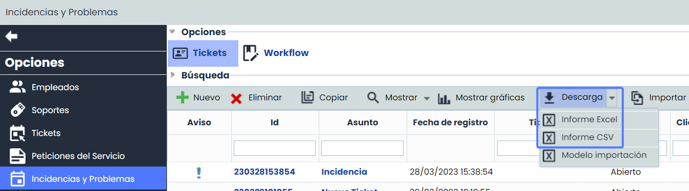

# v6.74 (Agosto 2023)

### Nuevas funcionalidades y mejoras generales de GlobalSuite® GRC

* **Módulo Ticketing**

**Optimización de la generación de los Informes de Tickets**

A partir de ahora será posible descargar los Informes de Tickets en dos formatos: CSV y Excel.

Esta ampliación en las alternativas de descarga brinda a los usuarios la posibilidad de seleccionar la herramienta que mejor se adapte a sus necesidades y capacidades, al mismo tiempo que garantiza una mayor compatibilidad, eficiencia y flexibilidad en el manejo y análisis de los datos de los informes de tickets.

* **Informe Excel:**  Ofrece la posibilidad de descargar los informes en formato Excel asegurando la compatibilidad con diversos sistemas y aplicaciones.
* **Informe CSV:** En caso de que el volumen de datos sea muy extenso, se incluirán todos los registros en un único archivo, en lugar de dividido en varios archivos Excel separados, lo que facilita su consulta posterior.

Este formato CSV es un estándar que permite la explotación y volcado de la información de riesgos en otros sistemas, facilitando la interconexión y explotación de las mismas.

El informe generado estará disponible en el apartado [Descargas Pendientes](https://help.globalsuite.es/display/GlobalSUITEes/.Descargas+Pendientes+vv6.53).

* **Mejoras internas y resolución de errores.**
