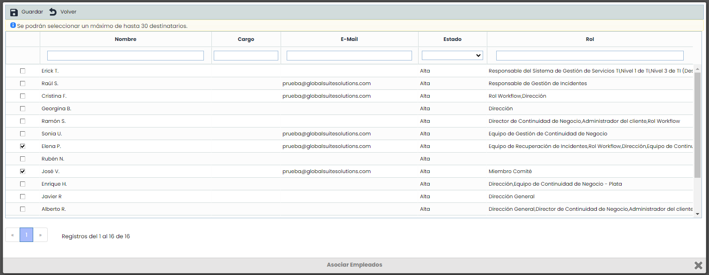
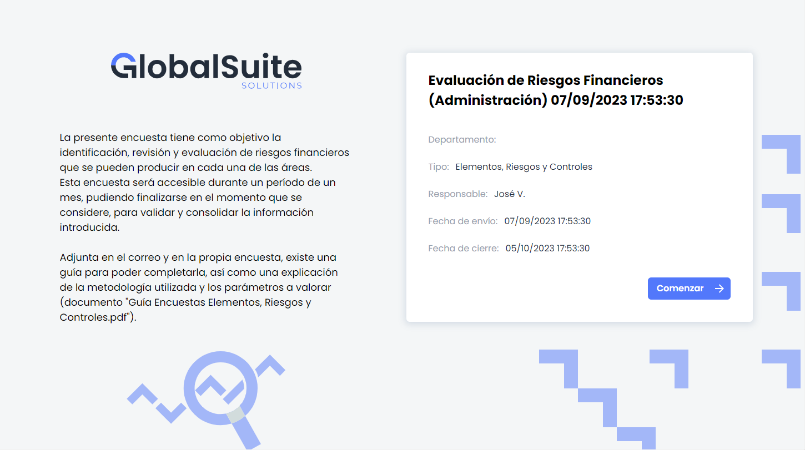

# v6.76 (Septiembre 2023)

### Nuevas funcionalidades y mejoras generales de GlobalSuite® GRC

* **Automatización de lanzamiento periódico de encuestas Elementos - Riesgos - Controles**

En esta versión, se ha incorporado en el módulo de encuestas de GlobalSuite® una nueva funcionalidad que permite programar la creación y lanzamiento de encuestas de Elementos, Riesgos y Controles de forma periódica. Como principales características:

 - Se podrá planificar el envío para que se haga a través de una publicación (de forma anónima mediante de un link único) o internamente, para lo cual el destinatario necesitará un usuario con privilegios para poder completar la encuesta.

 - Las encuestas se lanzarán en función de la frecuencia programada, pudiendo ser Mensual, Trimestral, Semestral o Anual

 - Este lanzamiento automático es compatible con la creación de encuestas de forma manual, ya que la próxima fecha de envío se obtiene a partir de la última encuesta lanzada.

Esta funcionalidad facilita la gestión de los procesos de reevaluación de riesgos, revisión de controles o el aporte periódico de evidencias, automatizando el flujo de creación y lanzamiento de encuestas a los destinatarios definidos en la configuración.

Podrá planificar todas sus evaluaciones de riesgos y controles con una frecuencia definida y automáticamente se notificará al responsable. Permitirá ahorrar tiempo en procesos repetitivos para poder centrarse en la supervisión y en la mejora continua.

**Configuración de Encuestas**

En el apartado de configuración de una encuesta ERC, se ha incorporado la posibilidad de activar el lanzamiento periódico de encuestas, pudiendo elegir la frecuencia de envío.

Estas encuestas se lanzarán tomando como referencia la fecha inicial establecida manualmente (si no existen encuestas previas) o la fecha de la última encuesta creada a partir de esa configuración. De esta forma, las encuestas se lanzarán siempre con el mismo intervalo de tiempo respecto a las anteriores.

**Publicación de Encuestas**

La publicación de encuestas se realizará de forma automática, manteniendo el campo Comentarios definido en la configuración, para poder incluir instrucciones o guías para completar la encuesta.

Si se establece un responsable para la configuración de encuestas, este mismo responsable se añadirá como responsable de la publicación, pudiendo hacer seguimiento de las encuestas lanzadas automáticamente, ampliar plazos, revisarlas y consolidarlas con los datos definitivos.

**Destinatarios predefinidos sin necesidad de Estados**

Si no se desean utilizar estados o un workflow para la gestión de la encuesta, a partir de ahora se podrán definir en la Configuración de Encuestas quiénes serán los destinatarios de cada encuesta, pudiendo dejarlos predefinidos en la configuración, sin necesidad de asignarlos manualmente en cada encuesta creada.

Estos destinatarios se utilizarán para la creación automática de encuestas periódicas, pero también se asignarán directamente cuando se creen encuestas de forma manual, por lo que no es necesario.

Lo mismo sucede con el campo Comentarios de la configuración, que estará disponible para las encuestas internas que reciben los usuarios de GlobalSuite®. Este campo estaba disponible únicamente para la publicación de encuestas anónimas, pero ahora se puede utilizar para encuestas de todo tipo, para agregar aclaraciones o instrucciones a los encuestados.

