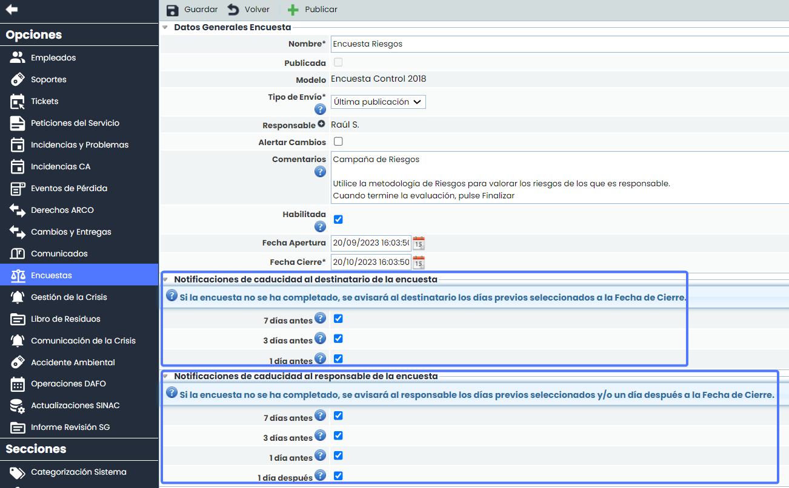
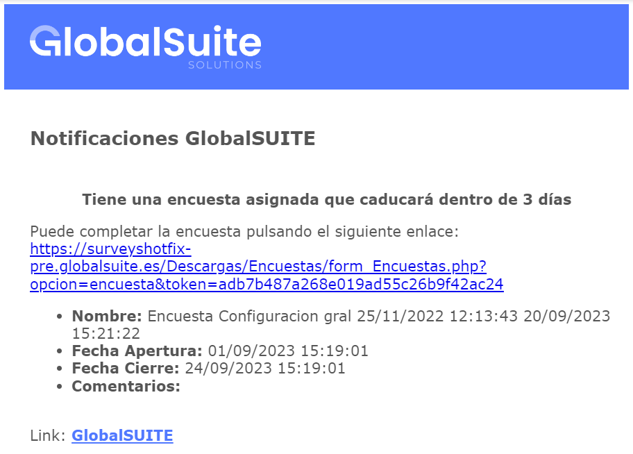
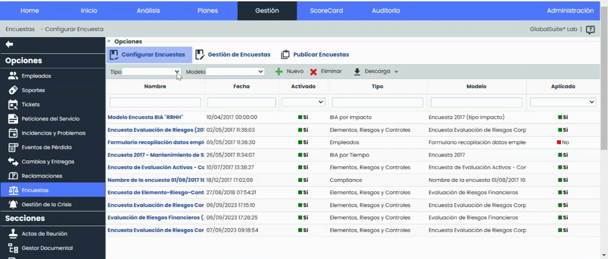
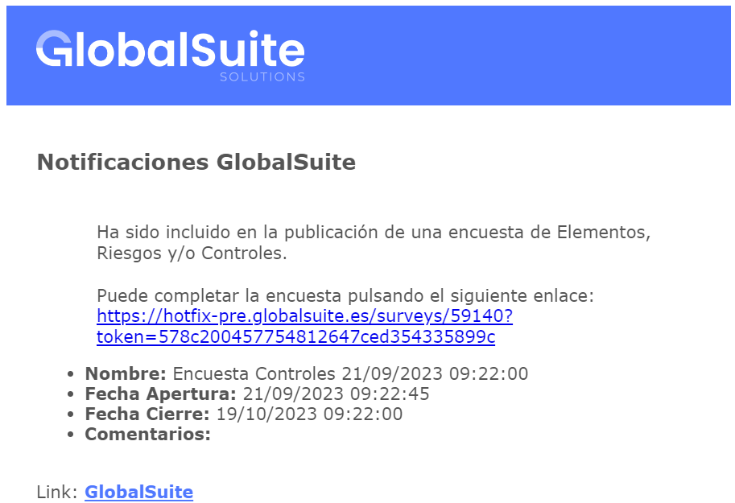

# v6.77 (Septiembre 2023)

### Nuevas funcionalidades y mejoras generales de GlobalSuite® GRC

* **Automatización de lanzamiento de Notificaciones de Encuestas**

En esta versión, hemos añadido una nueva funcionalidad al módulo de encuestas de GlobalSuite® que permitirá la automatización del envío de alertas a los responsables de las encuestas y destinatarios para todos los tipos de encuestas.

Esta funcionalidad facilitará el seguimiento y permitirá ser más eficientes y versátiles en la gestión de las encuestas y brindará un mayor control y automatización en todo el proceso.

* **Notificaciones de Caducidad de encuesta**

A partir de ahora, para los envíos de tipo externo, sin necesidad de tener usuario para acceder a la encuesta, será posible enviar notificaciones a los responsables y a los destinatarios de las encuestas próximas a finalizar que aún no se han completado,  así como de las que estén finalizadas y sin completar. Las nuevas funcionalidades son:

* Envío de notificaciones al responsable de las encuestas para avisar de una fecha de cierre próxima facilitando el seguimiento de todas las encuestas de las que es responsable.
* Envío de notificaciones al responsable de las encuestas que estén finalizadas y sin completar.
* Envío de notificaciones a destinatarios, que son los responsables de contestar la encuesta, de las encuestas próximas a finalizar que aún no se han completado. De este modo, se avisará varias veces de la fecha de cierre.
* Se calcularán a partir de la fecha de cierre de las encuestas.
* Posibilidad de elegir el plazo para notificar la caducidad próxima de la encuesta.

* **Notificación al destinatario**

* **Notificación al Responsable**

* **Notificación de Encuesta asignada al Destinatario**

Estas notificaciones se podrán configurar en el apartado de Encuestas - Configuración de Encuestas. Las características principales son:

* Se podrán configurar tanto para encuestas internas como externas.
* Son configurables a partir de la fecha de lanzamiento de la encuesta.
* Posibilidad de elegir la periodicidad del envío y;
* el tiempo durante el cual estará activa la notificación.
* Se enviarán siempre que la encuesta no se encuentre finalizada.

* **Mejoras internas y resolución de errores.**
