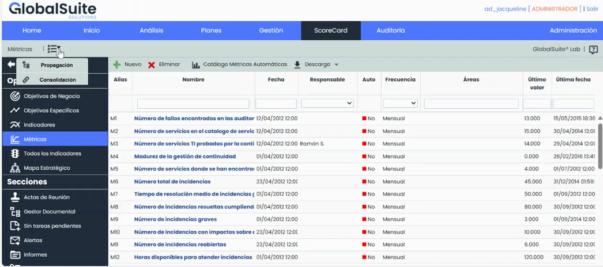
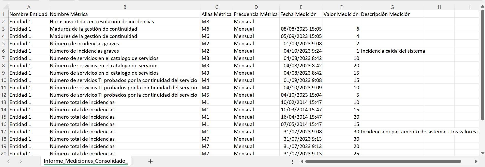
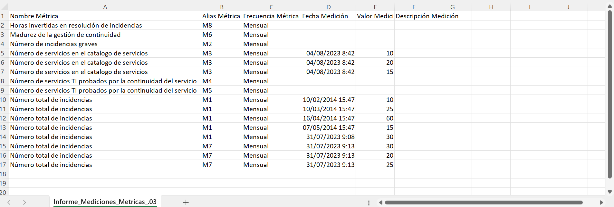

# v6.78 (Octubre 2023)

## GlobalSuite® Balanced ScoreCard

### Nuevos Informes de Mediciones de Métricas

A partir de ahora será posible descargar informes que contienen información completa sobre las métricas y sus valoraciones.

Esta nueva funcionalidad ofrece la capacidad de generar informes de métricas que se ajusten a necesidades específicas, ya sea consolidando mediciones de entidades inferiores en un único Informe, o proporcionando información detallada sobre una entidad en particular.

Esto mejora la capacidad de explotación de los datos, la toma de decisiones y facilita el seguimiento.

#### Informe de Métricas Consolidado

* Este informe es útil cuando se utiliza la opción de "Subentidades" y se desean consolidar las mediciones de métricas de todas las entidades inferiores en un mismo Informe.
* Proporciona una visión general de todas las mediciones de métricas de las entidades inferiores y las consolida en un solo informe.
* Permite ver qué métricas se encuentran valoradas y cuáles están sin valorar.
* Posibilidad de elegir que entidades se incluirán en el informe.
* El Informe se descargará en formato CSV y estará disponible en [Descargas Pendientes](https://help.globalsuite.es/display/GlobalSUITEes/.Descargas+Pendientes+vv6.53).

#### Informe de Métricas Individual

* Este informe es adecuado cuando no se utiliza la opción de "Subentidades" o cuando no existen entidades inferiores en la configuración.
* Contiene información solo sobre la entidad en la que el usuario está posicionado, sin incluir mediciones de métricas de otras entidades.
* Es útil para usuarios que solo desean información específica de su entidad sin la necesidad de consolidación.
* Permite ver qué métricas se encuentran valoradas y cuáles están sin de valorar.
* El Informe se descargará en formato CSV y estará disponible en [Descargas Pendientes](https://help.globalsuite.es/display/GlobalSUITEes/.Descargas+Pendientes+vv6.53).

* **Mejoras internas y resolución de errores.**
