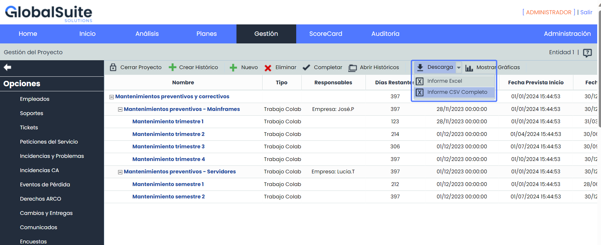
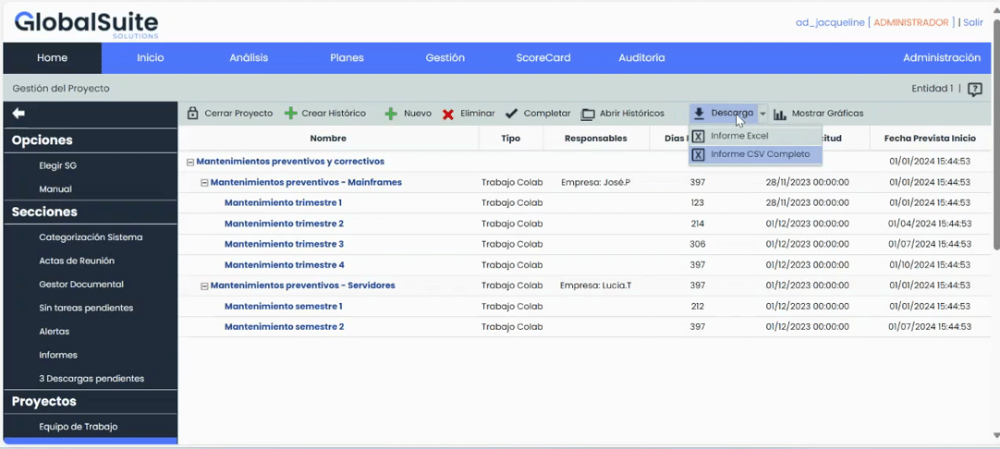
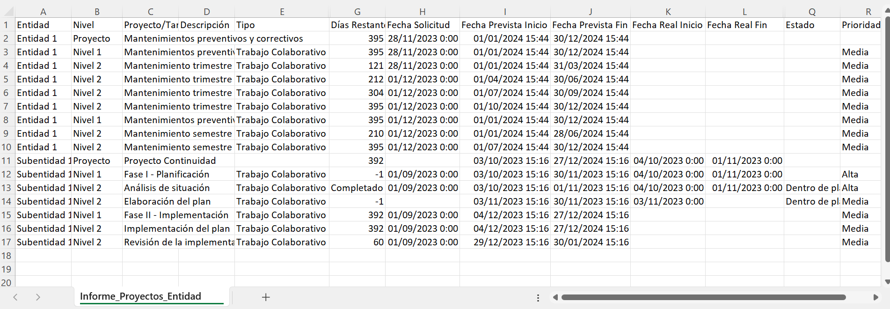
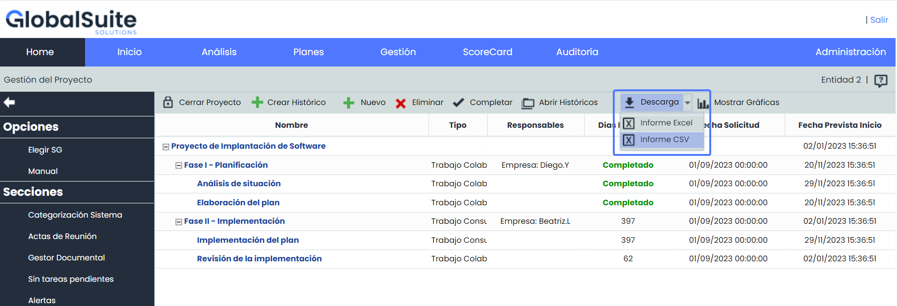
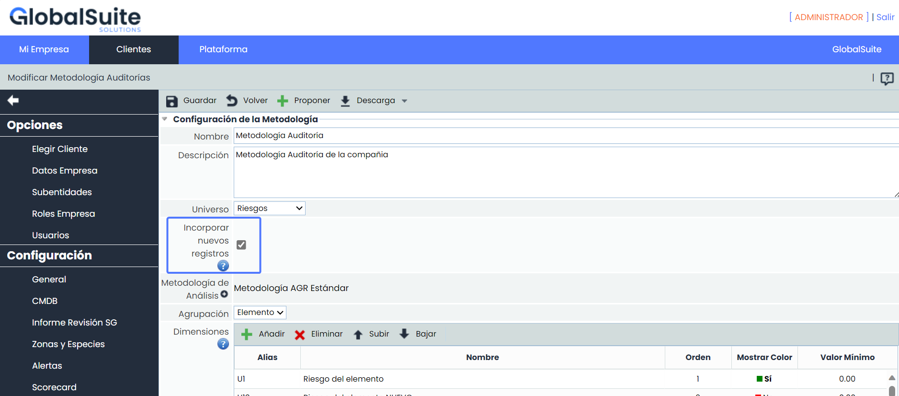
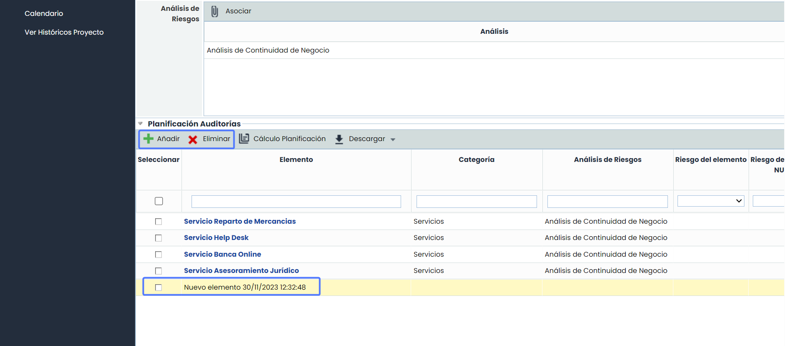
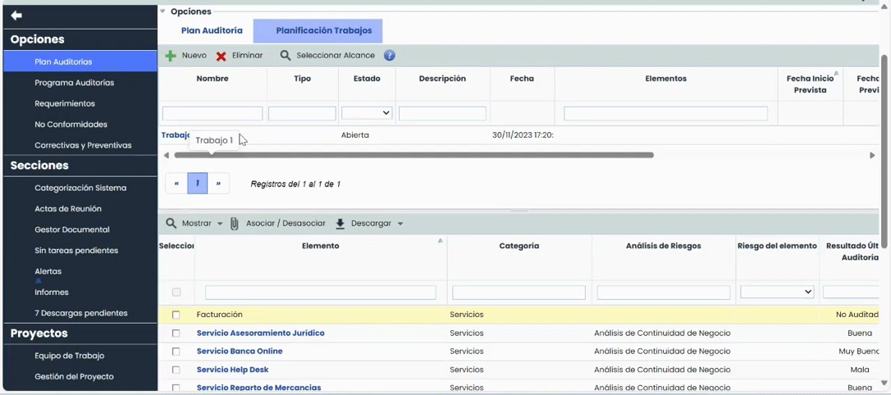
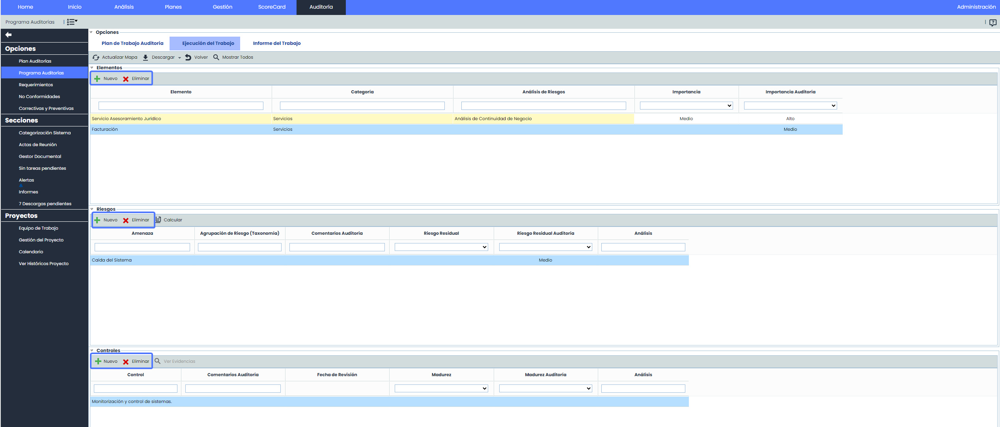

# v6.82 (Diciembre 2023)

## Nuevas funcionalidades y mejoras generales de GlobalSuite® GRC

### Nuevos Informes de Gestión de Proyectos

A partir de ahora será posible descargar informes que contienen información completa sobre la gestión y avance en la implantación de un proyecto determinado.

Esta nueva funcionalidad ofrece la capacidad de generar informes de Proyectos que se ajusten a necesidades específicas, ya sea consolidando la información entidades inferiores en un único Informe, o proporcionando información detallada sobre una entidad en particular.

Además se añade un nuevo campo “Nivel” que indica el nivel de cada tarea, lo que facilitará la explotación

Esto mejora la capacidad de explotación de los datos, la toma de decisiones y facilita el seguimiento y la gestión.

#### Informe de Proyectos Consolidado

* Este informe es útil cuando se utiliza la opción de "Subentidades" y se desea consolidar la información de algunas o todas las entidades inferiores en un mismo Informe.
* Permite descargar el estado del proyecto del sistema de gestión actual con toda su información.
* Las tareas se organizan en niveles dentro del informe para facilitar su posterior explotación.
* Proporciona una visión general de todos los proyectos de las entidades inferiores y los consolida en un único informe.
* Posibilidad de elegir que entidades se incluirán en el informe.
* El Informe se descargará en formato CSV y estará disponible en [Descargas Pendientes](https://help.globalsuitesolutions.com/es/globalsuite/v1/descargas-pendientes).

#### Informe de Proyectos Individual

* Este informe es adecuado cuando no se utiliza la opción de "Subentidades" o cuando no existen entidades inferiores en la configuración, aunque estará disponible para todos los usuarios, independientemente del uso o no subentidades.
* Permite descargar el estado del proyecto del sistema de gestión actual con toda su información.
* Las tareas se organizan en niveles dentro del informe para facilitar su posterior explotación.
* El Informe se descargará en formato CSV y estará disponible en [Descargas Pendientes](https://help.globalsuitesolutions.com/es/globalsuite/v1/descargas-pendientes).

## Nuevas funcionalidades y mejoras GlobalSuite® Audit Management

### Incluir nuevos registros en auditorías

Esta última actualización introduce una funcionalidad clave que está diseñada para proporcionar un control aún mayor sobre la planificación y ejecución de auditorías, permitiendo la incorporación de nuevos registros de elementos, riesgos y controles, incluso si no están dentro de un análisis de riesgos existente en la Auditoría.

Estas nuevas funcionalidades y mejoras no solo ofrecen una mayor flexibilidad y adaptabilidad en la gestión de auditorías, sino que también proporcionan una experiencia más eficiente y completa para los usuarios.

#### Principales características

* **Flexibilidad en la Planificación y Ejecución**: la capacidad de agregar nuevos registros proporciona flexibilidad adicional en la planificación y ejecución de auditorías, permitiendo la adaptación dinámica a los requisitos cambiantes.
* **Asociación de Categorías**: los nuevos registros podrán ser asociados a categorías, al igual que aquellos que provienen de un Análisis de Riesgos. Esto proporciona una estructura organizativa y facilita la identificación y clasificación de los mismos dentro de la Auditoría.
* **Valoración de Dimensiones**: los elementos son completamente adaptables a las dimensiones de la metodología. Pueden ser valorados de acuerdo con las especificaciones de las dimensiones pertinentes, permitiendo una evaluación más precisa y detallada durante la planificación y ejecución de auditorías.
* **Propagación de Elementos y Valoraciones**: Introducimos la capacidad de propagar estos elementos, sus valoraciones y la categoría que tengan asociada.
* **Identificación visual:** los nuevos elementos se destacan visualmente con un fondo de color amarillo durante el proceso de planificación. Esta diferenciación facilita la identificación rápida y sencilla de los elementos nuevos en comparación con los existentes, mejorando la eficiencia en la gestión.
* **Inclusión en Informes**: los nuevos registros y sus valoraciones se incorporan automáticamente a todos los informes generados desde el módulo de auditoría.
* **Integración en Cuadros de Mando:** los nuevos registros se incluyen en todos los cuadros de mando existentes la opción Programas de Auditorías.

#### Configuración

La habilitación de esta funcionalidad se realiza desde Administración > Metodologías > [Auditorías](https://help.globalsuitesolutions.com/es/globalsuite/v1/metodologias-auditorias)

#### Planificación Auditoría

Una vez seleccionada la opción, se activarán los botones "Añadir" y "Eliminar" para facilitar la inclusión de nuevos elementos en el plan de auditoría.

#### Planificación de Trabajos

Estos elementos podrán asignarse a los trabajos de auditoría mediante el mismo procedimiento utilizado para aquellos que provienen de un análisis de riesgo.

#### Ejecución del trabajo

En esta fase, además de agregar nuevos elementos, es posible añadir nuevos riesgos y controles en las tablas correspondientes.

#### Mejoras internas y resolución de errores.
