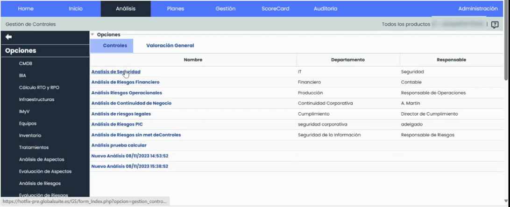
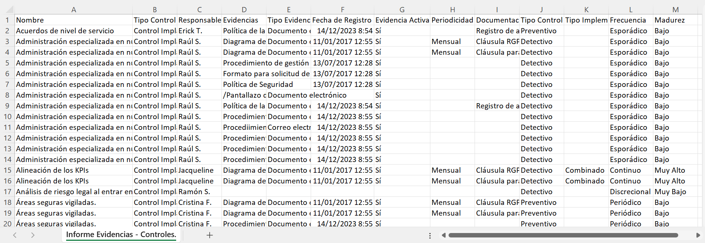
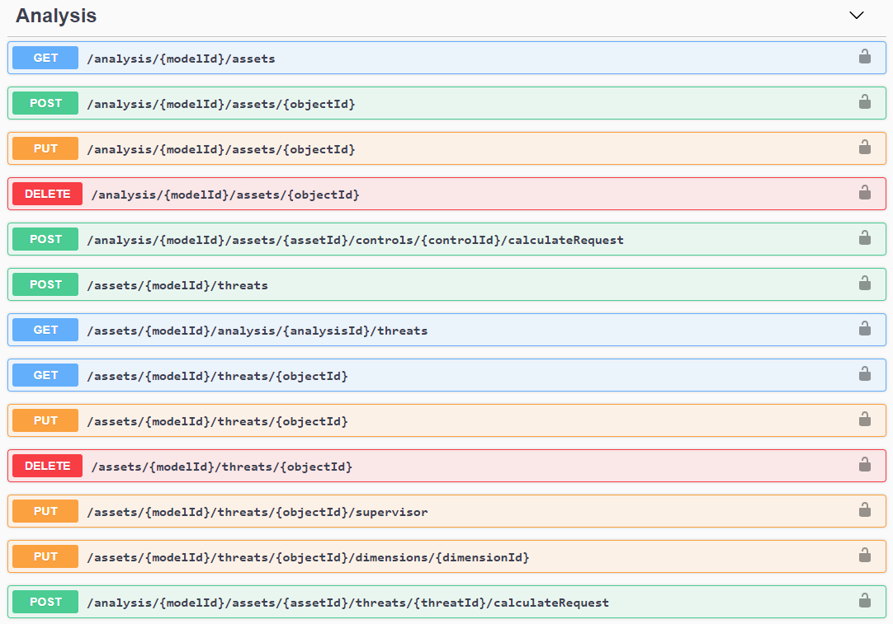

# v6.83 (Diciembre 2023)

## Nuevas funcionalidades y mejoras generales de GlobalSuite® GRC

### Nueva Vista Evidencias-Controles

Esta nueva vista mejora la experiencia de los usuarios al facilitar la visualización y gestión de las evidencias relacionadas con los controles, en la sección de [Gestión de Controles](https://help.globalsuitesolutions.com/es/globalsuite/v1/gestion-de-controles) > Listado de Controles-Acciones

Esta funcionalidad, proporciona una vista consolidada que muestra de manera clara y accesible las evidencias asociadas a cada control, sin necesidad de ingresar al detalle de cada control. De esta manera, los usuarios pueden obtener rápidamente una visión general de las evidencias disponibles sin tener que realizar múltiples accesos individuales.

Esta mejora no solo ahorra tiempo al usuario al evitar la necesidad de revisar cada control de forma separada, sino que también brinda una mayor transparencia y eficiencia en la gestión de controles al permitir una identificación más rápida de aquellos que tienen evidencias asociadas.

#### Principales características

* **Visión Consolidada**

  * Permite visualizar fácilmente qué controles tienen evidencias asociadas, y cuales no, desde la tabla principal.
  * Visualización de evidencias sin necesidad de acceder a los detalles de cada control de forma individual.
  * Se visualizarán tanto la información de las evidencias como la correspondiente a los controles y sus dimensiones.
* **Añadir nuevas evidencias**

  * Posibilidad de agregar nuevas evidencias directamente desde la vista Evidencias-Controles, accesible desde la sección de Opciones > Detalles.
* **Descarga de Adjuntos**

  * Será posible descargar directamente desde la vista Evidencias-Controles los documentos adjuntos que estén vinculados a cada evidencia, desde el campo “Documentación”.
* **Descarga de Informe CSV**

  * Se podrá descargar un Informe CSV de la nueva vista Evidencias - Controles.
  * Personalización de los campos incluidos en el informe según las preferencias del usuario.

#### Acceso a la nueva Vista

Para acceder a esta nueva opción se deberá ingresar a [Gestión de Controles](https://help.globalsuitesolutions.com/es/globalsuite/v1/gestion-de-controles), y al ingresar en la vista de Controles/Acciones de un análisis de riesgos, pulsar en Mostrar > Evidencias/Controles.

#### Descarga de Adjuntos

#### Informe CSV

En próximas versiones incorporemos además, posibilidad de generar [Históricos](https://help.globalsuitesolutions.com/es/globalsuite/v1/historicos) a partir de esta vista.

### API de Integración con Análisis de Riesgos

Con el objetivo de seguir ampliando la posibilidad de conectar GlobalSuite® con otros sistemas de información propios o de terceros, automatizar la actualización para que esté siempre al día, o automatizar la extracción de información para su estudio posterior, en esta versión del producto hemos incorporado capacidades para interactuar con el [Análisis de Riesgos](https://help.globalsuitesolutions.com/es/globalsuite/v1/analisis-riesgos) de GlobalSuite®, permitiendo automatizar distintas acciones.

#### Principales características

* Está disponible la consulta y obtención de riesgos de un análisis, con la valoración de dimensiones definida en la [Metodología de Riesgos](https://help.globalsuitesolutions.com/es/globalsuite/v1/metodologia-riesgos) asociada.
* Se pueden crear análisis de riesgos de manera automática, incluyendo en el alcance los elementos que se van a evaluar.
* Es posible crear, modificar y eliminar riesgos y valorar sus dimensiones manuales, pudiendo actualizar utilizando el motor de cálculo de GlobalSuite® las dimensiones automáticas cuando se desee.

Mediante el uso de las APIs, puede integrar GlobalSuite® con el resto de aplicaciones, herramientas o sistemas de su ecosistema corporativo. Por ejemplo:

* Puede automatizar la creación de registros desde otras herramientas.
* Sincronizar información para exportarlos en otra herramienta para su tratamiento.
* Exportar registros para almacenarlos en un repositorio, o lago de datos (EDL).


Puede consultar la API de GlobalSuite® mediante el repositorio de documentación [API GlobalSuite®](https://docs.globalsuitesolutions.com/docs/).


Si quiere comenzar a probar o a utilizar las APIs de GlobalSuite® póngase en contacto con su proveedor.

En próximas versiones iremos incorporando capacidades adicionales para la interacción automática del producto. Si quiere más información sobre las APIs, puede consultarla [aquí](https://help.globalsuitesolutions.com/es/globalsuite/v1/globalsuite-api).

##### Mejoras internas y resolución de errores.
