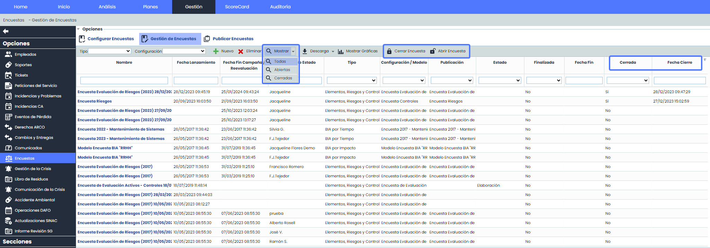
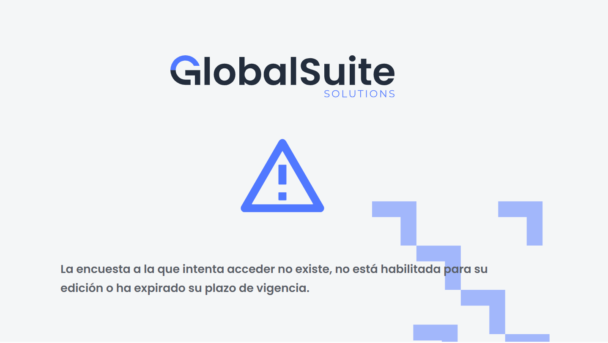
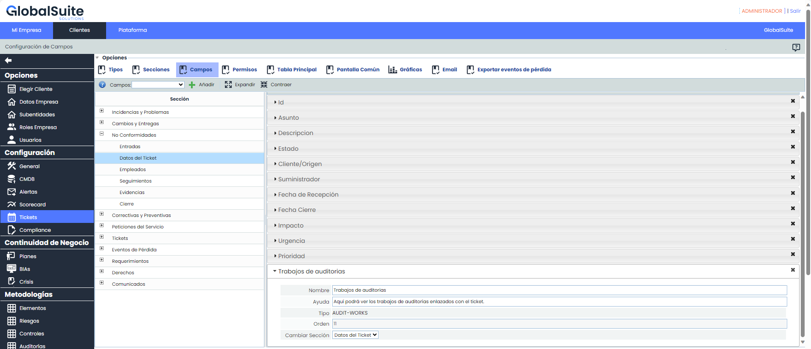
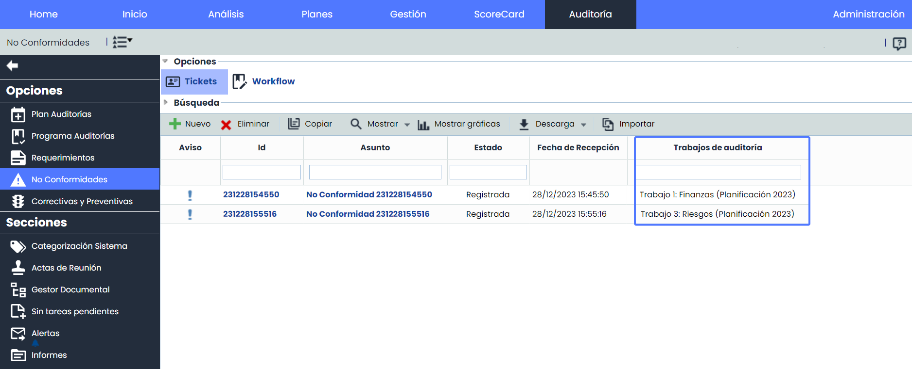
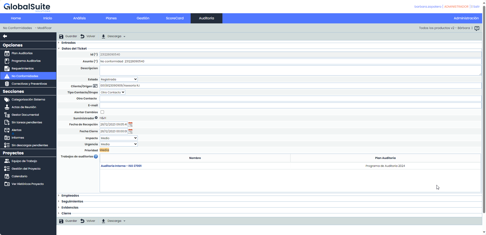

# v6.84 (Enero 2024)

## Nuevas funcionalidades y mejoras generales de GlobalSuite® GRC

### Cerrar y archivar Encuestas

Esta nueva funcionalidad incorpora la capacidad de cerrar encuestas y archivarlas en cualquier momento, según las necesidades de cada usuario.

Al cerrar una encuesta, se evitará cualquier modificación en la información, y la encuesta no aparecerá en el listado principal de forma predeterminada. La interfaz de usuario se ha mejorado con filtros que permiten a los usuarios ver únicamente encuestas abiertas, cerradas o todas.

Estas características ofrecen a los usuarios un mayor control sobre la administración de encuestas, desde el cierre y archivado hasta la visualización personalizada de encuestas activas y cerradas, y la flexibilidad de reabrir encuestas cuando sea necesario.

#### Principales características

* **Cierre de Encuestas:** Los usuarios ahora pueden cerrar encuestas en cualquier momento para evitar modificaciones posteriores por parte de los destinatarios.
* **Archivado Automático**: Al cerrar una encuesta, se archiva automáticamente, proporcionando un registro de las respuestas.
* **Restricciones de Edición:** Una vez cerrada, la encuesta se bloquea para ediciones, garantizando la integridad de los datos recopilados.
* **Visibilidad Personalizada:** Las encuestas cerradas no aparecen en el listado principal de forma predeterminada, simplificando la visualización y organización.
* **Filtrado por Estado:** Se ha añadido un filtro en la interfaz principal de Gestión de Encuestas para alternar entre:

  * Todas las encuestas (abiertas y cerradas).
  * Encuestas abiertas únicamente.
  * Encuestas cerradas para su revisión y análisis.
* **Vista Predeterminada:** La vista principal muestra por defecto solo las encuestas abiertas, mejorando la visualización y la eficiencia en la gestión.
* **Registro en log de auditoría**: se incorpora un detallado log de auditoría que registra las acciones de cerrar y reabrir encuestas, proporcionando transparencia y un historial de cambios.
* **Reapertura de Encuestas:** Existe la posibilidad de reabrir encuestas previamente cerradas, permitiendo realizar ajustes y actualizaciones según sea necesario.
* **Informe Excel:** Se podrá descargar un informe Excel, el cual incluirá los nuevos campos “Cerrada” y “Fecha de Cierre”.

El acceso a estas funcionalidades se realiza desde la opción Gestión > Encuestas > [Gestión Encuestas](https://help.globalsuitesolutions.com/es/globalsuite/v1/gestion-encuestas)

Vista del destinatario al intentar acceder mediante enlace, a una encuesta cerrada.

## Nuevas funcionalidades y mejoras GlobalSuite® Audit Management

### Enlazar Auditoría con Hallazgos y Requerimientos

Esta mejora funcionalidad permite incluir en el formulario de cada uno de los tipos de tickets un nuevo campo para que de ahora en más se puedan ver los trabajos de auditorías enlazados al ticket.

La implementación de un nuevo campo de enlace en cada tipo de ticket facilita la trazabilidad, proporcionando una visión clara y accesible de cómo cada ticket está vinculado a trabajos específicos de auditoría.

#### Principales características

* **Visibilidad:** Se podrá configurar la visibilidad de este nuevo campo entre las siguientes:

  * Formulario. Además contará con un enlace de acceso al trabajo, si se tiene acceso.
  * Pantalla Común, como por ejemplo en Entradas y Salidas.
  * Tabla principal de Tickets, según la opción en la que se haya configurado.
* **Notificaciones:** Este campo se incorpora al envío de las distintas notificaciones de tickets:

  * Asignación de tickets
  * Alerta seguimientos y clientes/contacto
  * Alertas configuradas, de modificación y cierre, las cuales se configuran en Alertas > [Alertas Tickets](https://help.globalsuitesolutions.com/es/globalsuite/v1/alertas-tickets), para cada tipo.
  * Roles y empleados, asignación y cambio de estados para los casos de WF.
* **Informes:** Además se incorpora en los informes de las opciones de ticketing

  * Informe Docx del formulario del ticket.
  * Informe Excel y CSV de la Tabla principal de tickets.

#### Configuración campo AUDIT-WORK

El nuevo campo se llama AUDIT-WORK y se configura de forma similar a los demás campos de un ticket. Se podrá definir el nombre del campo, un texto de ayuda, la sección y el orden en que se mostrará dentro de cada sección.

A la vez, este campo se podrá incluir en la tabla principal, en las pantallas comunes y estará incluido en las Descargas de Informes de los tickets.


El nuevo campo sólo se incluirá en la configuración por defecto en las nuevas empresas o cuando a una empresa existente se le añada una licencia que incluya algún nuevo tipo de ticket. En el resto de los casos, si se quiere añadir el campo debe configurarse en Administración.


#### Consulta de trabajos enlazados a un ticket

Una vez configurado el campo, dentro de cada ticket se mostrara en la tabla principal, según la configuración establecida, donde se listarán los trabajos asociados a dicho ticket.

Nombre: Nombre del trabajo donde esta asociado el ticket. Si el usuario tiene permisos, podrá acceder a través del link al trabajo.

Plan de Auditoria: Muestra el nombre del plan al que pertenece el trabajo.

Además, si se tiene configurado, se mostrará en el formulario del ticket, y se podrá acceder al trabajo mediante el enlace, se se tienen los permisos correspondientes.

##### Mejoras internas y resolución de errores.
