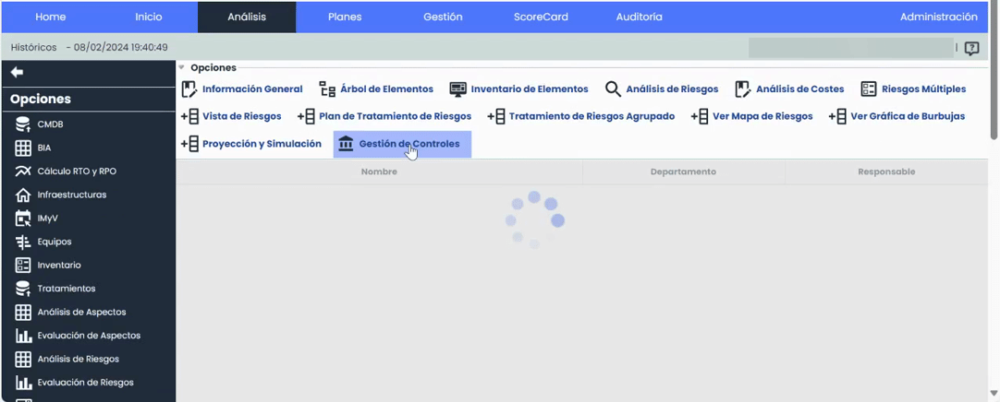
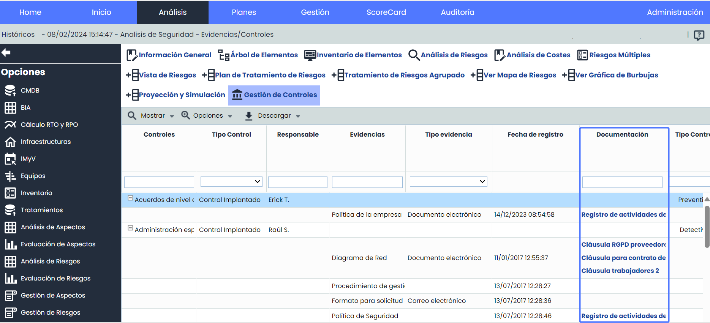
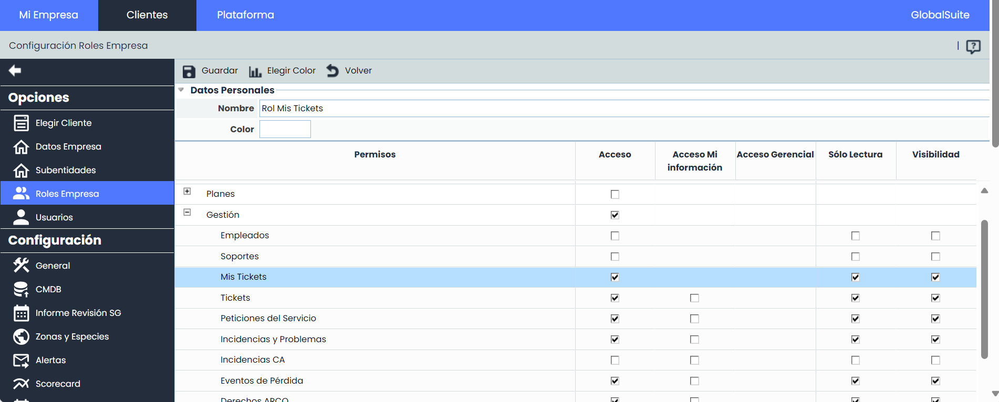
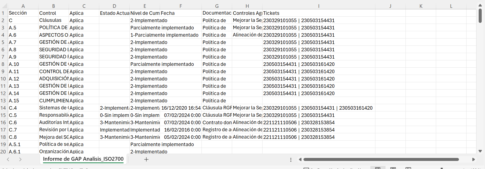
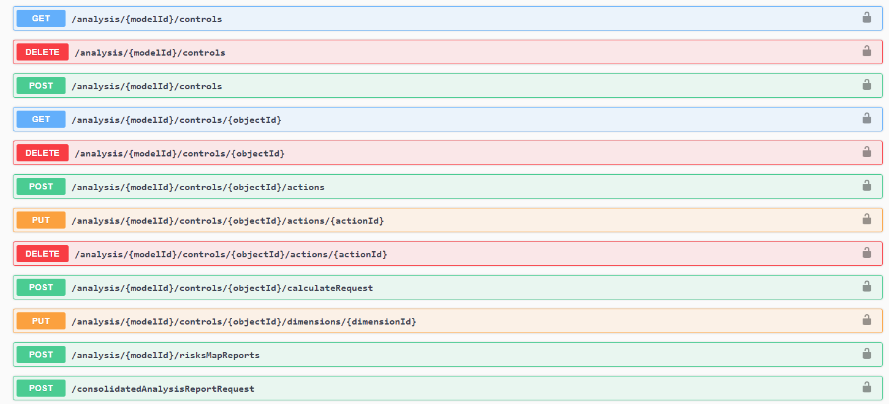

# v6.87 (Febrero 2024)

## Nuevas funcionalidades y mejoras generales de GlobalSuite® GRC

### Nueva Vista Evidencias-Controles Histórico

La reciente mejora en la visualización de evidencias y controles, implementada en Gestión de Controles, ahora se ve complementada con la nueva vista también incorporada en la sección de [Históricos](https://help.globalsuitesolutions.com/es/globalsuite/v1/historicos).

Esta nueva vista mejora la experiencia de los usuarios al facilitar la visualización y gestión de las evidencias relacionadas con los controles de los históricos almacenados.

Esta funcionalidad, proporciona una vista consolidada que muestra de manera clara y accesible las evidencias asociadas a cada control, sin necesidad de ingresar al detalle de cada control. De esta manera, los usuarios pueden obtener rápidamente una visión general de las evidencias sin tener que realizar múltiples accesos individuales.

Esta mejora no solo ahorra tiempo al usuario al evitar la necesidad de revisar cada control de forma separada, sino que también brinda una mayor transparencia y eficiencia en la gestión de controles al permitir una identificación más rápida de aquellos que tienen evidencias asociadas.

#### Principales características

* **Visión Consolidada**

  * Permite visualizar fácilmente qué controles tienen evidencias asociadas, y cuales no, desde la tabla principal.
  * Visualización de evidencias sin necesidad de acceder a los detalles de cada control de forma individual.
  * Se visualizarán tanto la información de las evidencias como la correspondiente a los controles y sus dimensiones.
* **Descarga de Adjuntos**

  * Será posible descargar directamente desde la vista Evidencias-Controles los documentos adjuntos que estén vinculados a cada evidencia, desde el campo “Documentación”.
* **Descarga de Informe CSV**

  * Se podrá descargar un Informe CSV de la nueva vista Evidencias - Controles.
  * Personalización de los campos incluidos en el informe según las preferencias del usuario.

#### Acceso a la nueva Vista

Para acceder a esta nueva opción se deberá ingresar a Análisis > [Históricos](https://help.globalsuitesolutions.com/es/globalsuite/v1/historicos), y al ingresar en la vista de Controles/Acciones de un análisis de riesgos, pulsar en Mostrar > Evidencias/Controles.

#### Descarga de Adjuntos

#### Informe CSV

### Mis tickets Solo Lectura

Esta nueva mejora permite configurar un subrol específico con privilegios de solo lectura en la opción de [Mis tickets](https://help.globalsuitesolutions.com/es/globalsuite/v1/mis-tickets). Esto ofrece la posibilidad de modelar y gestionar de manera más precisa los niveles de acceso de los usuarios en relación con los tickets.

Los administradores podrán asignar el subrol de Solo Lectura a Mis Tickets a usuarios específicos, restringiendo su capacidad para realizar cambios o modificaciones en los tickets desde esta opción.

Estas características proporcionan un control preciso sobre las acciones que los usuarios de solo lectura pueden realizar en la aplicación, asegurando que no realicen modificaciones no autorizadas mientras mantienen acceso a la información relevante para su función.

#### Principales características

**Acceso a la tabla principal:**

* Un usuario con el subrol de solo lectura en "Mis Tickets" no podrá realizar acciones de creación o eliminación de tickets desde la vista principal.
* A pesar de esto, los usuarios de solo lectura podrán acceder mediante un enlace directo al formulario de un ticket.

**Acceso al formulario del ticket:**

Un usuario con el subrol de solo lectura en "Mis Tickets" tendrá restringidas las siguientes acciones:

* Crear nuevos elementos asociados al ticket.
* Eliminar elementos de cualquier tabla asociada al ticket.
* Edición de cualquier campo de las tablas.
* Guardar cambios en el formulario.

**Filtrado, ordenamiento y descarga de tickets:**

Aunque existan limitaciones en la edición, los usuarios de solo lectura podrán seguir filtrando, ordenando y descargando los tickets de los cuales sean propietarios.

Se mantendrá la capacidad de visualizar todos los tickets de cualquier tipo y estado en los que el empleado asociado al usuario sea el propietario.

Configuración

### Nuevos Informes Compliance y Gap Analysis

A partir de ahora será posible descargar informes en formato CSV en la opciones de [Compliance](https://help.globalsuitesolutions.com/es/globalsuite/v1/compliance) y [GAP Analysis](https://help.globalsuitesolutions.com/es/globalsuite/v1/gap-analysis) que contienen información completa sobre los catálogos y toda su información.

Esto mejora la capacidad de explotación de los datos, la toma de decisiones y facilita el seguimiento.

* El Informe se descargará en formato CSV y estará disponible en [Descargas Pendientes](https://help.globalsuite.es/display/GlobalSUITEes/.Descargas+Pendientes+vv6.53).

### API de Integración con Controles y Evidencias

Con el objetivo de seguir ampliando la posibilidad de conectar GlobalSuite® con otros sistemas de información propios o de terceros, automatizar la actualización para que esté siempre al día, o automatizar la extracción de información para su estudio posterior, en esta versión del producto hemos incorporado capacidades para interactuar con los [Controles](https://help.globalsuitesolutions.com/es/globalsuite/v1/gestion-de-controles) del [Análisis de Riesgos](https://help.globalsuitesolutions.com/es/globalsuite/v1/analisis-riesgos) de GlobalSuite®, así como las [Evidencias](https://help.globalsuitesolutions.com/es/globalsuite/v1/gestion-de-evidencias) asociadas a los mismos, permitiendo automatizar distintas acciones. Esto amplía las APIs de Riesgos que se liberaron en la [versión v6.83](https://changelog.globalsuitesolutions.com/changelog/v-6-83-diciembre-2023#v6.83(Diciembre2023)-APIdeIntegraci%C3%B3nconAn%C3%A1lisisdeRiesgos) de GlobalSuite (diciembre 2023).

#### Principales características

* Está disponible la consulta y obtención de controles de un análisis, con la valoración de dimensiones definida en la [Metodología de Controles](https://help.globalsuitesolutions.com/es/globalsuite/v1/metodologias-controles) asociada.
* Es posible crear, modificar y eliminar controles así como sus acciones, además de valorar sus dimensiones manuales, pudiendo actualizar utilizando el motor de cálculo de GlobalSuite® las dimensiones automáticas cuando se desee.
* También es posible añadir evidencias y asociarlas a esos controles para monitorizar su eficacia, además de aportar nuevos archivos para dejar traza de los mismos.

Mediante el uso de las APIs, puede integrar GlobalSuite® con el resto de aplicaciones, herramientas o sistemas de su ecosistema corporativo. Por ejemplo:

* Puede automatizar la creación de registros desde otras herramientas.
* Sincronizar información para exportarlos en otra herramienta para su tratamiento.
* Exportar registros para almacenarlos en un repositorio, o lago de datos (EDL).


Puede consultar la API de GlobalSuite® mediante el repositorio de documentación [API GlobalSuite®](https://demo-eu.globalsuitesolutions.com/docs/).


Si quiere comenzar a probar o a utilizar las APIs de GlobalSuite® póngase en contacto con su proveedor.

En próximas versiones iremos incorporando capacidades adicionales para la interacción automática del producto. Si quiere más información sobre las APIs, puede consultarla [aquí](https://help.globalsuitesolutions.com/es/globalsuite/v1/globalsuite-api).
