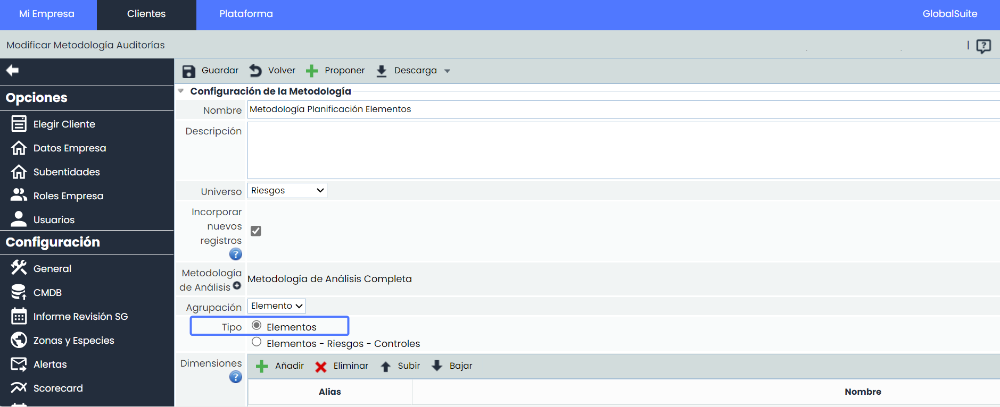
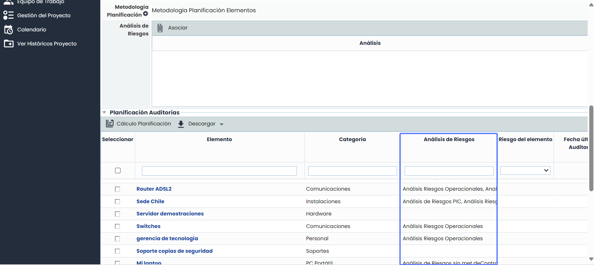
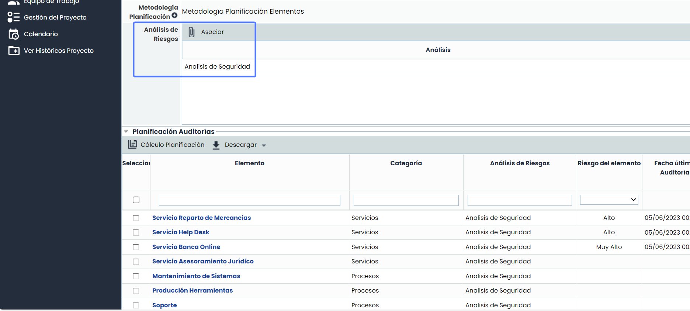
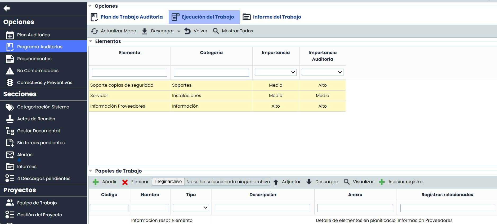

# v6.88 (Febrero 2024)

## Nuevas funcionalidades y mejoras GlobalSuite® Audit Management

### Auditorías de Elementos


Esta nueva funcionalidad amplía la versatilidad de las Auditorías disponibles, permitiendo a los usuarios definir el alcance de las mismas de forma más precisa. En esta oportunidad incorporando el tipo de Auditoría de elementos.
A partir de ahora, será posible especificar el alcance de las auditorías específicamente de tipo Elementos, independientemente de que éstos estén incluidos o no en un análisis de riesgos.


#### Principales Características

* **Ampliación del Alcance**: a partir de ahora, será posible definir con mayor precisión el alcance de las auditorías. Además de las auditorías de elementos-riesgos-controles, se podrán realizar auditorías exclusivamente de elementos.
* **Mayor Flexibilidad**: se podrán realizar auditorías de elementos del inventario sin estar limitados por la dependencia de un análisis de riesgos. Esto simplifica el proceso y permite una evaluación más directa y focalizada de los elementos de interés.
* **Adaptación de Informes:** los informes han sido adaptados para incluir únicamente la información relevante para este tipo de auditorías.
* **Combinación con funcionalidad** [Incorporar nuevos Registros](https://changelog.globalsuitesolutions.com/changelog/v6-82-diciembre-2023#v6.82(Diciembre2023)-NuevasfuncionalidadesymejorasGlobalSuite%C2%AEAuditManagement): será posible combinar ambas funcionalidades para una gestión más completa y eficiente, permitiendo añadir nuevos elementos durante el proceso de auditoría.

**Configuración**

Administración > Metodologías > [Auditorías](https://help.globalsuitesolutions.com/es/globalsuite/v1/metodologias-auditorias)

**Plan Auditoría**

En la tabla de planificación auditorías, se cargarán por defecto, todos los elementos del Inventario, estén incluidos o no en un análisis de riesgos.

En caso de que se desee definir el alcance específicamente a los elementos incluidos en uno o más Análisis de riesgos, se podrán seleccionar desde la opción “Asociar”. Esta acción dinámica reemplazará los elementos cargados por defecto en la tabla de planificación con los elementos asociados a los análisis de riesgos seleccionados.

**Ejecución de Auditoría e Informe del trabajo**

Durante la fase de ejecución de auditorías y en la generación del informe del trabajo, hemos adoptado un enfoque específico que destaca la tabla de Elementos como componente central. Esta elección se alinea con el alcance específico de las auditorías de elementos.

