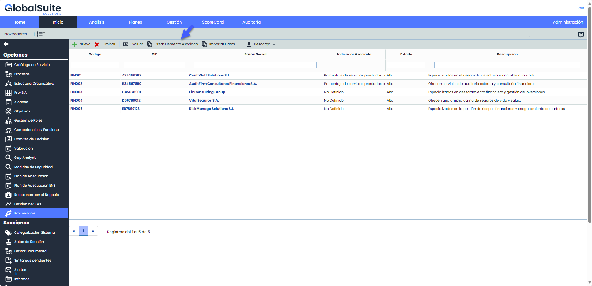
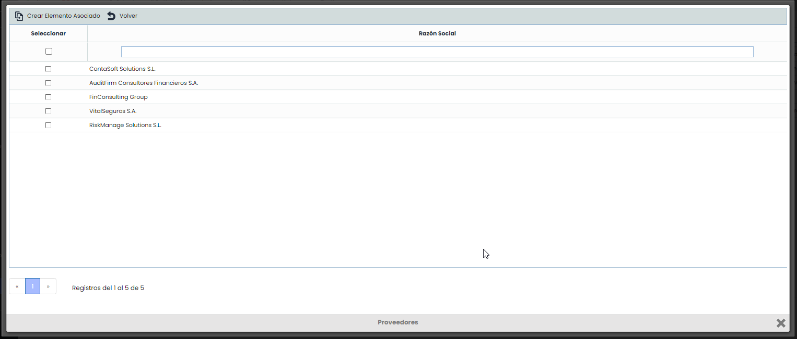

# v6.89 (Marzo 2024)

## Nuevas funcionalidades y mejoras generales de GlobalSuite® GRC

### Proveedores - Crear elementos relacionados de forma masiva

Actualmente para crear elementos asociados a un proveedor hay que hacerlo de manera individual, ingresando a cada uno.

Con el objetivo de simplificar y agilizar este proceso de creación elementos se añadió la opción de hacerlo de forma masiva.

Para esta mejora, se ha desarrollado un modal en donde se listan los proveedores que no tengan previamente un elemento asociado.

En el modal se puede seleccionar uno, varios o todos los proveedores a la vez. Además, se permiten mostrar, ocultar, filtrar y ordenar los campos de la tabla.


Nota: Una vez incorporados al inventario, los cambios que se hagan desde la ficha/formulario del proveedor (por ejemplo, renombrarlo, evaluarlo, etc.) se verán reflejados en el inventario de forma automática igual que hasta ahora


## Nuevas funcionalidades y mejoras generales de GlobalSuite® Risk

### Eventos de Perdida - Adaptación del campo monto en la exportación txt.

Se ha ampliado el límite del campo 'monto' de 10 a 15 dígitos en la exportación de eventos de pérdida en formato txt como parte del proceso de gestión e información de riegos operacional.

Esta modificación se lleva a cabo para adaptar GlobalSuite a los requisitos establecidos conforme a la comunicación A 7971 [Aplicación de "Envío de Comunicaciones y Comunicados"](https://www.bcra.gob.ar/Pdfs/comytexord/A7971.pdf), emitida por la entidad reguladora (<https://bcra.gob.ar/>).
