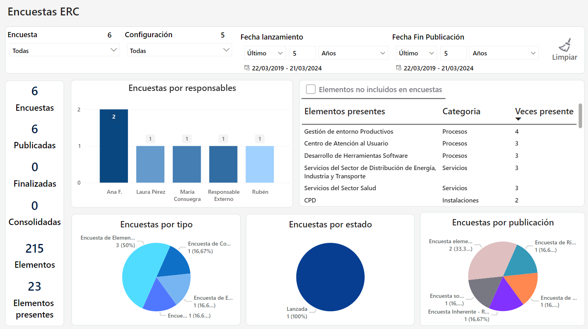
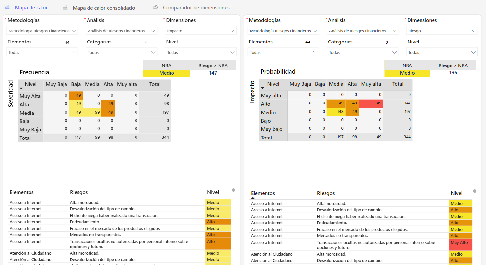
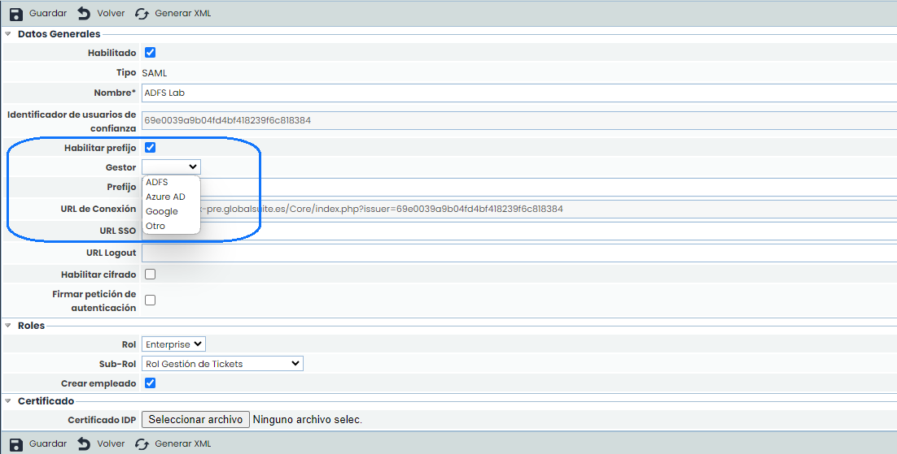
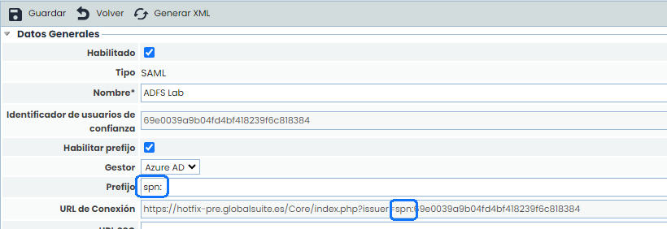

# v6.90 (Marzo 2024)

## Nuevo Módulo Business Intelligence

### Cuadros de mando avanzados con información clave

Hemos incorporado un módulo de análisis empresarial que permite integrar las capacidades de visualización y ayuda a la toma de decisiones directamente en GlobalSuite®.

Se podrá integrar informes interactivos, gráficas y tablas dentro de la solución.

Esto permitirá a los usuarios ver y explorar sus datos, así como monitorizar y evaluar fácilmente la efectividad de los sistemas.

Se obtienen informes sin esfuerzo para un reporting a dirección más visual, con una mayor eficacia y efectividad en la demostración de los datos de su sistema.

Además, cuenta con **seguridad integrada** al contar con las políticas de acceso y control de nuestra plataforma.

#### Beneficios principales

* **Mejora de la Toma de Decisiones**: Facilita a los usuarios el acceso a informes y análisis directamente relacionados con sus procesos, optimizando la toma de decisiones.
* **Interactividad de los Datos**: Permite explorar datos de manera interactiva, filtrar información y realizar análisis detallados directamente desde GlobalSuite, brindando una experiencia inmersiva y personalizada.
* **Optimización de Procesos**: Agiliza la identificación de tendencias y patrones dentro de los datos, mejorando la eficiencia operativa en todos los niveles.
* **Datos en tiempo real**: Posibilidad de obtener datos en tiempo real, brindando información siempre actualizada para decisiones más precisas y oportunas.
* **Agregación de la Información**: Facilita la agregación de datos desde diversas fuentes, permitiendo una vista holística y consolidada de la información.
* **Análisis Inmersivo**: Ofrece a los usuarios la capacidad de explorar y analizar datos directamente dentro de la aplicación mejorando la eficiencia y agilizando la toma de decisiones.
* **Adaptable a cada Cliente**: Flexibilidad para adaptarse a las metodologías, configuraciones y flujos de trabajo únicos de cada cliente.
* **Visualizaciones Dinámicas:** Proporciona una amplia gama de gráficos y representaciones visuales para adecuarse a necesidades específicas de cada negocio.

#### Cuadros de Mando

Actualmente a través de nuestra solución se puede contar con diferentes dashboards predefinidos.

* Análisis de Riesgos.
* Encuestas.
* Gestor Documental.
* Evaluación de Riesgos.
* Compliance.
* Encuestas ERC.
* BIAs.


También existe la opción de disponer de \*\*dashboards personalizados\*\* con orígenes de datos adicionales y que no solo provengan de GlobalSuite® pudiendo cruzar información de distintas fuentes y potenciando los resultados obtenidos.
Puede solicitar información adicional al respecto escribiendo a [comercial@globalsuitesolutions.com](mailto:comercial@globalsuitesolutions.com)


##### Análisis de Riesgos.

En el núcleo de una gestión eficaz, el Análisis de Riesgos emerge como una herramienta clave, ofreciéndonos una visión completa y dinámica de los desafíos que enfrenta nuestra organización.

##### [Más Información](https://help.globalsuitesolutions.com/es/globalsuite/v1/tablero-analisis-de-riesgos)

##### Encuestas

Tipología de encuestas: Visualiza la distribución de encuestas generadas, categorizadas por tipo (BIAS, Compliance, RRHH Críticos, Elementos, riesgos y controles), permitiendo identificar focos de atención y áreas de mejora.

##### [Más Información](https://help.globalsuitesolutions.com/es/globalsuite/v1/tablero-encuestas)

##### Gestor Documental

Este cuadro de mando transforma la forma en que se gestionan los documentos, proporcionando visibilidad, control y eficiencia en la administración documental, y apoyando la toma de decisiones estratégicas para la mejora continua del sistema.

##### [Más Información](https://help.globalsuitesolutions.com/es/globalsuite/v1/tablero-gestor-documental)

##### BIAs

Herramienta indispensable para los responsables de la continuidad del negocio y la gestión de riesgos para priorizar acciones y fortalecer la resiliencia organizacional frente a posibles interrupciones.

##### [Más Información](https://help.globalsuitesolutions.com/es/globalsuite/v1/tablero-bias)

##### Encuestas ERC

Este cuadro de mando mejora la visibilidad y el entendimiento de los elementos, riesgos y controles evaluados a través de las encuestas.

##### [Más Información](https://help.globalsuitesolutions.com/es/globalsuite/v1/tablero-encuestas-erc)

##### Evaluación de Riesgos

Herramienta esencial para los responsables de la gestión de riesgos, proporcionando la información necesaria para tomar decisiones informadas, optimizar la gestión de riesgos y reforzar la estrategia de seguridad corporativa.

##### [Más Información](https://help.globalsuitesolutions.com/es/globalsuite/v1/tablero-evaluacion-de-riesgos)

##### Compliance

Este cuadro de mando no solo optimiza la gestión del cumplimiento normativo, sino que también soporta la toma de decisiones estratégicas, la asignación de recursos y la implementación del ciclo de mejora continua, contribuyendo a un entorno de gestión más seguro y conforme a las normativas vigentes.

##### [Más Información](https://help.globalsuitesolutions.com/es/globalsuite/v1/tablero-compliance)

## Otras mejoras de GlobalSuite® GRC

### Ampliación de autenticación por SAML2 (Single Sign-On)

En esta versión, hemos potenciado la capacidad de conectar GlobalSuite® con otros gestores de identidades que utilicen el protocolo SAML2, sumándose a la conexión que ya teníamos con ADFS, permitiendo a los usuarios una mayor flexibilidad y seguridad en su inicio de sesión en la solución.

Hemos personalizado el conector de SAML para que soporte otros Proveedores de Identidad, como **Azure AD**, **Google**, **OKTA** u otros IdP alojados en la nube.

Además del identificador de usuarios de confianza único que genera GlobalSuite®, es posible establecer un **prefijo personalizado** para dotar la conexión de mayor seguridad y adaptarse a las características particulares de cada fabricante.

De manera de ayuda, al seleccionar un tipo de conexión se proporciona un prefijo por defecto soportado para dicho conector.

Con esta nueva configuración se soportan los mecanismos de autenticación, tanto **IDP initiated** como **SP initiated** Single Sign-On, permitiendo el acceso a usuarios autorizados de forma rápida y sencilla.

##### Cómo Configurar la Autenticación con SAML:

* Para configurar la autenticación de GlobalSuite® con SAML a través de alguno de los proveedores de identidad mencionados anteriormente, puedes ver el manual correspondiente en nuestro [centro de recursos](https://help.globalsuitesolutions.com/es/globalsuite/v1/adfs).
* Si necesitas asistencia o tienes preguntas, no dudes en contactar con nuestro [equipo de soporte](https://help.globalsuitesolutions.com/soporte/).  
  Estamos aquí para ayudarte en cada paso del proceso.
