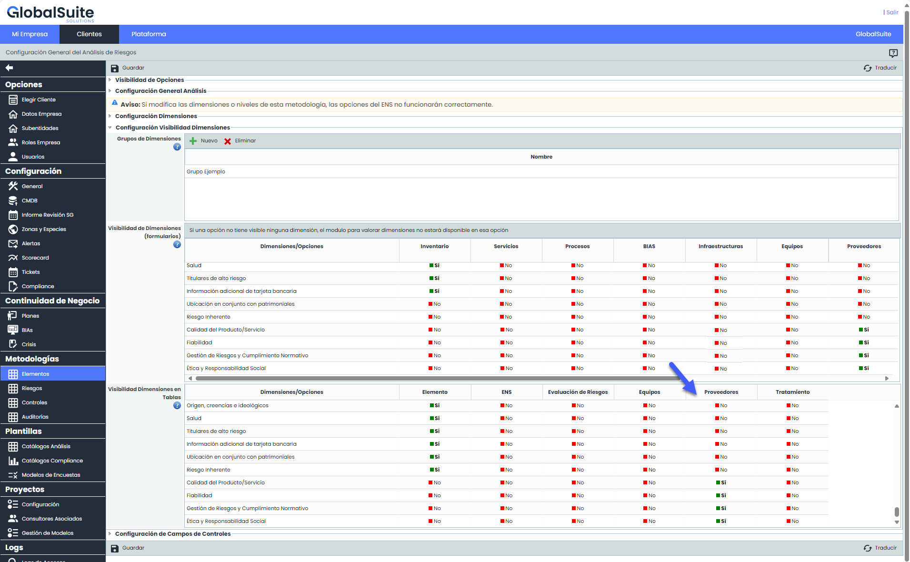
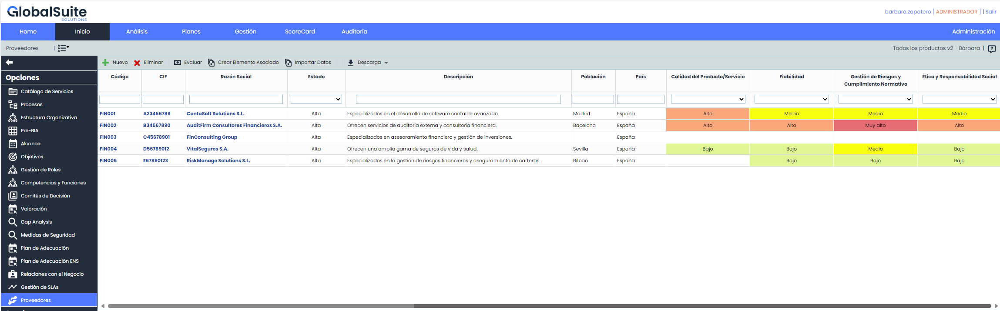
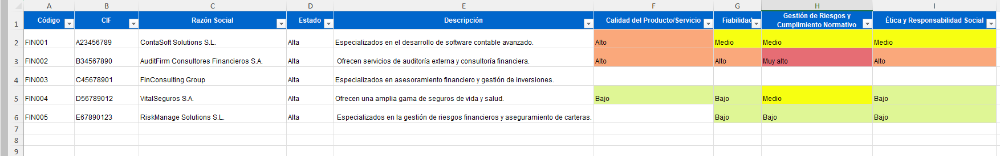

# v6.92. (Abril 2024)

## Nuevas funcionalidades y mejoras generales de GlobalSuite® GRC

Hemos implementado nuevas funcionalidades para el Modulo de Proveedores. A continuación, los detalles de estas mejoras:

### Personalización de la Tabla de Proveedores

Con el objetivo de potenciar el módulo de Proveedores de GlobalSuite, se ha incluido la posibilidad para configurar qué dimensiones se verán en la tabla principal de proveedores.

Estas dimensiones se podrán ver en el listado, filtrar por ellas, descargarlas en un informe para procesarlo luego.

* **Configuración desde Administración**: En Administración > Elementos, hemos incorporado una columna en la tabla "Visibilidad de Dimensiones en Tablas" llamada "Proveedores". Aquí se permite a los usuarios configurar que dimensiones mostrar u ocultar en la tabla principal de proveedores según sus preferencias.

  
* **Vista personalizada de la tabla principal de Proveedores**: Las dimensiones con la configuración de "Visible=SI", se añadirán en la tabla, luego de los atributos de los proveedores.

  

Se mostrarán campos vacíos para aquellos proveedores que no tengan elementos relacionados o que no estén evaluados en las dimensiones visibles en la tabla.

* **Descarga del listado de proveedores:** Se ha actualizado la funcionalidad de Descargar - Informe Excel, que se utiliza para descargar el listado de los proveedores, para que incorpore los campos que se añaden como visibles en la tabla.

Para mas información sobre el modulo de Proveedores, puedes ver el manual correspondiente en nuestro [Centro de recursos](https://help.globalsuitesolutions.com/es/globalsuite/v1/proveedores).
