# v6.96 (Junio 2024)

## Nuevas funcionalidades y mejoras GlobalSuite® Audit Management

En esta versión de GlobalSuite® hemos incorporado dos nuevas funcionalidades para potenciar el módulo de Audit Managemente, orientada a poder facilitar la gestión de los ciclos de auditoría y a adaptar la información de los trabajos de auditoría incorporando nuevos campos personalizados.

### Personalización de campos - Programa Auditoría


Esta nueva funcionalidad permite la personalización de campos en los programas de auditoría. Los usuarios podrán añadir campos adicionales de tipo Fecha, Texto y Selector, adaptando tanto el formulario de los trabajos como la tabla principal de programación de auditoría a las necesidades específicas de cada usuario.


#### Principales Características

* **Incorporación de Campos Personalizados:**

  * **Tipos de Campos Disponibles:** Los usuarios podrán añadir campos de tipo Texto, Fecha y Opciones.
* **Visibilidad de Campos.** Estos campos serán visibles en las siguientes opciones:

  * Formularios de los trabajos de auditoría.
  * Tabla de trabajos, opción Plan Auditorías > [Planificación Trabajos](https://help.globalsuitesolutions.com/es/globalsuite/v1/planificacion-trabajos).
  * Tabla principal de [Programación de auditorías](https://help.globalsuitesolutions.com/es/globalsuite/v1/programa-auditorias).
* **Adaptación de Informes:**

  * Los informes se han actualizado para incluir cualquier nuevo campo configurado, asegurando que toda la información personalizada se refleje adecuadamente en los reportes generados.
* **Integración con Entidades:**

  * Para empresas que trabajan con entidades, los nuevos campos también se han incluido en la propagación de auditorías, permitiendo una gestión coherente y uniforme de los datos a través de diferentes niveles y áreas de la organización.

#### Configuración

Estos nuevos campos se podrán configurar en Administración > Metodologías > [Auditorías](https://help.globalsuitesolutions.com/es/globalsuite/v1/metodologias-auditorias)

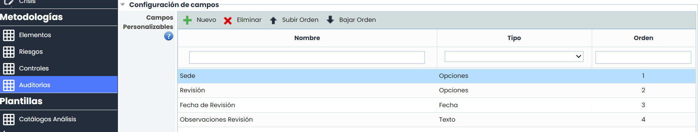

#### Visibilidad de campos personalizables

* Formulario de trabajos

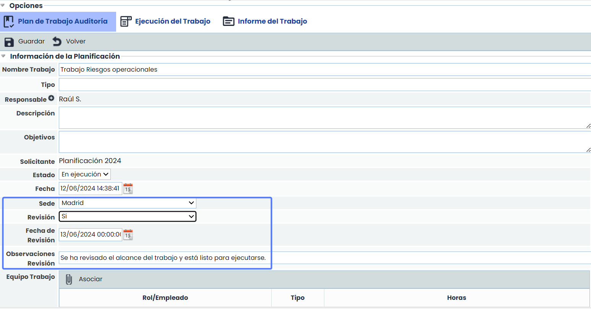

* Tabla de trabajos, opción Plan Auditorías > [Planificación Trabajos](https://help.globalsuitesolutions.com/es/globalsuite/v1/planificacion-trabajos).

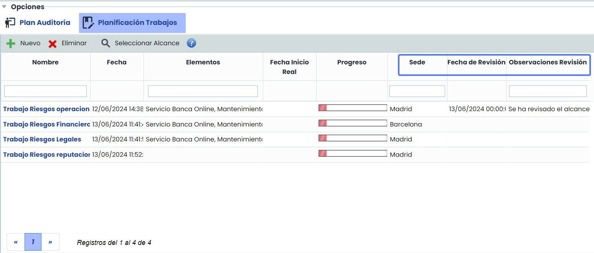

* **Gestión de campos Tipo Opciones:**

  * Por defecto, las opciones configuradas para este tipo de campo se visualizarán con un selector. Sin embargo, si hay muchas opciones, se habilitará automáticamente la opción “Mostrar todas”, que permitirá visualizar las opciones configuradas mediante una ventana, la cual facilitará la búsqueda y selección.

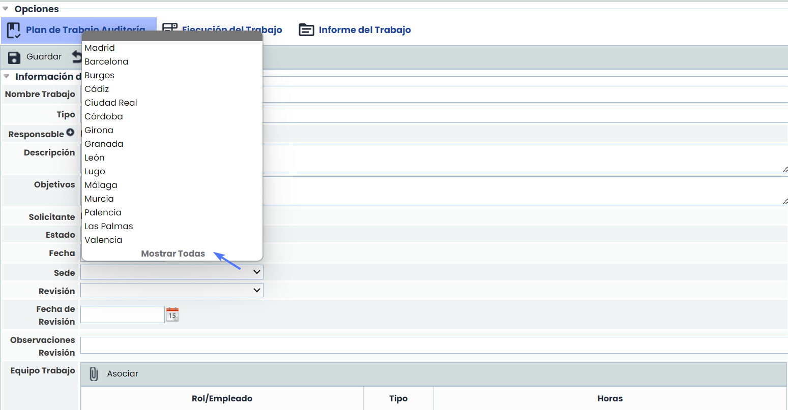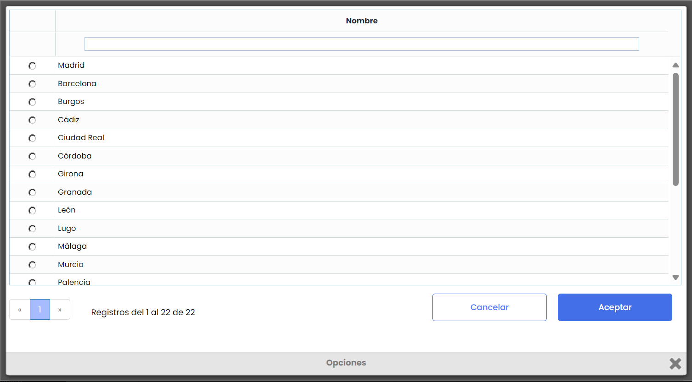

### Nuevo estado “Borrador” en Planes y trabajos de auditorías.


Hemos incorporado un nuevo estado llamado "Borrador" tanto en los Planes de Auditoría como en los trabajos de auditoría. Este nuevo estado permite crear borradores de auditorías que funcionan como plantillas o trabajos de auditoría base, los cuales pueden copiarse para no tener que construir manualmente toda la estructura del plan y trabajos asociados en cada nuevo ciclo de auditoría. Estos borradores o plantillas no se muestran por defecto en la tabla principal para centrar la información en la información vigente.


#### Estado borrador en Planes de auditoras

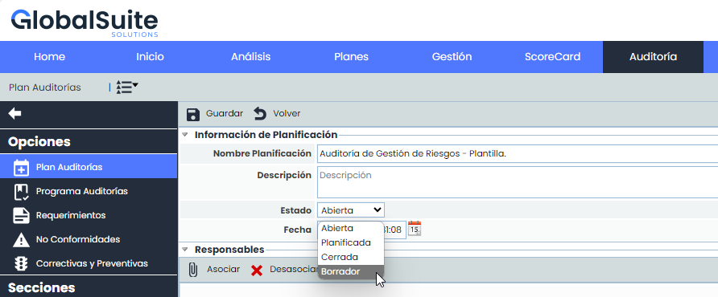

Las planificaciones de auditorías seguirán creándose en estado “Abierta”, pero ahora hemos añadido la opción de crear planificaciones en estado “Borrador”. Para las planificaciones en estado “Borrador” se permiten la configuración completa de todos los campos y la creación de trabajos, funcionando de manera similar a los Planes en estado “Abierta”.

Las planificaciones de auditorías en estado “Borrador” no aparecerán por defecto en el listado principal. Para visualizarlas, hemos añadido una nueva opción en el menú Mostrar > Borradores.

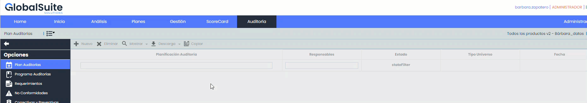

Así estas planificaciones, no se confunden con las auditorias en curso o cerradas.

#### Copiar Planificaciones de auditorías en estado borrador

Las planificaciones en estado Borrador, se pueden copiar como las demás planificaciones, pero al hacerlo estas se crean en estado Abierto:

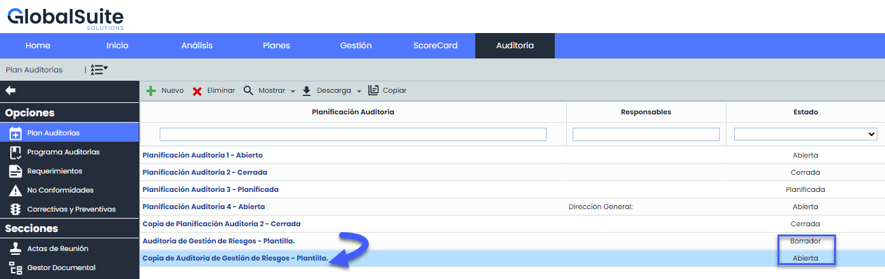

A la vez, si el Plan de Auditorias tiene asociados trabajos en estado Borrador, estos trabajos también se crean/copian en estado “Abierto”.

#### Estado borrador en Programas de auditorías

Al igual que las planificaciones de auditorías, se podrán crear Programas (trabajos) de auditoria en estado Borrador.

Al crear un trabajo lo hará por defecto en estado Abierto, como hasta ahora. En caso de querer cambiar el estado a borrador se deberá ingresar dentro el programa de auditoria y cambiar el estado a “Borrador”

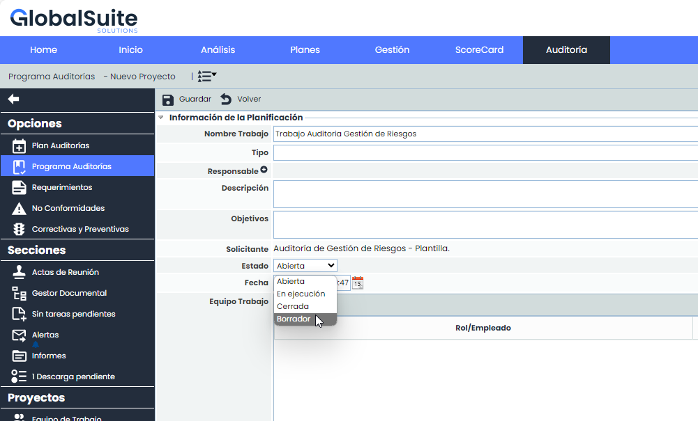

Desde el estado borrador, se podrá cambiar a los estados Abiertos y En ejecución. Sin embargo, una vez que un trabajo pasa a estado “En Ejecución” no podrá volver a Borrador, ya que en ese momento se realiza una copia de la información a auditar.

Para ver los Programas de auditorias en estado borrador, desde la tabla principal, se deberá utilizar la opción Mostrar > Borrador:

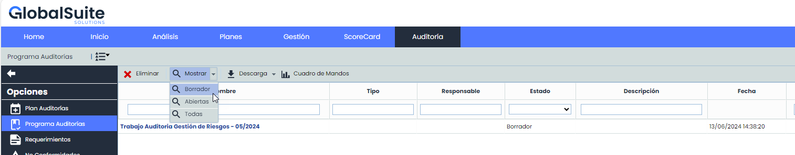

También, si estamos dentro de un plan de auditorias en “Planificación de trabajos” podremos ver todos los trabajos del Plan, como hasta ahora, incluyendo los programas/ en estado Borrador:

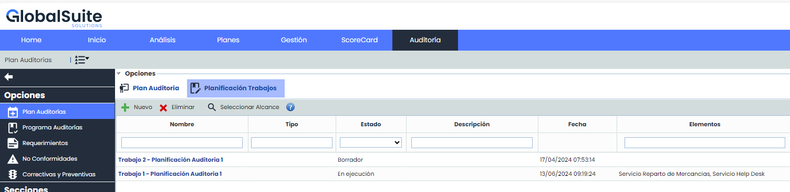

**Propagar auditorías en estado “Borrador”**

Actualmente se pueden propagar Planes y trabajos de auditorías que estén abiertos, hemos incluido los que están en estado Borrador.

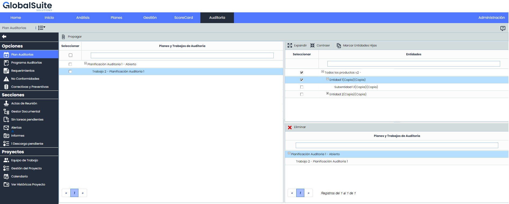

Los planes y trabajos en estado borrador seleccionados se propagarán con los mismos datos y mantendrán su estado en subentidades destino

**Descargas y Cuadros de mando**

Todas las descargas y los cuadros de mando han sido modificadas para que se tenga en cuenta el nuevo estado Borrador de Planes y Programas de auditorías.

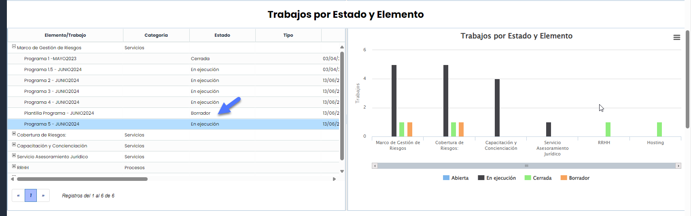


Para mas información sobre el módulo de Audit Management de GlobalSuite®, puedes ver el manual correspondiente en nuestro [Centro de recursos](https://help.globalsuitesolutions.com/es/globalsuite/v1/auditoria).

