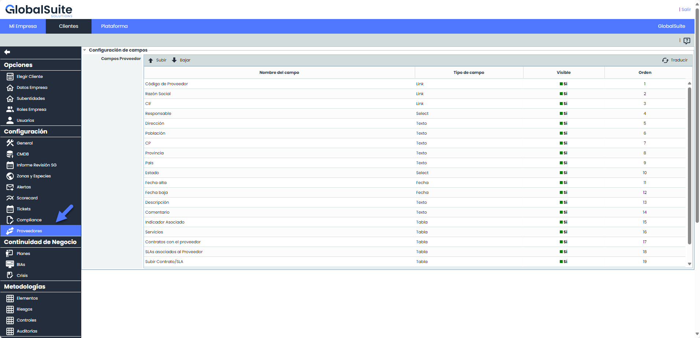
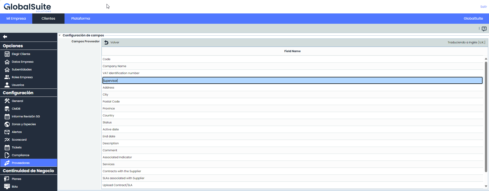
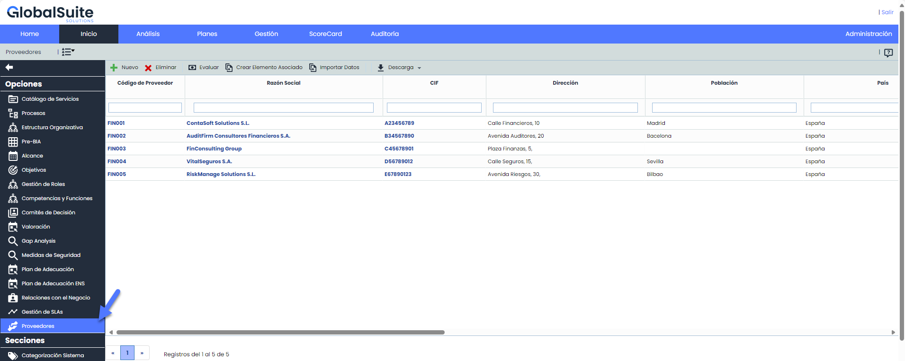
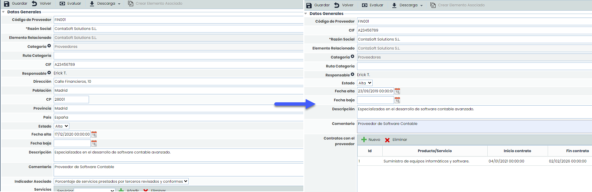
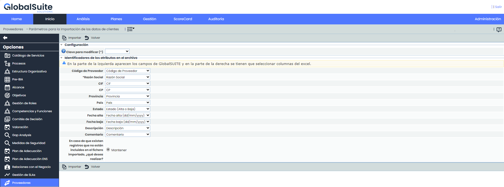
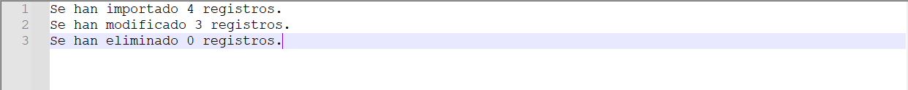

# v6.97 (Junio 2024)

## Nueva Funcionalidad: Configuración de Campos de Proveedores

Continuando con las mejoras para TPRM, hemos añadido una nueva funcionalidad que permite configurar los campos del formulario de un proveedor. Estas mejoras permiten una mayor flexibilidad y personalización en la gestión de datos de proveedores, facilitando su administración y actualización de manera eficiente y efectiva.

### Configuración de Campos de Proveedores

En Administración, hemos añadido una nueva opción llamada "Proveedores". Dentro de esta opción, se puede personalizar los campos que contienen datos de proveedores. Esto incluye cambiar el nombre, la visibilidad y el orden en que se listan dentro del formulario.

* **Nombre**: El nombre con el que se mostrara el campo en el formulario de proveedor. Para modificar el nombre del campo, hacer doble clic en la celda que contiene el nombre actual.
* **Tipo de Campo:** Los tipos de campos disponibles en esta tabla son: link, selector, texto, fecha y tabla. Este campo no es editable son a modo informativo.
* **Visibilidad**: Haciendo clic en la celda de "Visible", puede establecer si el campo es visible (="SI") o no (="NO"). Todos los campos pueden ocultarse, excepto Razón Social, CIF y Estado. Esta funcionalidad permite personalizar la vista del formulario para enfocarse en los datos más relevantes.
* **Orden**: Se muestra el orden de los campos en el formulario. Con los botones "Subir" y "Bajar" se podrá reorganizar el orden de los campos dentro del formulario. Esto permite una organización lógica y personalizada de los campos, mejorando la usabilidad y la eficiencia al completar el formulario.

#### Traducciones

Además, si se cambian los nombres de los campos, también se podrán configurar estos nombres en los idiomas que tenga configurados la empresa.

### Proveedores

#### Tabla Principal

En la tabla principal se verán los campos con los nombres de configurados en Administración > Proveedores. Si en la tabla principal se desea acotar aún más los campos visibles, estos se pueden configurar haciendo clic derecho en la cabecera y desmarcando los campos que se desea ocultar.

**Descarga Informe Excel:** La descarga de la tabla principal se realiza con la información tal como se muestra en pantalla. Esto significa que solo se incluyen los campos visibles y los datos que cumplen con los filtros aplicados.

#### Formulario de Proveedor

En este formulario se reflejan las configuraciones realizadas en Administración > Proveedores según el idioma del usuario logueado. Si el proveedor se ha creado con un Elemento asociado, en este formulario aparecerán debajo del campo “Razón Social” los campos Elemento Relacionado, Categoría, Ruta Categoría, los cuales no son configurables. A demás, en estos casos, las dimensiones que han sido configuradas como visibles en Administración> Elementos, se muestran al final del formulario en el apartado llamado “Valoración general”

#### Importación de Proveedores

**Modelo de Importación:** Se descargará el modelo de importación con los campos visibles, con los nombres configurados y en el orden configurado.

**Alta Masiva o Actualización**: Se podrá realizar el alta o actualización masiva de datos de proveedores mediante la importación de un archivo en formato Excel. Se ha incorporado la opción de seleccionar un valor como "Clave para modificar". Si al importar se encuentra un proveedor con la misma clave, no se creará un nuevo registro, sino que se actualizará el existente.

**Resultado de la importación:** Hemos añadido la generación automática de un archivo de texto, en donde se muestra el resultado de la importación, en el cual se indica cuantos registros fueron importados, modificados y cuales fueron los que no se pudieron importar por algún problema de datos.

Para mas información sobre el modulo de Proveedores, puedes ver el manual correspondiente en nuestro [Centro de recursos](https://help.globalsuitesolutions.com/es/globalsuite/v1/proveedores).
