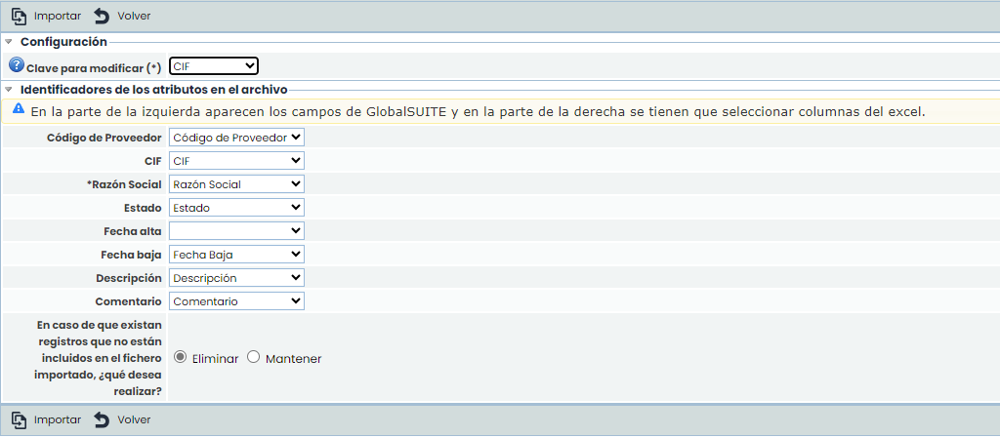
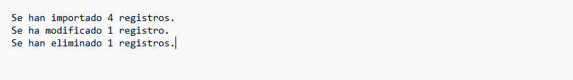

# v6.98 (Julio 2024)

## Nuevas funcionalidades y mejoras generales de GlobalSuite® GRC

### Mejora en la asociación de evidencias a Controles


Esta mejora optimiza el proceso de Gestión de evidencias tanto en [Gestión de Controles](https://help.globalsuitesolutions.com/es/globalsuite/v1/gestion-de-controles), como en [Gestión de Riesgos](https://help.globalsuitesolutions.com/es/globalsuite/v1/gestion-de-riesgos), aumentando la eficiencia y reduciendo el tiempo y esfuerzo necesarios para realizar esta gestión. Además, permite centralizar y simplificar varios pasos del proceso, permitiendo una búsqueda, revisión, creación y asignación de evidencias más rápida y eficiente.


#### Principales características

* **Adjuntar Documentación**: Directamente desde el [Detalle de un Control](https://help.globalsuitesolutions.com/es/globalsuite/v1/detalles-de-un-control) será posible adjuntar documentación a las evidencias desde dos fuentes:

  * Desde Gestor Documental: Se podrán asociar los documentos previamente almacenados en el [Gestor Documental](https://help.globalsuitesolutions.com/es/globalsuite/v1/gestor-documental), así como desasociarlos de la evidencia cuando sea necesario.
  * Desde el Equipo Local: Se podrán subir archivos directamente desde el equipo del usuario.
* **Creación y Eliminación de Evidencias**:

  * Se podrán crear nuevas evidencias directamente desde el [Detalle de un Control](https://help.globalsuitesolutions.com/es/globalsuite/v1/detalles-de-un-control), mejorando la flexibilidad y la gestión centralizada de las evidencias.
  * Ahora es posible eliminar evidencias sin necesidad de acceder a la sección de [Gestión de evidencias](https://help.globalsuitesolutions.com/es/globalsuite/v1/gestion-de-evidencias).

* **Acceso y Edición de Evidencias:**

  * Se podrá acceder a la evidencia mediante un enlace directo, facilitando la navegación y el acceso rápido a la información necesaria.
  * Se podrá editar el nombre de la evidencia, simplificando la actualización y mantenimiento de la información.


\*\*Nota\*\*
Todo el proceso se podrá realizar dentro de la opción [Detalles de un Control](https://help.globalsuitesolutions.com/es/globalsuite/v1/detalles-de-un-control) > Evidencias, evitando acceder a la sección de [Gestión de Evidencias](https://help.globalsuitesolutions.com/es/globalsuite/v1/gestion-de-evidencias) para crear una nueva o editarla.


#### Acceso a la Vista [Detalle de un Control](https://help.globalsuitesolutions.com/es/globalsuite/v1/detalles-de-un-control)

Las nueva mejora estará disponible desde [Gestión de Controles](https://help.globalsuitesolutions.com/es/globalsuite/v1/gestion-de-controles) y [Gestión de Riesgos](https://help.globalsuitesolutions.com/es/globalsuite/v1/gestion-de-riesgos), al acceder al [Detalle de un Control](https://help.globalsuitesolutions.com/es/globalsuite/v1/detalles-de-un-control).

#### Asociar documentos del [Gestor Documental](https://help.globalsuitesolutions.com/es/globalsuite/v1/gestor-documental).

Además de asociar y desasociar documentación del gestor documental a la evidencia, se podrá modificar el nombre. visualizar y descargar la documentación.

### Importación de Proveedores - Eliminar

Se ha implementado la posibilidad de eliminar proveedores del sistema mediante contraste con un archivo Excel:

Al Importar y seleccionar “Eliminar”, si un proveedor que está actualmente en el sistema no aparece en el archivo Excel seleccionado, será eliminado del sistema.

Esta función facilita la sincronización de la lista de proveedores con el archivo Excel, asegurando que solo los proveedores presentes en el archivo permanezcan en el sistema.

Luego de importar, se deja un log en donde se pueden comprobar la cantidad de proveedores que han sido eliminados:

