# v6.99 (Julio 2024)

## Nuevas funcionalidades y mejoras generales de GlobalSuite® GRC

### Inventario y Tratamientos: Asociar y adjuntar Documentación


Esta mejora optimiza la gestión de los documentos al permitir la inclusión de una tabla de documentación en los formularios de los elementos desde las opciones de [Inventario](https://help.globalsuitesolutions.com/es/globalsuite/v1/inventario) y [Tratamientos](https://help.globalsuitesolutions.com/es/globalsuite/v1/tratamientos).
A partir de ahora, será posible adjuntar documentos desde el equipo local o asociar documentación existente desde el [Gestor documental](https://help.globalsuitesolutions.com/es/globalsuite/v1/gestor-documental). Esto facilitará una mejor organización y acceso a la documentación relevante, mejorando así la eficiencia y efectividad en la gestión de los elementos.
Además, esta mejora está diseñada para integrarse con el módulo [TPRM (Third-Party Risk Management).](https://help.globalsuitesolutions.com/es/globalsuite/v1/globalsuite-tprm)


#### Características principales

* **Adjuntar y asociar documentación:** Al incorporar la tabla de Documentación será posible incorporar documentación desde dos fuentes:

  * **Adjuntar Documentos desde el Equipo Local:** Será posible adjuntar documentos directamente desde el equipos local de cada usuario, simplificando la incorporación de nueva documentación relevante.
  * **Asociar Documentos desde el Gestor Documental:** Se podrán asociar los documentos previamente almacenados en el [Gestor Documental](https://help.globalsuitesolutions.com/es/globalsuite/v1/gestor-documental), así como desasociarlos cuando sea necesario. Esto permite centralizar y facilitar el acceso a toda la documentación relevante.

* **Inclusión de la Documentación en Informes**

  * **Informes del Formulario:** La tabla de documentación se incluirá en los informes generados desde la vista del formulario, proporcionando una visión completa de la documentación asociada a cada elemento.
  * **Informes de la Tabla de Elementos y Tratamientos:** Los informes generados desde la [Tabla de elementos](https://help.globalsuitesolutions.com/es/globalsuite/v1/tabla-de-elementos) y [la Tabla de Tratamientos](https://help.globalsuitesolutions.com/es/globalsuite/v1/tratamientos) también incluirán la información de la tabla de documentación.

* **Configuración y visibilidad**

  * Visible en formulario: Al seleccionar esta opción se añadirá en el formulario de los elementos del inventario y de los tratamientos la posibilidad de añadir documentación.
  * Visible en tabla de elementos: Al seleccionar esta opción se añadirá en la [Tabla de elementos](https://help.globalsuitesolutions.com/es/globalsuite/v1/tabla-de-elementos) y en la [Tabla de tratamientos](https://help.globalsuitesolutions.com/es/globalsuite/v1/tratamientos) la posibilidad de añadir documentación.

**Configuración**

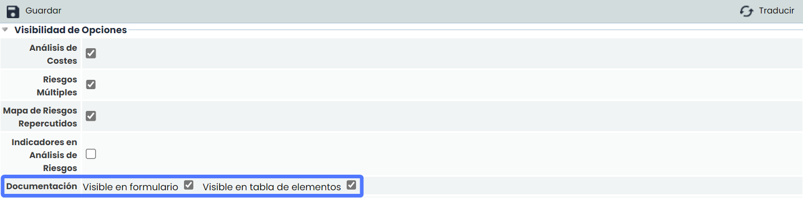

**Visibilidad tabla documentación en formulario**

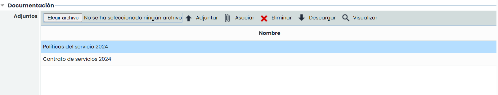

**Visibilidad** **en tabla de elementos y tratamientos**

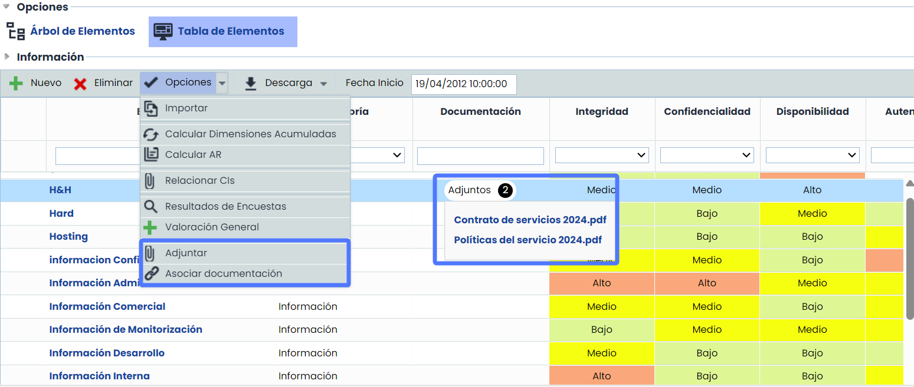

* **Integración con el Módulo TPRM**

  Esta mejora está diseñada para integrarse con el módulo de Gestión de Riesgo de Terceros (TPRM), mejorando la gestión y el acceso a la documentación relacionada con la evaluación y gestión de riesgos de proveedores y terceros.

### Mejoras en encuestas ERC: Nuevo formato formulario


En esta mejora se ha implementado un nuevo formato tipo formulario.
A partir de ahora, además del formato de tabla, es posible presentar las encuestas en un formulario estructurado. Este tipo de formato estará disponible para encuestas de elementos y potencia el módulo [TPRM (Third-Party Risk Management)](https://help.globalsuitesolutions.com/es/globalsuite/v1/globalsuite-tprm).


#### Características principales

* **Opciones de Formato:** Los usuarios tendrán la opción de elegir entre el formato de tabla y el nuevo formato de formulario para las encuestas de elementos.

**Configuración**

En la pestaña [Configuración de Encuestas](https://help.globalsuitesolutions.com/es/globalsuite/v1/configurar-encuestas), si el modelo asociado es únicamente de elementos, se habilitará un nuevo check denominado "Formato Formulario".

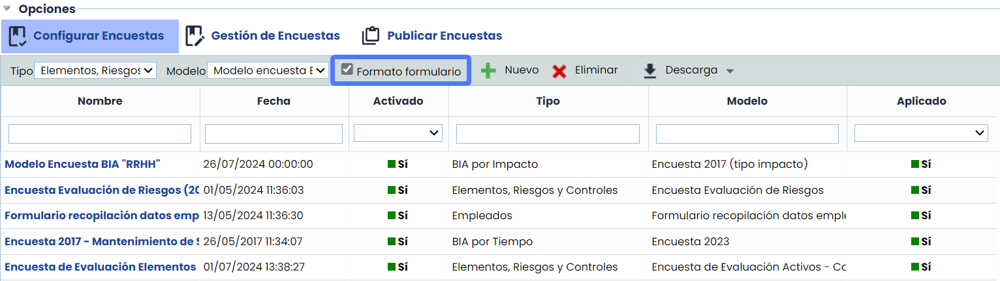

* **Formato Formulario:**

  * Al marcar el check "Formato Formulario", la encuesta adoptará el nuevo formato, permitiendo a los usuarios completar todas las preguntas de manera estructurada y eficiente.

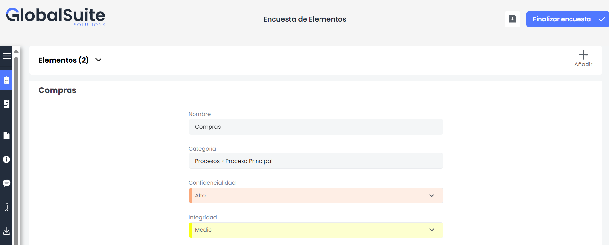

* **Potenciación del Módulo TPRM**

  * Esta mejora está directamente relacionada con el módulo de Gestión de Riesgo de Terceros (TPRM), optimizando la recolección y manejo de datos esenciales para la evaluación y gestión de riesgos de proveedores y terceros.
  * Automatiza la obtención de datos de primera mano e importa masivamente desde diversas fuentes a través de los distintos tipos de encuestas automatizadas, mejorando la eficiencia en la recolección de información.
* **Descarga de Información**

Al igual que el formato de tabla, será posible descargar la información de la encuesta en formato Excel, facilitando el análisis y la gestión de los datos recopilados.

* **Filtrado por Elemento:**

En caso de tener múltiples elementos, se podrá filtrar la información por cada elemento, proporcionando una mayor precisión y facilidad en la visualización y análisis de los datos.

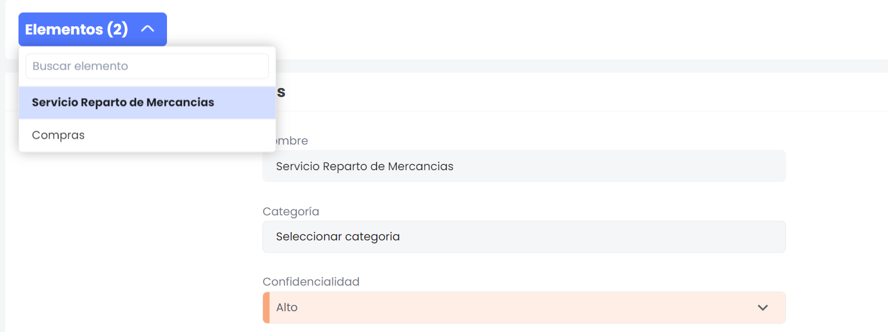

### Mejora en Inventario – Filtros Predefinidos


La nueva funcionalidad de filtros predefinidos reemplaza la antigua funcionalidad de crear Grupos de dimensiones. Esta mejora permite crear filtros más complejos que incluyen tanto dimensiones como categorías del inventario, proporcionando una herramienta más flexible y robusta para la gestión del [Inventario](https://help.globalsuitesolutions.com/es/globalsuite/v1/inventario).


#### Características principales

* **Configuración de Filtros Predefinidos:**

En Administración > Metodologías > [Elementos](https://help.globalsuitesolutions.com/es/globalsuite/v1/metodologia-elementos), se ha añadido un nuevo fieldset llamado "Filtros predefinidos". Los usuarios podrán crear, configurar, copiar y eliminar filtros predefinidos a través de esta nueva sección.

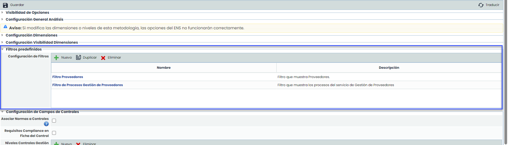

* **Detalles del Filtro:**

  * Al crear un nuevo filtro, los usuarios verán una pantalla de configuración detallada con los siguientes campos:
* **Nombre del Filtro:** Identificación única para el filtro.
* **Descripción del Filtro:** Breve descripción del propósito del filtro.
* **Pestañas de Configuración:**

  * **Categorías:** Árbol que muestra y permite seleccionar una o más categorías para filtrar.

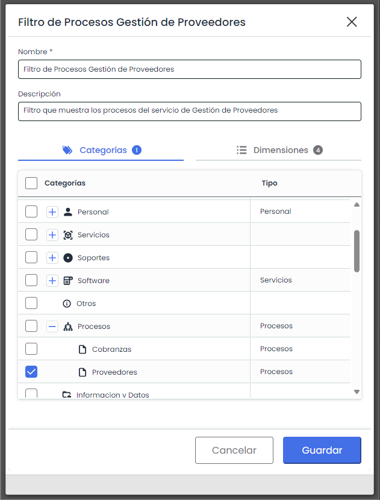

**Dimensiones:** Permite seleccionar cuáles dimensiones serán visibles para las categorías seleccionadas.

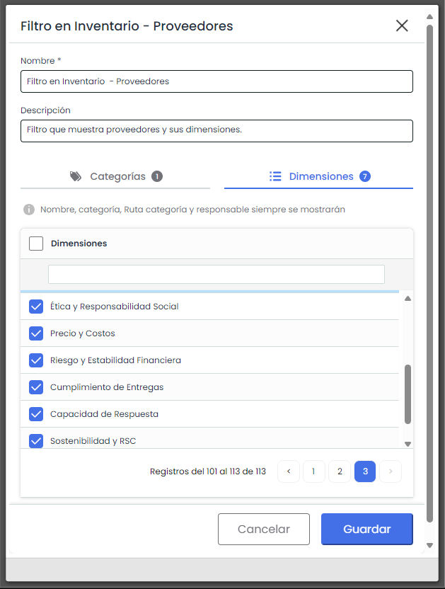

Como indica el mensaje, al aplicar el filtro en la tabla de resultados los campos del elemento nombre categoría, ruta categoría y responsables siempre estarán visibles.

* **Reemplazo de Grupos por Filtros:**

Todos los grupos de dimensiones existentes se migraron automáticamente a la nueva opción "Filtros predefinidos". Los usuarios encontrarán sus configuraciones anteriores bajo esta nueva funcionalidad, garantizando una transición sin problemas.

* **Traducción de nombres de Filtros:**

Se podrán configurar los nombres de los filtros en todos los idiomas configurados para la SG

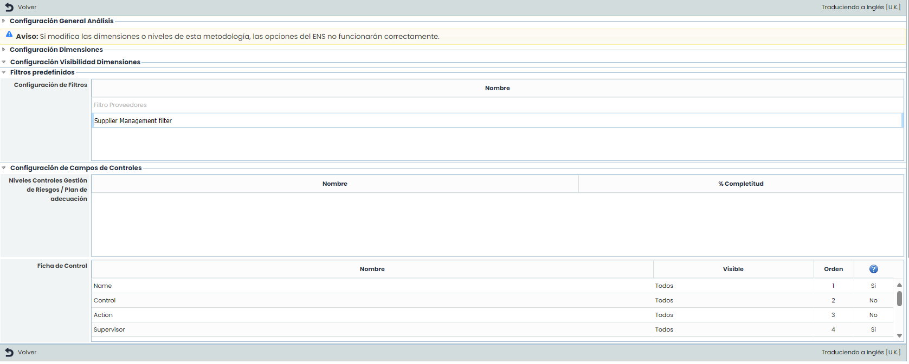

* **Aplicación de Filtros predefinidos.**

Una vez configurados los filtros, se podrán utilizar en Análisis>Inventario> Tabla de Elementos

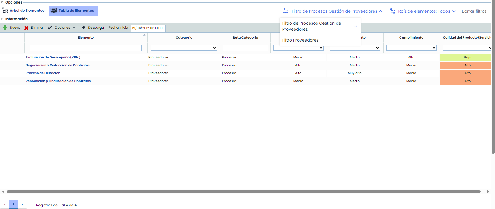

* **Nuevo filtro “Raiz de Elemento”**

Hemos añadido dentro al lado de Filtro predefinidos, la opción Raíz de Elementos, en donde se ven todos los elementos raíz (servicios) para también filtrar dentro de la tabla. Al seleccionarlo, el sistema filtra los elementos del inventario de ese servicio.

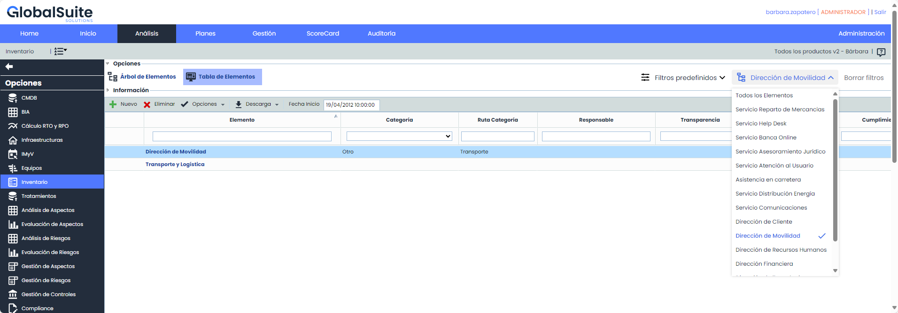


Para mas información sobre el Inventario, puedes ver el manual correspondiente en nuestro [Centro de recursos](https://help.globalsuitesolutions.com/es/globalsuite/v1/proveedores).

