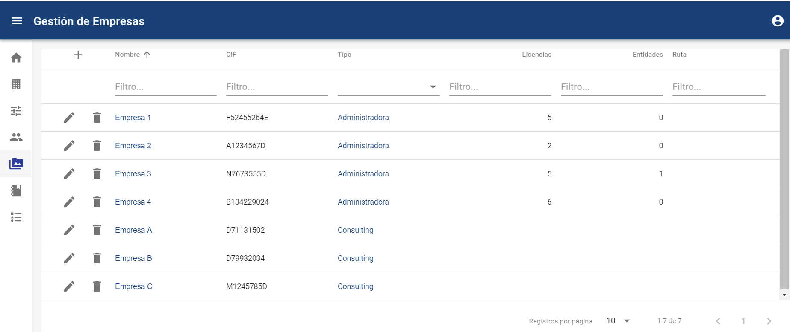
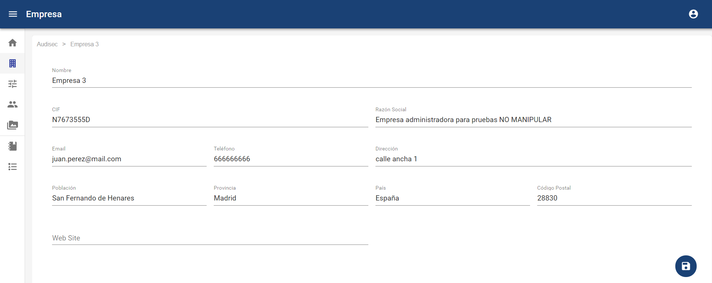
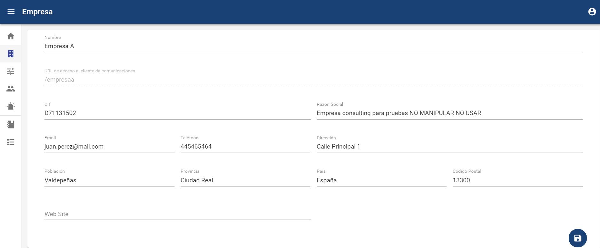

# Gestión de Empresas

**NOTA: Esta opción está disponible para los usuarios Administrador Global, Administrador y Consulting. Los usuarios Consulting sólo verán dentro de esta opción aquellas empresas a las que le hayan dado acceso, por defecto, ninguna.**

En esta pestaña podremos gestionar todas las empresas, tendremos acceso a las mismas, a sus configuraciones, y a sus usuarios. Hay dos tipos de empresas:

En concreto para ver un ejemplo de ambos tipos de empresas, en las siguientes imágenes se muestra como se crean las mismas:

* Nombre de la empresa (obligatorio)
* CIF es el código de identificación fiscal (obligatorio)
* Razón social.
* Tipo, es el tipo de empresa (Administradora o Consulting) (obligatorio)
  * La empresa administradora podrá tener empresas por debajo y por tanto tener licencias.
    * Licencias son el número de empresa que puedes crear por debajo.
    * Entidades son el numero de licencias que tienes ya utilizadas.
* Email (obligatorio)
* Teléfono (obligatorio)
* Dirección, Población, Provincia, País, Código Postal

### Empresa Administradoras

Se pueden crear con unas licencias en concreto que luego una vez creada no se puede modificar. Podremos crear nuevas empresas, en función del número de licencias contratadas, pudiendo crear empresas de tipo Administradora y de tipo Consulting. Creación de una nueva empresa Administradora , nos permitirá poder crear jerárquicamente nuevos canales para gestionar, o nuevas empresa Administradoras para subcontratar o dividir la gestión de estos canales.

### Empresa Consulting

Son canales de comunicación, es decir, empresas finales para la gestión de comunicaciones. La creación de una nueva empresa Consulting, nos permitirá poder generar un nuevo canal de comunicación, poder gestionarlo y parametrizarlo. Una vez creada la nueva empresa Consulting , tendremos una nueva URL de acceso para poder enviar comunicados a este nuevo canal. La URL seguirá el patrón: https://DireccionDominio/**nombreempresa**

