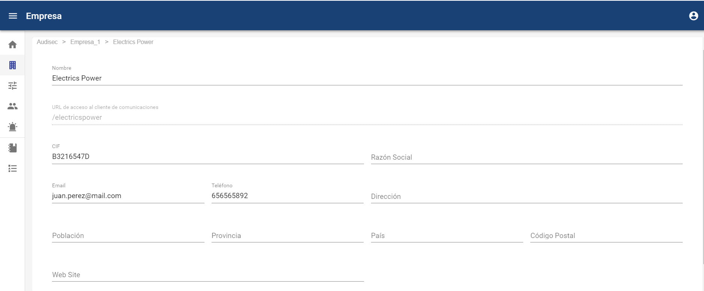
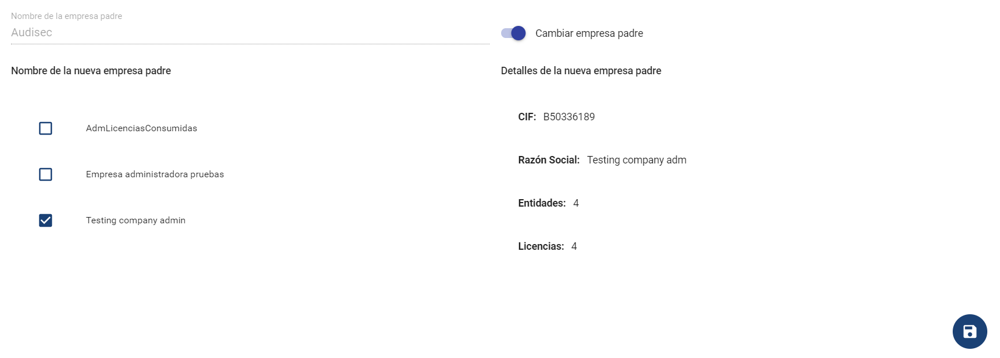
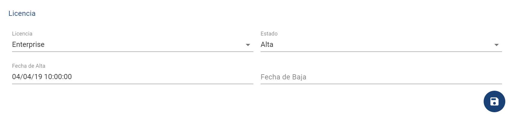

# Empresa - Datos de Empresa

**NOTA: Esta opción está disponible para los usuarios Administrador Global y Administrador.**

En esta opción se pueden ver todos los datos de la empresa, es decir la información detallada de la misma, concretamente los campos son los siguientes:

* Nombre empresa
* \*\*URL de acceso al cliente de comunicaciones,\*\*tendrá la terminación del nombre de empresa todo junto. (/nombreempresa). A través de esta URL de acceso al canal, los usuarios accederán para poder formular un nueva comunicación.
* CIF
* Razón Social
* Email
* Teléfono
* Dirección
* Población
* Provincia
* País
* Código Postal
* Web site

De manera adicional, en la parte inferior del formulario, es posible cambiar de qué empresa superior (empresa padre) va a depender la actual. Para ello, hay que activar el check de "Cambiar empresa padre", tras lo cual nos aparecerá el listado de empresas Administradoras a las que se puede transferir.

En caso de que esa nueva empresa padre no disponga de límite de entidades disponibles, no me permitirá cambiarla.

En el apartado de Licencia, se puede consultar el tipo de licencia de la empresa, además de si se encuentra de Alta, o de Baja, y las fechas asociadas.

Cuando se quieran almacenar las modificaciones del formulario, hay que pulsar el botón situado en la parte inferior derecha de la pantalla.
