# Alta de Comunicados

## CREACIÓN DE UNA COMUNICACIÓN

Al crear una comunicación, se deben completar los pasos indicados a continuación (estos pasos son personalizables, aunque este ejemplo contiene los diferentes tipos de apartados disponibles). En cualquier momento, es posible consultar la documentación de apoyo que el gestor del canal haya dejado a disposición del comunicante:

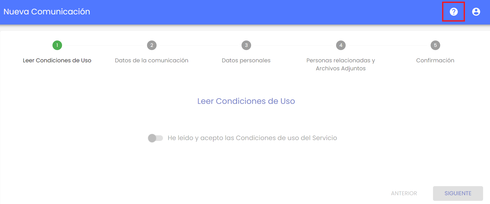

Al pulsar el botón, aparece el listado de documentos. En caso de no existir ninguno, aparecerá el enlace para acceder a este manual de usuario.

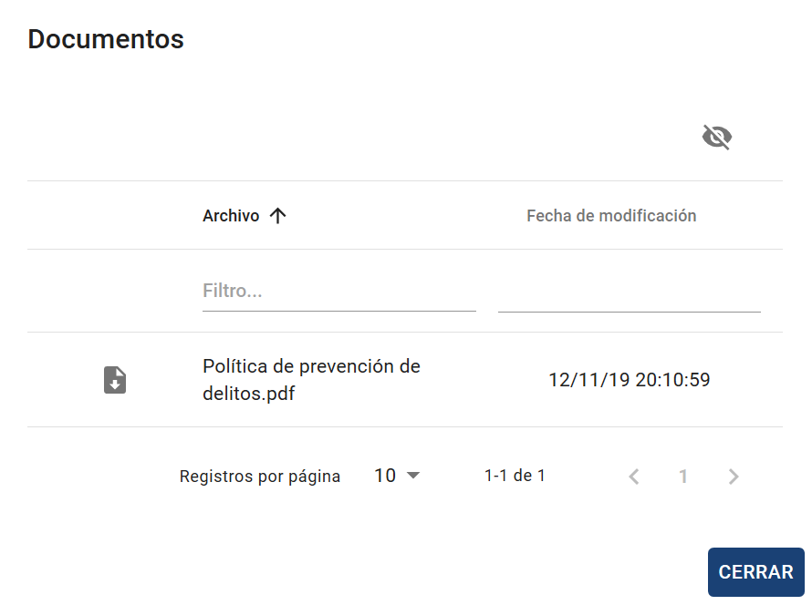

### **1- Aceptación de las condiciones de uso.**

Son las condiciones de uso definidas por la empresa en la que está implantada el canal de comunicación.

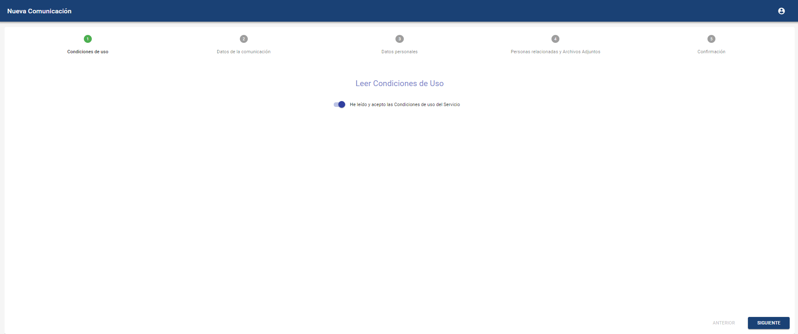

### **2 - Datos de la comunicación**

Formulario general para la redacción de la comunicación. Se podrán completar los campos disponibles, pudiendo incluir campos obligatorios necesarios para registrarla. En caso de existir, no se podrá pasar al siguiente paso hasta que estén completos. Estos campos podrán ser desplegables de opciones, campos textuales, fechas o checks.

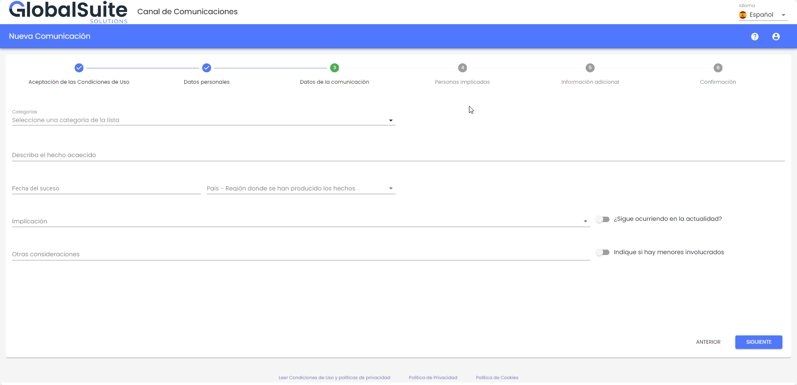

#### 2.1 - Categorías

En el caso de que las categorías estén configuradas con al menos una visible, dentro de este paso, se vera un selector para asignar una categoría a la comunicación.

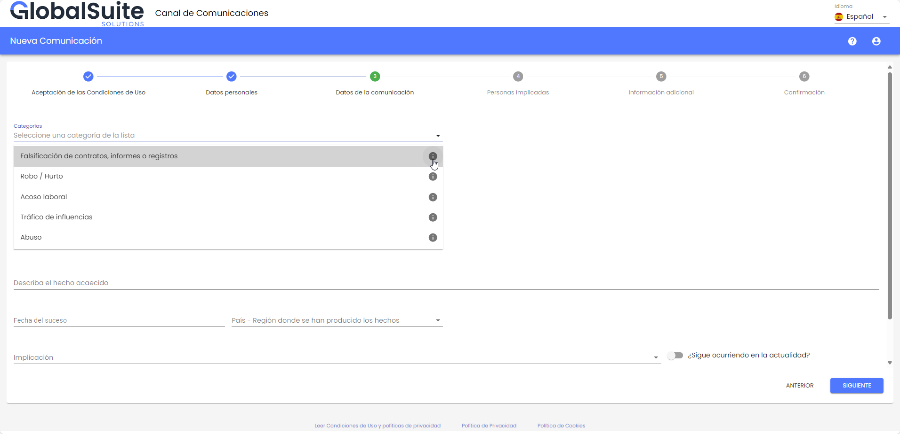

Para ver mas detalles sobre la categoría a seleccionar, existen varias formas, la primera al presionar el icono de Informacion (info.) que aparece a la derecha del nombre, se abrirá una ventana emergente donde podrá tener mas información sobre la categoría.

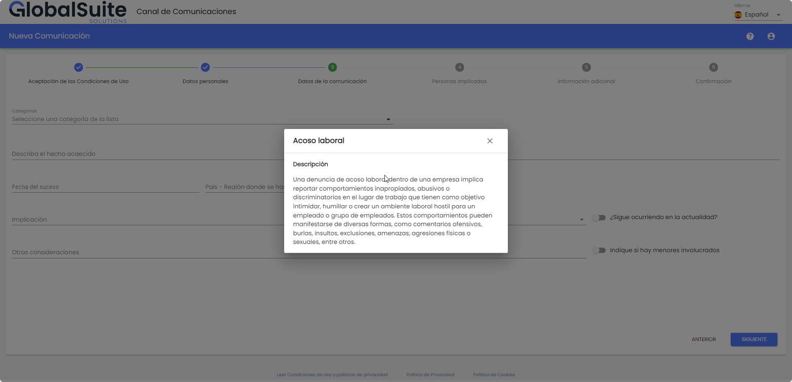

También se podrá ver luego de seleccionar una categoría, debajo de la misma:

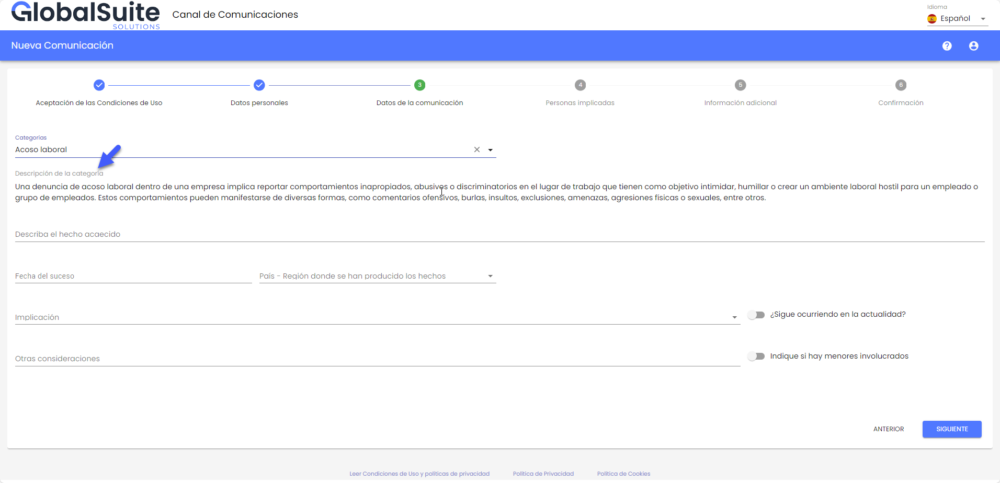

### **3 - Datos personales**

Datos personales del comunicador. En función de la configuración, se podrá mandar el comunicado como anónimo, o será necesario identificarse. En ese caso, el comunicador deberá completar al menos el campo "Email" para poder realizar el envío.

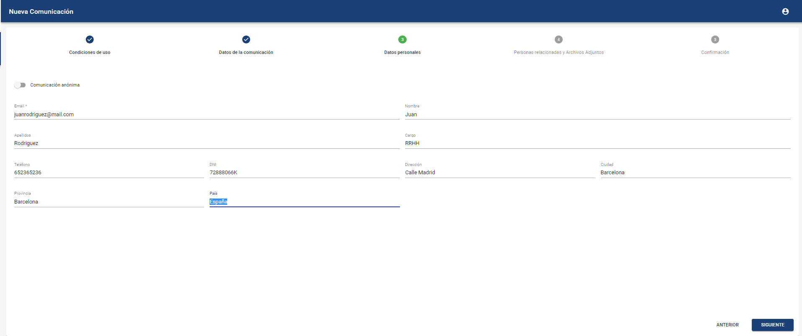

### **4 - Personas implicadas en los hechos, informantes y archivos adjuntos**

Permite informar sobre personas implicadas en el hecho comunicado, personas informantes que puedan tener más información al respecto y adjuntar archivos que sirvan como pruebas o evidencias del suceso.

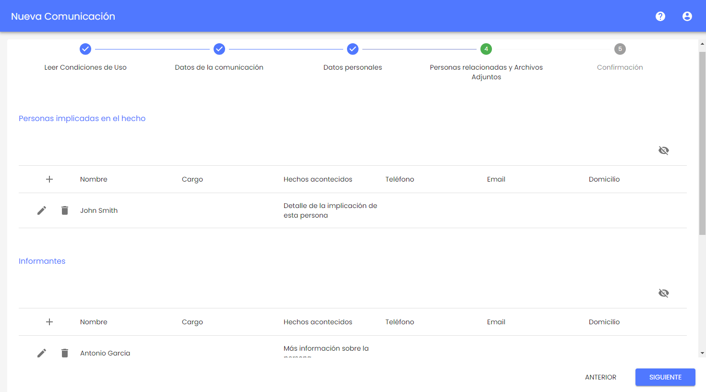

Ejemplo de introducir a una persona implicada en el suceso:

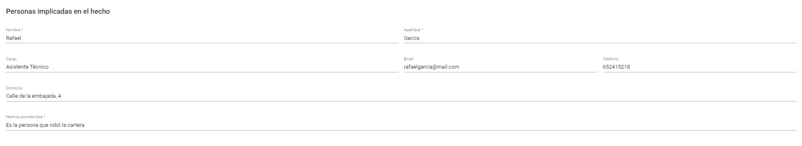

En el caso del campo de Adjuntos, es posible cargar información de dos formas, en función de la configuración del canal:

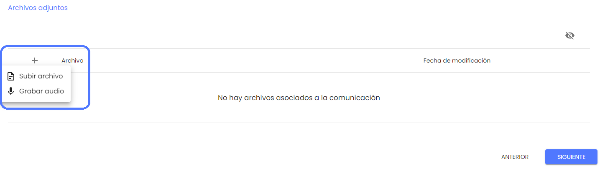

* Subir archivo: Permite seleccionar un archivo del dispositivo local, y cargarlo en el formulario de la comunicación.

Los archivos que se pueden incluir en la comunicación tienen que ser de uno de los tipos permitidos:

.7z, .ac3, .avi, .bmp, .bpm, .bpmc, .csv, .doc, .docx, .dot, .jpeg, .jpg, .mgr, .mkv, .mov, .mp3, .mp4, .mpp, .mpt, .msg, .odg, .odp, .ods, .odt, .pdf, .png, .pps, .ppsx, .ppt, .pptx, .rar, .rtf, .txt, .vsd, .vst, .wmv, .xls, .xlsm, .xlsx, .zip

* Grabar audio: Esta opción, permite una alternativa a la hora de registrar la información de la comunicación, pudiendo hacerlo mediante voz. Al pulsarlo, abrirá una ventana para poder comenzar la grabación.

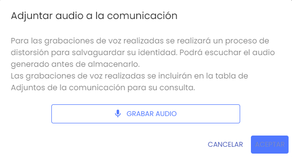

Durante la grabación, se podrá pausar para continuar la misma en cualquier momento, o finalizar la grabación.

Una vez que se finaliza la grabación, esta se procesa para distorsionar la voz y salvaguardar la privacidad del comunicador. El comunicador podrá reproducir el audio grabado antes de almacenarlo. Si no se quiere guardar el audio, se podrá descartar, o en caso contrario asignarle un asunto y pulsar Aceptar.

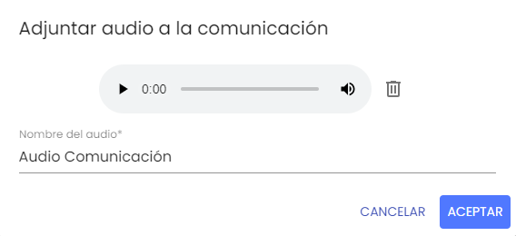

El audio de voz (tras el proceso de distorsión) quedará almacenado en la tabla de adjuntos, y se enviará junto con el resto de información al finalizar la comunicación.

### **5 - Confirmación**

Vista de resumen del comunicado a enviar, indicando cuántas preguntas de las disponibles en el formulario se han completado, si se ha adjuntado algún archivo y la información del comunicador o y si existen personas involucradas.

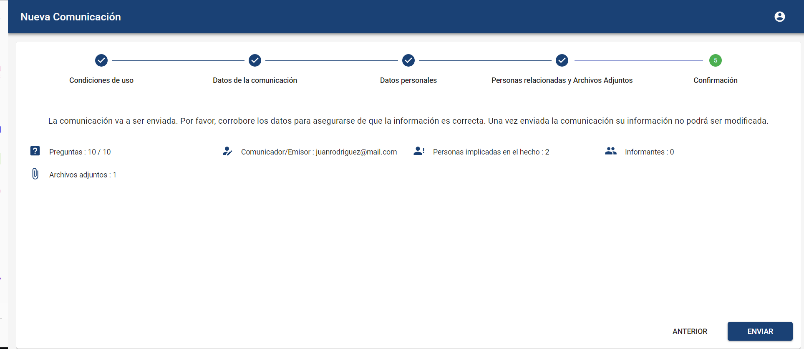

En caso de estar habilitado el conflicto de intereses en el Canal, además del resumen de la información aportada, al comunicador le aparecerá qué usuarios van a recibir la comunicación que se envíe.

Por defecto, aparecerán marcados los usuario que correspondan por defecto o que estén asociados a la categoría seleccionada por el comunicador.

También se mostrarán, sin marcar, otros gestores que no apliquen para la categoría seleccionada, como destinatarios alternativos.

En caso de que el comunicador considere que alguna persona de las que van a recibir esa comunicación puede estar involucrada y no debería tener acceso a la misma, puede desmarcarlo, y marcar alguno alternativo.

Para asegurar que la comunicación se pueda gestionar en el Canal, sólo será posible enviarla si hay al menos marcado un usuario que recibirá la misma, en caso contrario el botón de Enviar aparecerá deshabilitado.

Cuando se envíe la comunicación, los usuarios del canal que no tengan acceso, no recibirán ninguna notificación o alerta al respecto.

### **6 - Usuario y Password**

Claves de acceso para la futura revisión de la comunicación.

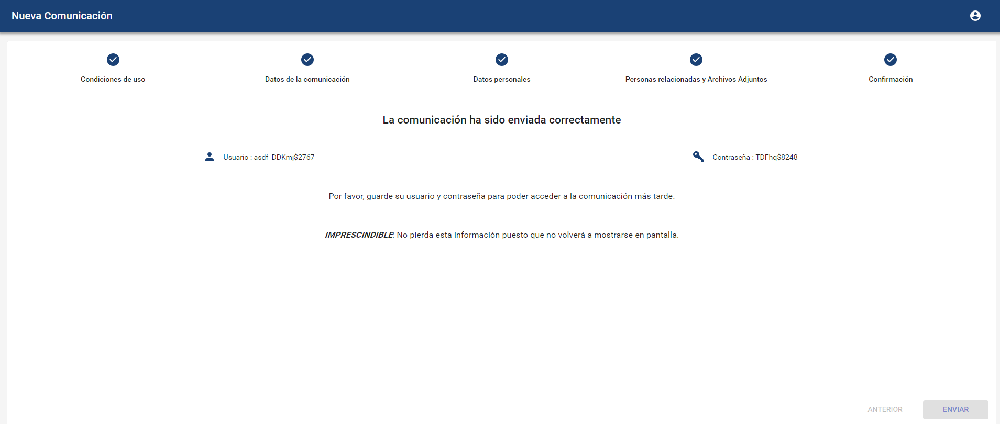

**NOTA IMPORTANTE:** Es muy importante almacenar las credenciales que aparecen en el último paso, sobre todo en caso de realizar una comunicación anónima, porque al finalizar el proceso no se podrán recuperar, y es la única forma de poder hacer seguimiento de la comunicación realizada.

En caso de que el comunicador se haya identificado, este usuario y contraseña se le enviarán por correo electrónico.
