# Configuraciones

##### **NOTA:** Esta opción está disponible para los usuarios Administrador Global y Administrador.

# **Preguntas**

Esta opción nos permite crear un formulario de comunicados desde cero, de tal forma que su estructura será la que se quiera siguiendo un patrón de fila por columna. Si definimos en una empresa un tipo de formulario, todas aquellas empresas hijas que se cree, aparecerán por defecto con ese tipo de formulario ya parametrizado, este podrá ser modificado sin que afecte al resto de empresas sus cambios.

Disponemos de un botón en la parte inferior para agregar una nueva pregunta.

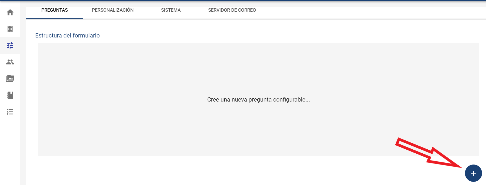

**Estructura del formulario**

Permite parametrizar el formulario de la comunicación, podremos **añadir, editar y eliminar**las preguntas que queramos dentro de los tipos que se explican a continuación. Además podremos determinar la ubicación de cada una de estas preguntas. Con cada pregunta que se quiera configurar se ha de rellenar la siguiente información:

* Tipo, que puede ser un campo de tipo:

  * Textual → Permite añadir texto para completar la pregunta.
  * Selector → Permite dar diferentes opciones para responder la pregunta.
  * Verificación → Nos da dos opciones para marcar un Si o No.
  * Fecha → Permite marcar una fecha como respuesta a la pregunta.
* Idioma de la pregunta → Para definir las preguntas del formulario en los diferentes idiomas posibles.
* Pregunta a formular, es un campo obligatorio → Hay que detallar la pregunta concreta.
* Número de Opciones (sólo en el caso de Selector) → Permite definir las opciones posibles para contestar una pregunta de tipo Selector.
* Tamaño → Permite definir el tamaño de la pregunta dentro del formulario, están las siguientes opciones:

  * S
  * M
  * L
  * XL

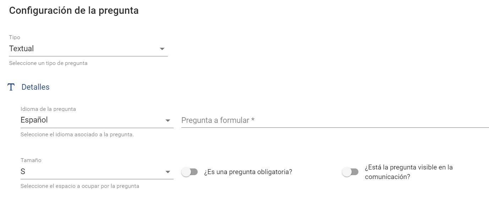

Se ha de ir rellenando para definir el formulario/cuestionario dándole al botón de abajo a la derecha (más), posteriormente permite la herramienta desplazarlas para configurar donde estén cada una de ellas, al igual que su tamaño y otras opciones si hiciera falta. De esta forma la creación, edición o eliminación de preguntas, es muy intuitiva.

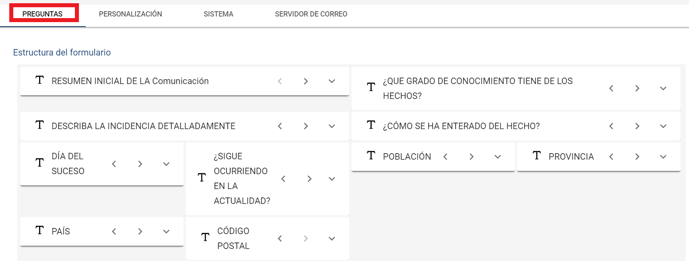

#### Adicionalmente existen dos opciones Check:

* ¿Es una pregunta obligatoria?

  * Permite definir si obligatorio completar la pregunta para poder enviar el comunicado.
* ¿Está la pregunta visible en la comunicación?

  * Permite definir si la pregunta se va a mostrar en el formulario, o es una pregunta que no está aprobada y está temporalmente deshabilitada.
* ¿Está la pregunta visible en el listado de comunicaciones?

  * Permite configurar si la pregunta se verá en el listado principal de comunicaciones, para poder realizar búsquedas o filtrados sobre ella, o poder descargar la información de la misma en un listado CSV

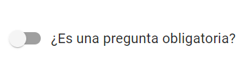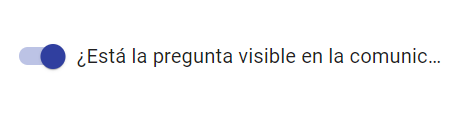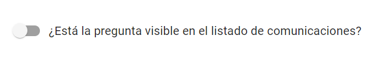

Debajo de la configuración de las preguntas del formulario de la comunicación, existe un apartado donde se pueden habilitar o deshabilitar dos apartados de la comunicación:

* Personas Implicadas en la comunicación: Permite mostrar u ocultar el apartado para registrar personas implicadas en los hechos que se comunican.
* Informantes: Marcando o desmarcando este campo, aparecerá o no el apartado para registrar informantes que puedan aportar más datos sobre la comunicación.

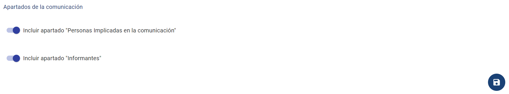

**Apartados**

Permite configurar qué apartados se definen en el formulario de una denuncia y qué se mostrará en cada uno. Esta sección permite añadir, editar, ordenar y eliminar los apartados.

También permite la posibilidad de mostrar o no un Resumen final de la información completada antes de enviarla.

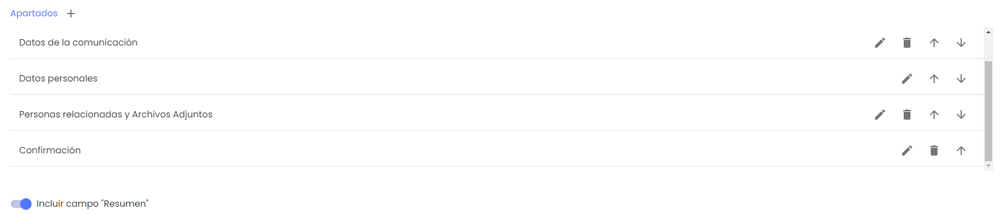

Cuando se procede a editar un apartado, (al pulsar el icono del lápiz), se pueden realizar las siguientes acciones:

* Reorganizar las preguntas del formulario.
* Permite seleccionar el idioma.
* Personalizar las etiquetas y el nombre de los apartados.
* Añadir desde la opción "Campos" las preguntas creadas en el formulario.

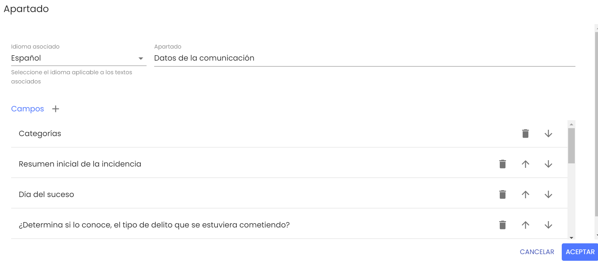

**NOTA:**Si se edita el apartado que viene por defecto relativo a la Aceptación de las condiciones de Uso, solo se vera reflejado en el nombre del apartado. Para editar el nombre del link, debe realizarse a través de la pestaña "Sistema" en la opción de "Texto de las condiciones de Uso".

Para definir si mostrar o no el Resumen final de una denuncia se debe activar o no el check "Incluir campo Resumen". Esta información se proporciona por defecto en el apartado de "Confirmación".  Si el check está habilitado , dicha información aparecerá en el último apartado de la lista, incluso si se elimina este apartado o se ordena en otro lugar que no sea el último.  Asimismo, si el check esta deshabilitado, esta información no aparecerá, aunque este el apartado de "Confirmación" creado.

Además es posible activar otro campo adicional para tratar y evitar posibles conflictos de intereses con los gestores del canal a la hora de que un denunciante registre una denuncia, que es el campo "Habilitar Conflicto de Intereses"

Ahí se muestra el campo que indica si el conflicto de intereses está habilitado o no. Al igual que el campo Resumen, se muestra al final ya que será en el último apartado del formulario de la denuncia donde el denunciante podrá ver los receptores de la denuncia.

En caso de estarlo, se muestra un campo de texto "Mensaje de aviso al comunicador" para poder definir un mensaje informativo que verá el denunciante en ese apartado.

# **Datos Personales**

En este apartado de la Configuración, es posible parametrizar qué campos y qué datos personales puede completar, y cuáles debe completar por ser obligatorios, el comunicador que registra una denuncia (cuando esta no es anónima).

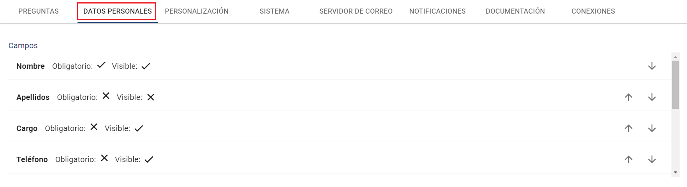

Al seleccionar un campo, en la parte inferior se habilita un formulario donde se muestra el tipo de campo (Nombre, formato del campo) y es posible marcar o desmarcar el mismo como:

* Visible: en caso de estar desactivado no aparecerá en la vista del denunciante.
* Obligatorio: en cuyo caso deberá rellenarse antes de poder enviar la denuncia.

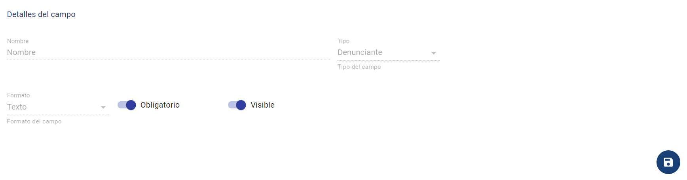

NOTA: El campo "Email" es obligatorio y no se puede desactivar, ya que es necesario para el envío de contraseña de acceso y otros propósitos.

# **Personalización**

En esta opción de la Configuración, es posible parametrizar varios apartados como son los siguientes:

**Textos**

* Idioma → Nos permite alternar sobre qué idioma estamos parametrizando los campos. (Una vez seleccionado el idioma, podremos completar el texto de los campos en dicho idioma)
* Título de la Aplicación → Título que aparece al lado de los logos en la parte superior izquierda.

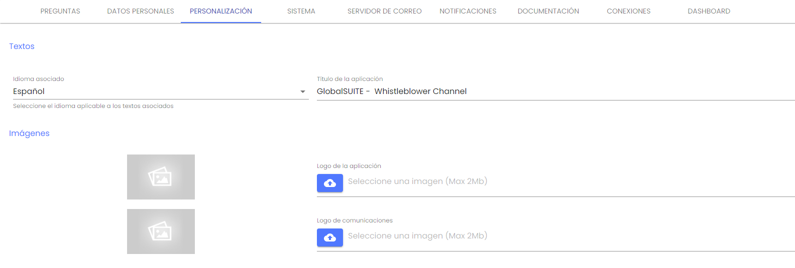

**Imágenes y Colores**

* Modificar los logos visibles en la parte superior de administración de la herramienta, y también es visible en los formularios de comunicaciones. Las imágenes deben como máximo ocupar 2Mb de tamaño. Se tiene estos dos logos:

  * Logo de Aplicación → Es el logo que aparecerá en las vistas de gestión del canal de comunicación.
  * Logo de Comunicaciones → Es el logo que aparecerá en el canal de comunicación.

* Personalización de colores → Da la posibilidad de adaptar los colores corporativos de la interfaz.

Este cambio aplica tanto a la **interfaz de administración** (backoffice interno de gestión del canal) como sobre todo a la **vista del denunciante** (formulario público), tanto a la hora de reportar una nueva denuncia como de hacer seguimiento de una previa.

En la configuración, por defecto aparecen los colores actuales de la solución, pero es posible personalizarlos en función de distintos parámetros.

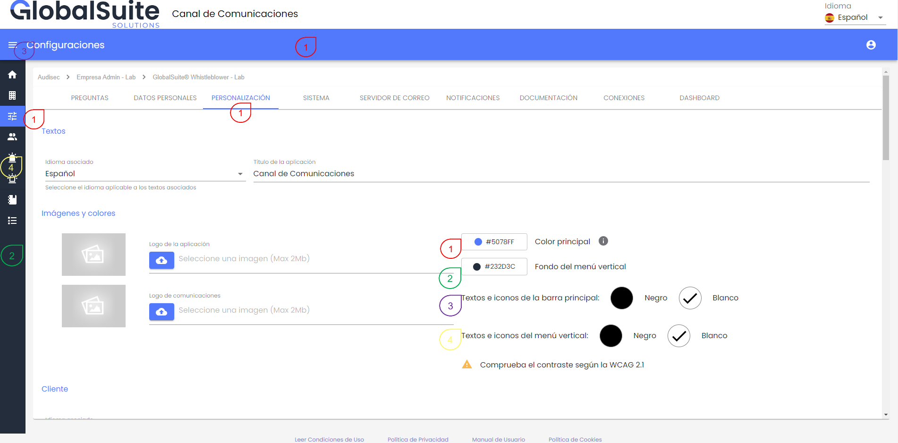

1. Color principal: Este color será el que se aplicará a la barra principal del menú, botones, títulos y frontal principal de la vista del denunciante.
2. Menú vertical: Este color se utilizará para la banda de menú vertical del panel
3. Textos e iconos del menú principal: Con la posibilidad de elegir entre blanco y negro, se utilizará para representar los textos e iconos que existan en el menú principal
4. Textos e iconos del menú vertical: El color elegido (blanco o negro) se utilizará para representar los iconos y textos del menú lateral

Esto está pensado para que, además de ir alineado con la imagen corporativa, los textos e iconos sean legibles y se adapten a los criterios de contraste y accesibilidad marcados por las [WCAG 2](https://www.w3.org/WAI/standards-guidelines/wcag/) (Web Content Accesibility Guidelines).

Una vez modificado alguno de los parámetros, es necesario pulsar el botón “Vista Previa” que en una ventana te muestra cómo queda la interfaz de usuario sin necesidad de aplicar los cambios.

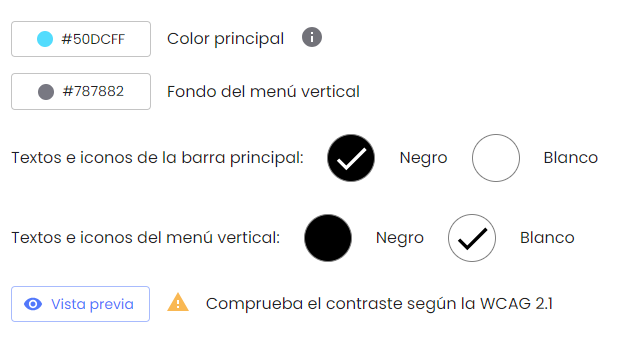

Al abrirlo, mostrará una ventana para visualizar cómo quedará con los ajustes propuestos, viendo los cambios en distintas vistas:

* Sección de Configuración
* Sección de Landing
* Formulario de denuncia

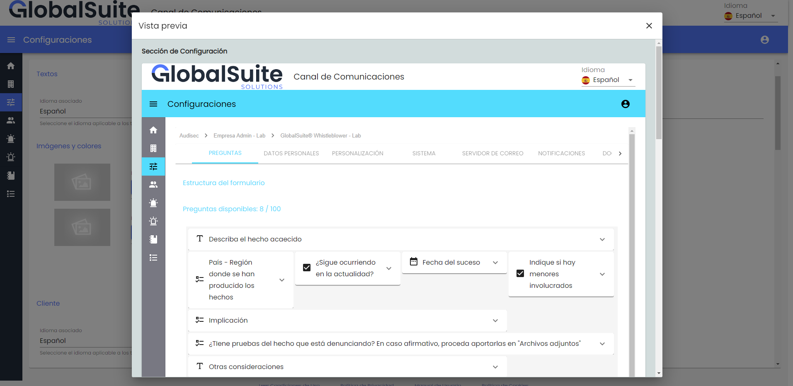

Una vez revisada la vista previa, se podrán aplicar los cambios mediante el botón Guardar y se actualizará la interfaz para todos los usuarios.

**Cliente**

En este apartado se puede personalizar la página de Inicio del cliente, así como el habilitar o deshabilitar los botones de "Formular Nueva Comunicación" o "Ver una Comunicación Previa".

* Idioma → Nos permite alternar sobre qué idioma estamos parametrizando los campos de texto. (Una vez seleccionado el idioma, podremos completar el texto de los campos en dicho idioma)
* Texto informativo "Canal de Denuncias" → Campo de texto que permite personalizar el mensaje que aparece en la ventana de Inicio del cliente. En caso de no proporcionar ningún texto, aparecerá el texto por defecto:

*Bienvenido al Canal de Comunicación. Aquí podrá realizar las acciones pertinentes para comunicar cualquier cuestión, consulta o incidencia que sea de su interés. Por favor, seleccione una acción.*

* Botón "Formular Nueva Comunicación" → Es posible activar o desactivar el botón que permite dar de alta una nueva comunicación, además de personalizar el texto que aparece en el mismo.
* Botón "Ver una Comunicación Previa" → Es posible activar o desactivar el botón que permite consultar comunicaciones registradas previamente, además de personalizar el texto que aparece en el mismo.
* Campo "Texto Resumen de la Comunicación" → Campo de texto para personalizar el mensaje que se muestra antes de confirmar el envío de una nueva comunicación.

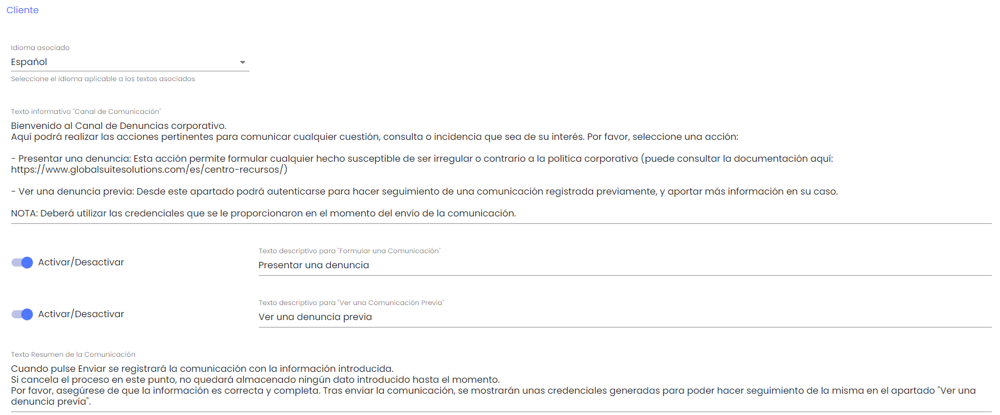

**Idiomas**

En este apartado se muestran los idiomas habilitados en la empresa.

**NOTA:** La habilitación de nuevos idiomas entre los disponibles debe solicitarse al servicio de soporte. Actualmente los idiomas disponibles son: Español, Inglés, Alemán, Francés, Portugués, Brasileño, Checo, Euskera, Catalán, Gallego y Valenciano.

* Idioma por defecto → Se podrá elegir cuál es el idioma por defecto en la empresa (entre los disponibles). Ese será el idioma por defecto en el que se creen los usuarios, y en el que aparecerá la vista del denunciante.

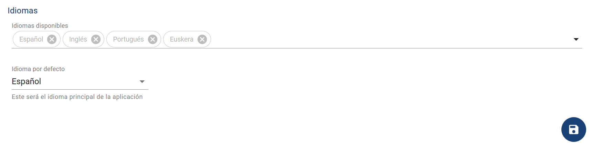

**Estados**

En este apartado es posible personalizar los estados por los que pasará una comunicación, a partir de los que se crean por defecto.

En la tabla que se muestra, es posible editar y reordenar los estados actuales. Para cambiarlos de orden, únicamente hay que pulsar las flechas correspondientes.

El primer estado y el último no son posibles eliminarlos, únicamente editarlos. El estado inicial será el que tomen las nuevas comunicaciones que se creen, y el estado final es el estado en el que la comunicación ya se encuentra cerrada (siendo posible reabrirla posteriormente).

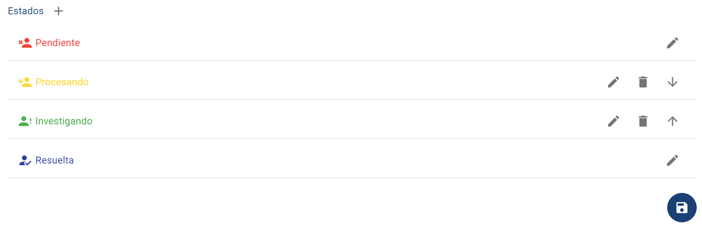

Si pulsamos en el símbolo de papelera  podremos eliminar el estado correspondiente. Para lo cual nos pedirá confirmación de la acción.

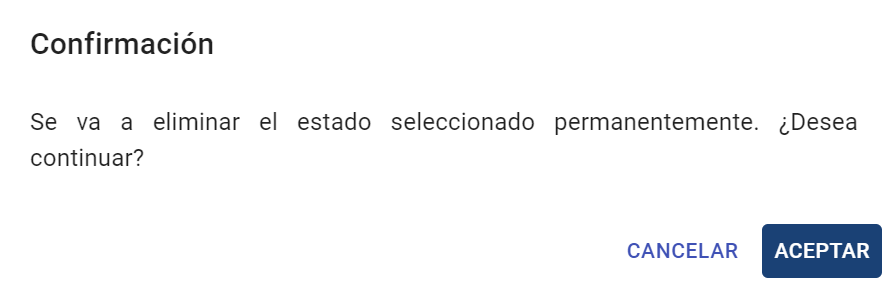

Para crear un nuevo estado, simplemente hay que pulsar el símbolo + que aparece al lado del nombre de la sección. Al pulsarlo se abrirá una nueva ventana para configurarlo:

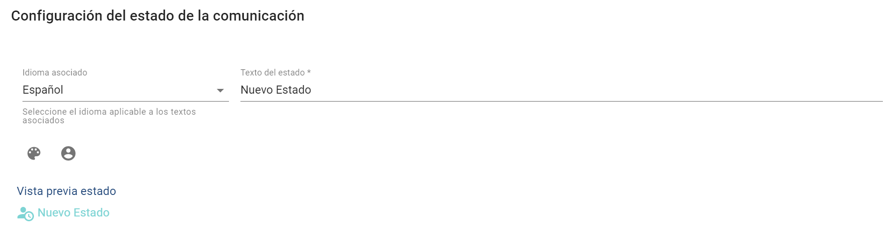

* Idioma asociado → Por defecto aparece el idioma principal de la empresa, pudiendo cambiarlo para definir el texto en caso de existir más idiomas.
* Texto del estado → En este campo se define el nombre que tomará ese estado en el idioma seleccionado.
* Color → Es posible seleccionar el color del estado, que permitirá distinguirlo rápidamente.

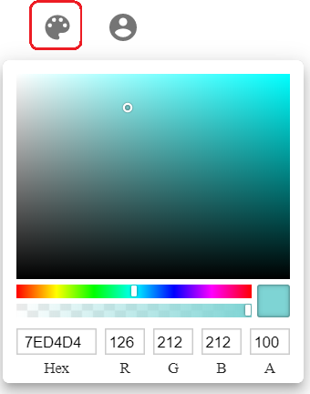

* Icono → De igual manera, es posible elegir, entre un conjunto de iconos disponibles, el que se utilizará para este estado.

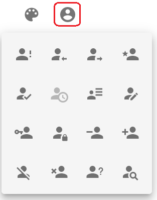

**Categorías**

En este apartado es posible personalizar las categorías que se pueden asignar a una comunicación, a partir de los que se crean por defecto.

En la tabla que se muestra, es posible añadir, eliminar y editar las categorías.

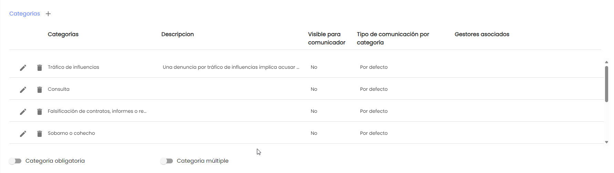

**NOTA:**  En caso de que no se tengan configuradas categorías para clasificar las comunicaciones o se eliminen, ya no aparecerá el campo en el formulario de la misma,  así como también en las comunicaciones que se hayan registrado previamente. Por lo tanto, las categorías proporcionadas por el comunicador o el gestor de la misma en cada comunicación desaparecerán.

Al pulsar el botón con el + que tenemos al lado del título, podremos añadir una nueva categoría, o al pulsar el icono con el lápiz, de una categoría, podremos editar sus propiedades:

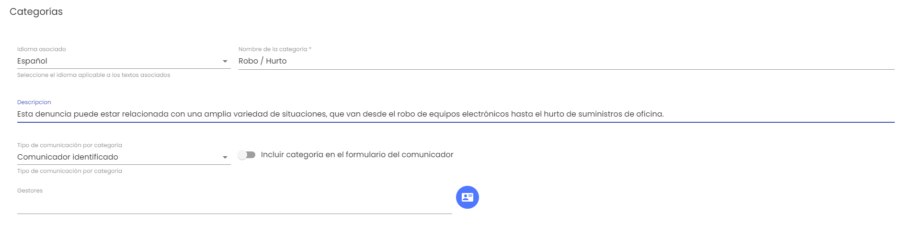

* Idioma asociado → Por defecto aparece el idioma principal de la empresa, pudiendo cambiarlo para definir el texto de la categoría en caso de existir más idiomas.
* Nombre de la categoría → En este campo se define el nombre que tomará esa categoría en el idioma seleccionado.
* Descripción de la categoría → Este campo permite agregar detalles adicionales sobre la categoría en el idioma seleccionado.
* Tipo de comunicación por categoría→ En caso de que la categoría sea habilitada para que pueda asignarla un comunicador, permite definir el tipo de identificación del mismo:

  * Por defecto: Si el canal está configurado para permitir comunicaciones anónimas o con el denunciante identificado, mantendrá el comportamiento configurado de forma general.
  * Anónima: En caso de asignar este tipo, si el comunicador asigna esta categoría, obligatoriamente la comunicación se realizará de forma anónima independientemente de la configuración general.
  * Comunicador identificado: Si se define este tipo, el comunicador deberá obligatoriamente a identificarse (ver apartado Datos Personales), independientemente de la configuración general.
* Incluir categoría en el formulario del comunicador → Este campo permite habilitar la categoría para que pueda ser seleccionada por el comunicador a la hora de dar de alta una nueva comunicación. En caso de que no se marque, la categoría estará disponible únicamente de manera interna para los gestores del canal.  
  NOTA: Si no se habilita ninguna categoría para el formulario del comunicador, este campo no aparecerá a la hora de registrar una nueva comunicación.
* Gestores: Permite asignar las denuncias automáticamente a los Gestores definidos, en función a una categoría.

Si pulsamos en el símbolo de papelera  podremos eliminar la categoría correspondiente. Para lo cual nos pedirá confirmación de la acción.

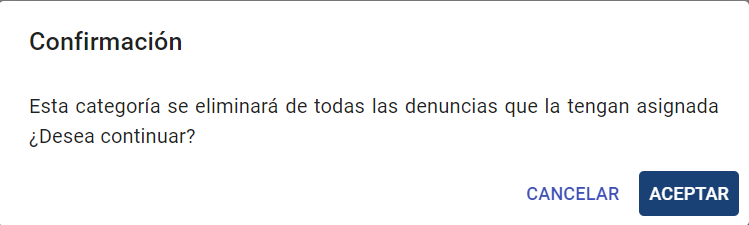

Debajo, se tienen dos campos adicionales de configuración de las categorías:

* Categoría obligatoria → Permite indicar que, en caso de que habilitemos alguna categoría para ser incluida en el formulario del comunicador, sea obligado asignarle una antes de registrarla.
* Categoría múltiple → Si se habilita este campo, los gestores del canal podrán asignar más de una categoría a una misma comunicación.

Se debe pulsar el botón *Guardar* de la parte inferior derecha para que los cambios sean efectuados.

**Visibilidad listado Comunicaciones**

En este apartado se puede ajustar qué campos globales de la denuncia (aparte de las preguntas personalizables del formulario) van a estar visibles en el listado principal de Comunicaciones o Comunicaciones Caducadas, y en qué orden.

Pulsando el icono con el Ojo, se puede mostrar u ocultar la columna, la cual aparecerá o no en el listado de comunicaciones. Mediante las flechas, se podrán reordenar para visualizarlas en el orden que se desee.

Los campos que se pueden visualizar son:

* Identificador: Este campo es el Id de la comunicación, que genera automáticamente la solución, y es único. Esta columna no se puede ocultar, ya que sirve de enlace para acceder al detalle de una comunicación.
* Asunto: Campo editable para indicar un resumen o código para identificar un caso o comunicación concreta.
* Gestores: Listado de usuarios asignados a una comunicación para su tratamiento.
* Estado actual: Muestra el estado en que se encuentra cada una de las comunicaciones. Por defecto, esta columna aparece filtrada para mostrar únicamente las comunicaciones que no estén cerradas.
* Categoría: Detalla la categoría o categorías asignadas a una comunicación.
* Tipo: Campo que muestra si una comunicación ha sido anonimizada, archivada o se encuentra activa, y permite filtrar para localizar las de un tipo concreto.
* Fecha de creación: En esta columna se muestra la fecha de registro de una comunicación.
* Comunicador: Para las comunicaciones en las que la persona que la registró se identificó, se muestra su dirección de correo electrónico. En las comunicaciones anónimas (o que fueron anonimizadas) muestra el campo "Anónima".

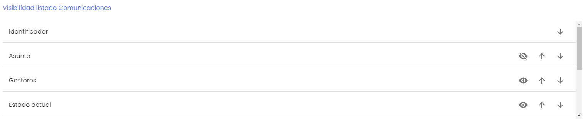

**Sistema**

**General**

* Tipos de comunicaciones permitidas.

  * Esta opción permite indicar si se podrán realizar comunicaciones anónimas, obligando a identificarse al denunciante, o de ambos tipos.
* Tipo por defecto.

  * En caso de que en el campo anterior se permitan realizar ambos tipos de comunicaciones (anónimas o con comunicador identificado), en este campo se podrá definir cual de ambos modos aparecerá marcado por defecto en el formulario de [Alta de Comunicación](../alta-de-comunicados.md).
* Expiración de Contraseña.

  * Número de días que tarda en caducar la contraseña de los usuarios, pasados estos días respecto a la fecha en que se cambió, pedirá modificarla en el siguiente inicio de sesión.
* Tamaño máximo de almacenamiento: Nos indica el espacio de almacenamiento que tenemos habilitado para los archivos incluidos en las comunicaciones. Debajo de ese límite, aparece un mensaje con el espacio utilizado, y el porcentaje respecto al máximo.
* Mensaje para comunicación anónima: Este campo sirve para personalizar la información para el comunicador cuando se vaya a registrar una nueva comunicación de forma anónima. Este texto se puede configurar para cada uno de los idiomas disponibles, utilizando el selector de Idioma.
* Límite de usuarios: Nos indica el número máximo de usuarios que podemos tener registrados en el sistema. Debajo de ese límite, aparece un mensaje con el número de usuarios actual.
* Permitir Eliminar / Anonimizar Comunicaciones.

  * Sirve para permitir eliminar o anonimizar comunicaciones a los usuarios del canal. En caso de estar desactivado no será posible eliminar comunicaciones del sistema.

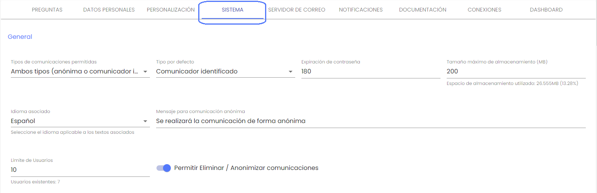

**Comunicaciones**

* Mostrar autor en Timeline del comunicador.

  * Permite configurar que desde la vista de seguimiento del comunicador, se pueda visualizar o no, el nombre del usuario gestor que ha registrado un comentario o adjunto visible por el comunicador.
* Activar caducidad de Comunicaciones.

  * Permite habilitar/deshabilitar la caducidad de las comunicaciones, y definir el plazo (en días) para que una comunicación se considere caducada o vencida, desde la fecha en que se registró.
  * En caso de estar activada, se mostrará una opción adicional en el menú para poder gestionarlas (ver [Comunicaciones Caducadas](../empresa-consulting/comunicaciones-caducadas.md)).
* Tamaño máximo por comunicación: Dentro del espacio total habilitado, es posible limitar cuánto espacio es posible ocupar en una comunicación concreta. Este límite nunca puede ser superior al total del entorno.
* Plazo de Recepción: Permite definir cuántos días desde el registro de una comunicación se enviará una alerta a los destinatarios configurados, para realizar un acuse de recibo.

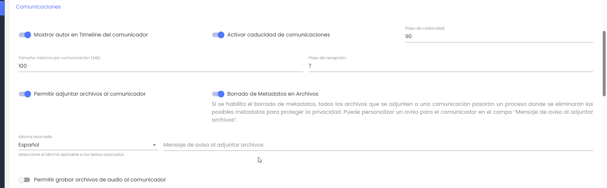

* Permitir adjuntar archivos al comunicador: Este campo sirve para habilitar o deshabilitar los permisos para adjuntar archivos locales en la propia comunicación que se enviará. Al habilitarlo se mostraran las siguientes opciones:

  * Borrado de Metadatos en Archivos: Si se habilita el borrado de metadatos, todos los archivos que se adjunten a una comunicación pasarán un proceso donde se eliminarán los posibles metadatos para proteger la privacidad. Cuando se carga un archivo en una denuncia, la eliminación de sus metadatos es un proceso transparente para el usuario. En caso de ser necesario, se puede emplear el "Mensaje de aviso al adjuntar archivos" para informar al comunicador acerca de la eliminación de los metadatos durante el proceso.
  * Mensaje de aviso al adjuntar archivos: En caso de habilitar la subida de adjuntos, se puede personalizar un mensaje que aparecerá junto con el campo de "Archivos adjuntos" del formulario de la comunicación para proporcionar indicaciones o información adicional al comunicador.

* Permitir grabar archivos de audio al comunicador: Si se habilita este campo, el comunicador podrá registrar un audio de voz para ofrecer otro mecanismo para registrar la comunicación, que realizará un tratamiento para distorsionar la voz, como parte del proceso de salvaguardar la privacidad del comunicador.

  * Indicaciones de grabación: Si se permite la grabación de audios de voz, se podrá parametrizar un mensaje con las instrucciones o información adicional que el comunicador verá a la hora de grabar el audio.

#### **Condiciones de Uso**

* Idioma → Nos permite seleccionar sobre qué idioma estamos adjuntando las condiciones del entorno.
* Condiciones de Uso → Permite adjuntar unas condiciones de uso a la herramienta, que tendrán que se aceptadas para el envío de nuevas comunicaciones.
* Actuales condiciones de uso → Muestra el nombre del archivo de condiciones que se tiene actualmente subido en la herramienta.
* Texto de las Condiciones de Uso → Permite configurar el título del apartado de aceptación de las condiciones de uso, tanto de usuarios internos como de comunicadores.
* Texto de aceptación de las Condiciones de Uso → Permite definir el texto específico de la aceptación de las condiciones.

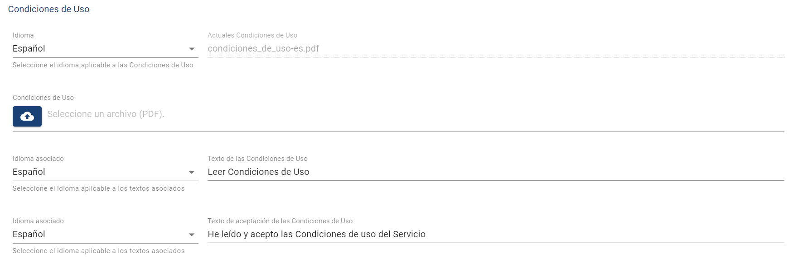

Estos cambios se aplicarán en los apartados de aceptación del usuario:

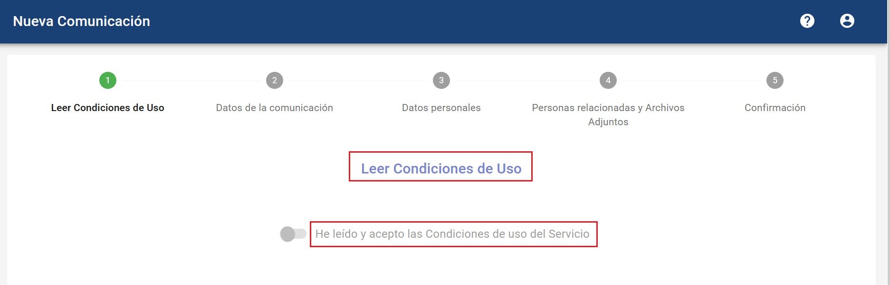

#### **Política de Privacidad**

En este apartado se puede personalizar la política de privacidad que estará disponible en la vista del Comunicador o denunciante.

* Idioma → Nos permite seleccionar sobre qué idioma estamos adjuntando la Política de Privacidad.
* Política de Privacidad → Permite adjuntar la Política de Privacidad corporativa a la herramienta, que podrá consultarse por el comunicador.
* Actual Política de Privacidad → Muestra el nombre del archivo de condiciones que se tiene actualmente subido en la herramienta.
* Texto de la Política de Privacidad → Permite configurar el título del enlace donde se podrá descargar la política de privacidad por parte de los comunicadores.

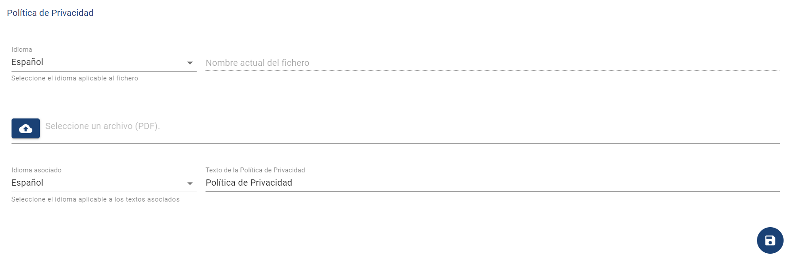

Esta configuración se aplicará a la vista del comunicador, tanto al realizar nuevas comunicaciones como al acceder al seguimiento de una realizada previamente.

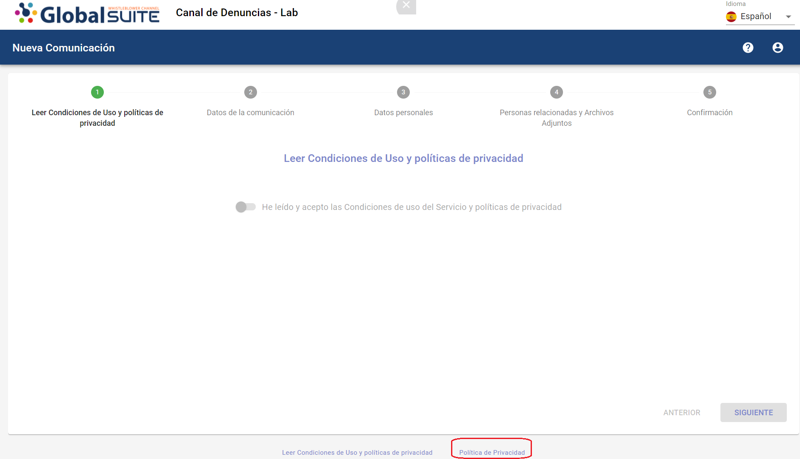

#### **Asunto**

En este apartado permite la posibilidad de habilitar/deshabilitar el campo "Asunto" para que sea visible en las fichas de las [Comunicaciones](https://help.globalsuite.es/display/CD/.Comunicaciones+vv2.46)  y se incluirá en los informes que se pueden obtener de la herramienta. Si se desea también se puede modificar el nombre del campo "Asunto". 

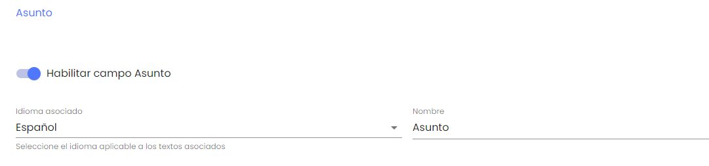

**Doble Factor de Autenticación**: Se ha incorporado la funcionalidad de incorporar un segundo factor de autenticación en la herramienta GlobalSUITE Whistleblower Channel.

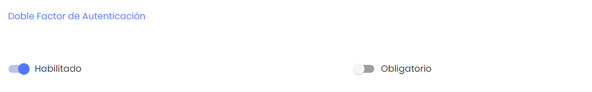

* De manera adicional al mecanismo de autenticación actual (local, Active Directory, o ADFS Single Sign-On) se puede activar un segundo factor de autenticación mediante TOTP (Time-Based One-Time Password).  
  Este mecanismo permite sincronizar algún dispositivo para introducir un código numérico que cambia cada 30 segundos, y que será solicitado en el momento que el usuario realiza login en la herramienta.
* Esta configuración se puede activar si así se requiere, bien de forma opcional, o habilitarlo de forma obligatoria, en cuyo caso a los usuarios tendrán que configurarlo en el siguiente acceso.
* Cuenta con mecanismos de seguridad para poder acceder una única vez a la herramienta (Códigos de Recuperación), así como poder desactivarse para un usuario concreto en caso de pérdida o borrado del dispositivo asociado.

*Para activar el Doble Factor de Autenticación mediante TOTP, debe realizar los siguientes pasos:*

*1. Instalar y utilizar alguna de las aplicaciones que permiten gestionar este doble factor. Algunas de ellas son:*

* *Google Authenticator (*[*Apple Store*](https://apps.apple.com/es/app/google-authenticator/id388497605)*,*[*Play Store*](https://play.google.com/store/apps/details?id=com.google.android.apps.authenticator2&hl=es&gl=US))*)*
* *Microsoft Authenticator (*[*Apple Store*](https://apps.apple.com/es/app/microsoft-authenticator/id983156458)*,*[*Play Store*](https://play.google.com/store/apps/details?id=com.azure.authenticator&hl=es&gl=US)*)*
* *FreeOTP (*[*Apple Store*](https://apps.apple.com/us/app/freeotp-authenticator/id872559395)*,*[*Play Store*](https://play.google.com/store/apps/details?id=org.fedorahosted.freeotp&hl=es&gl=US)*)*
* *Otros*

*2. Una vez la tenga instalada, mediante la aplicación debe escanear el código QR que le aparece en pantalla, o introducir la "Cadena de secreto" de forma textual.*

*3. Una vez enlazado, deberá introducir el token o código temporal que se genera en la aplicación, y pulsar el botón "Activar".*  
*IMPORTANTE: Este token cambia cada 30 segundos, por lo que una vez pasado ese tiempo, dejará de ser válido.*

*4. Por último, deberá almacenar de forma segura los códigos de recuperación. Estos códigos le servirán para autenticarse una única vez en WhistleblowerChannel en caso de pérdida del dispositivo o borrado de la aplicación.*

# **Servidor de Correo**

Es la siguiente opción del menú superior, donde es posible añadir un **Servidor de Correo** propio para el envío de las notificaciones de la herramienta:

* TLS (Transport Layer Security) → Permite habilitar un protocolo criptográfico, para el envío de notificaciones seguras.
* Direccion URL → Ruta del servidor que ha de ponerse desde el departamento técnico.
* Puerto → Puerto que es necesario tener abierto desde al área o departamento técnico para permitir que los emails de comunicación lleguen a sus destinos.

#### Configuración de Email

* Remitente del Email → Remitente del correo de las notificaciones que envía la herramienta.
* Alias del Remitente →  Nombre que va a tener el remitente cuando lleguen estas notificaciones al correo.

#### Autenticación en el Servidor

* Usuario → Cuenta de correo habilitada en el servidor (No necesaria en caso de tener Relay)
* Contraseña del usuario → Contraseña de la cuenta de correo. (No necesario en caso de tener Relay)

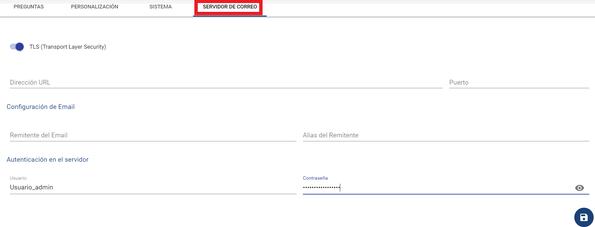

# **Notificaciones**

Es este apartado del menú superior, donde es posible configurar las notificaciones que envía la herramienta en determinados casos.

#### Notificaciones disponibles

Existe una serie de notificaciones que se pueden configurar de manera específica, que aparecen en el listado de este apartado. En la parte derecha es posible consultar si cada una de ellas están habilitadas o no. Las notificaciones disponibles son:

* Alta de Comunicaciones → Esta notificación se envía en el momento en que se registra una nueva comunicación (de forma anónima o no), y permite informar a los usuarios que gestionan el canal.
* Cambio de estado de Comunicación → Esta notificación interna, permite alertar a los usuarios seleccionados cuando se realiza un cambio de estado en una comunicación.
* Cambio de estado de Comunicación. Notificación Externa → Permite informar a la persona que realizó la comunicación (en caso de que fuera un comunicador no anónimo) de que se ha realizado un cambio de estado.
* Caducidad de Comunicaciones → Esta alerta automática, se envía en caso de que existan comunicaciones caducadas en la empresa. Ver [Comunicaciones Caducadas](../empresa-consulting/comunicaciones-caducadas.md)
* Comentarios de la Comunicación → Si se habilita esta notificación, enviará un correo a los destinatarios configurados en caso de que se registre un comentario en una comunicación
* Comentarios públicos de la Comunicación → Esta notificación permite enviar un aviso al comunicador (no anónimo) cuando se registren comentarios públicos, para que pueda acceder al seguimiento de la comunicación para consultarlos.
* Subida de documentación en la Comunicación → Esta notificación avisa a los usuarios correspondientes de que se ha incorporado un nuevo documento adjunto en una comunicación.
* Subida de documentación pública → Permite informar al comunicador (en caso de que no sea anónimo) de que se ha subido un documento adjunto a la comunicación, y que pueda acceder para consultarlo.
* Alta de Usuarios → Permite personalizar el mensaje que se enviará a los usuarios de cualquier perfil que se creen en una empresa, con las instrucciones y credenciales para acceder al apartado de administración del canal.  
  Esta notificación deberá contener las variables *$userLogin* y *$userPassword*, de forma obligatoria.
* Alta de Comunicadores → Esta notificación, que no puede ser desactivada, permite personalizar el mensaje que se enviará a los comunicadores (no anónimos) que registren una nueva comunicación, con las instrucciones para acceder al seguimiento.  
  Esta notificación deberá contener las variables *$userLogin* y *$userPassword*, de forma obligatoria.
* Nueva comunicación asignada → Esta alerta permite personalizar el texto que se enviará a los Gestores a los que se asigne una comunicación para su seguimiento.
* Desasignado de la comunicación → Permite configurar cómo se avisará a los Gestores cuando se les desasigne una comunicación que tenían previamente asignada.
* Comunicación Eliminada/ Anonimizada → Permite alertar a los roles seleccionados cuando una comunicación haya sido eliminada o anonimizada. Por defecto esta desactivada, para activarla se deberá pulsar el campo tipo check "Activar/Desactivar".
* Caducidad de Licencia → Permite definir qué destinatarios recibirán aviso cuando la licencia de GlobalSuite® Whistleblower Channel esté próxima a caducar.
* Recordatorio recepción de comunicación → Esta alerta interna, permite notificar a los usuarios del Canal, incluyendo a los gestores asignados, cuando una comunicación se haya registrado X días antes (siendo esta cantidad configurable)
* Aviso recepción de comunicación al comunicador. Notificación externa → Permite notificar del estado o situación de la denuncia registrada en el Canal, cuando pase un determinado número de días desde la creación. Esta alerta por correo electrónico se enviará únicamente en caso de que el comunicador no la haya registrado de forma anónima.

#### Detalles de la notificación

Cuando se selecciona una notificación en la tabla de notificaciones disponibles, se carga en este apartado toda la información para configurar la misma.

* Activar / Desactivar → Permite habilitar o deshabilitar una notificación concreta para la empresa.
* Roles Disponibles → Es posible seleccionar a qué perfiles de usuario se enviará correo electrónico de esa notificación.

  * Administrador Global: Todos los usuarios de la empresa con ese perfil.
  * Consulting: Los usuarios de perfil "Consulting" que estén asignados a la empresa que se está notificando.
* Idioma asociado → Nos permite alternar sobre qué idioma estamos parametrizando el mensaje de la notificación. (Una vez seleccionado el idioma, podremos completar el texto de los campos en dicho idioma)
* Mensaje de la notificación → Campo de texto que permite especificar el mensaje que se enviará en el cuerpo del correo para cada notificación. Es posible incorporar variables o textos clave para que sean sustituidos por el parámetro correspondiente. Estos son:

  * *$company*: Corresponde al nombre (Razón social) de la empresa sobre la que se está trabajando
  * *$communicationId*: Es el código identificador de la comunicación afectada.
  * *$communicationStatus*: Indica el estado en el que se encuentra la comunicación sobre la que se está notificando.
  * *$userLogin:* Indica el campo login, o identificador del usuario (válido tanto para usuarios internos como comunicadores)
  * *$userPassword:* Muestra la contraseña generada en un nuevo usuario (utilizable solamente para las notificaciones de Alta de Usuario y Alta de Comunicador)
  * *$userName*: Nombre completo del usuario
  * *$userLastname*: Apellidos del usuario
  * *$publicURL:* Se sustituye por la URL de acceso a la vista de comunicadores, donde podrán reportar una nueva comunicación, o visualizar una previa.
  * *$adminURL:* Es la dirección de acceso para la parte interna del canal, donde se tiene acceso a la gestión de una empresa tanto Administradora como Consulting.

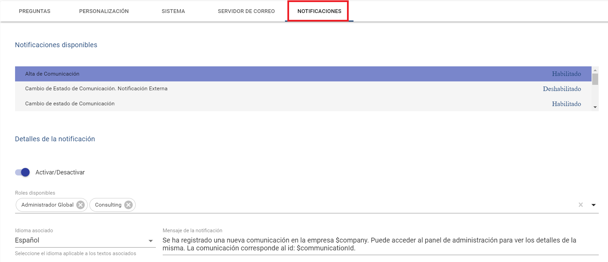

##### **NOTA**: En las empresas Administradoras no aplican las notificaciones. Sin embargo, es posible configurarlas porque esa configuración se copia a las empresas inferiores.

##### Las notificaciones para usuarios Administradores Global y Consulting se gestionan dentro de cada canal.

# **Documentación**

Esta opción permite a los administradores incorporar documentos que sean consultados por otros usuarios gestores desde la vista de [Documentos](documentos.md), o por las personas que van a dar de [alta un nuevo comunicado](../alta-de-comunicados.md).

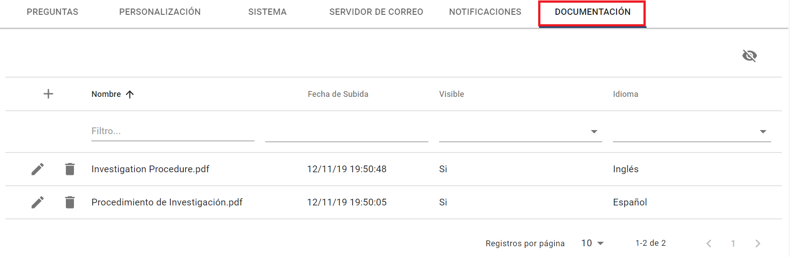

Al pulsar el botón + aparece una ventana donde poder subir ese nuevo documento, con los siguientes campos:

* Idioma asociado → El archivo incorporado será visible para los usuarios que tengan configurado dicho idioma en la herramienta. Esto permite subir una versión del documento para cada idioma.
* Subida de ficheros → Permite seleccionar en el equipo local, el documento que se incorporará a esta tabla.
* Visible en cliente → Al marcarlo, el documento estará disponible para las personas que vayan a formular una nueva comunicación.

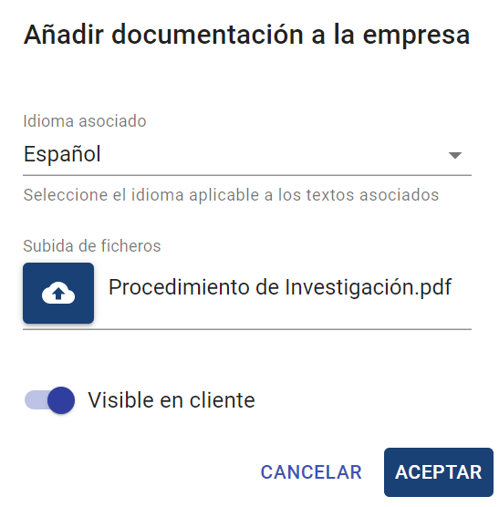

# **Conexiones**

Este apartado permite a los administradores configurar conexiones con sistemas, servicios o herramientas externas.

### ADFS

En caso de querer integrar la empresa con el servidor de ADFS corporativo, se podrá configurar en este apartado. Esto permitirá a los usuarios acceder mediante Single Sign-On (SSO), directamente en caso de estar autenticado en el dominio.

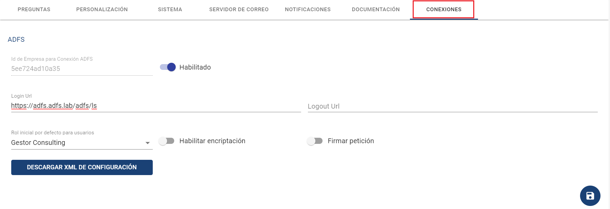

##### **NOTA:** Esta funcionalidad se ofrece como un servicio adicional. Si quiere más información, póngase en contacto con su proveedor.

En primer lugar, para poder configurar la integración, esta tiene que estar habilitada (check **Habilitado**).

A continuación se dispone de los siguientes campos:

* Id de Empresa para Conexión ADFS → Es un campo que se genera de forma automática. Indica la cadena de confianza que se establece entre el servidor ADFS y GlobalSUITE® Whistleblower Channel. Es un campo único.
* Login Url → Cuando se desea configurar una conexión usando el método SP initiated SSO, se debe introducir la url del servicio del IdP donde se realiza la autenticación vía ADFS.
* Logout Url → Dirección a la que se redirige cuando un usuario con autenticación ADFS cierra la su sesión. Si no se define, al cerrar sesión volverá a la pantalla de login por defecto.
* Habilitar encriptación → Configuración de la conexión ADFS que permite que los parámetros que se reciben desde el IdP vayan cifrados.
* Firmar petición → Indica que, usando la configuración SP initiated SSO, la petición de autenticación que se realiza al IdP será firmada.
* Rol inicial por defecto para usuarios → Aquí se puede indicar qué rol por defecto tomarán los nuevos usuarios que accedan por ADFS. Pueden ser:

  * Administrador
  * Administrador Global
  * Consulting
  * Gestor Consulting

Los roles de usuario pueden ser obtenidos directamente del servidor de ADFS, en caso de no recibir datos sobre el rol o que los datos que se reciban sean erróneos se utilizará el rol configurado en este campo.

Mediante el botón "Descargar XML de Configuración" se puede descargar el fichero XML de configuración para cargarlo como una nueva entrada de veracidad de usuarios de confianza.

##### **NOTA IMPORTANTE:** El estándar SAML2 dispone de varios protocolos de binding

* HTTP Redirect
* HTTP POST
* HTTP Artifact

##### Actualmente GlobalSuite® Whistleblower Channel soporta únicamente el protocolo HTTP Redirect.

#### Configuración Servidor ADFS (SAML 2.0)

En la configuración del servidor ADFS se debe indicar que los datos a pasar en la petición son como mínimo:

* Id. Nombre (nameidentifier)
* Dirección de correo electrónico (emailaddress)

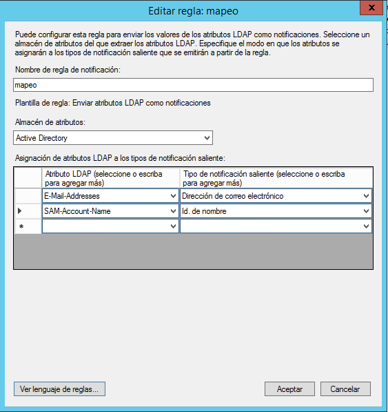

Si se desea enviar la configuración del rol para crear los nuevos usuarios de ADFS deberá utilizarse el claim:

<http://schemas.microsoft.com/ws/2008/06/identity/claims/role>

IMPORTANTE: El nombre del rol que se envía desde el servidor de ADFS debe coincidir con alguno de los roles configurados en GlobalSUITE.

Para obtener más información sobre la configuración del servidor ADFS puede acceder a:

<https://docs.microsoft.com/es-es/windows-server/identity/ad-fs/operations/create-a-relying-party-trust>

#### Autenticación ADFS (SAML 2.0)

Existen dos tipos de autenticación con ADFS:

* IDP initiated SSO, el proceso de autenticación es iniciado por el idp, el usuario dispone de una lista de “aplicaciones corporativas”, selecciona la que corresponde de GlobalSUITE e inicia la autenticación. A continuación, se muestra una imagen tipo de este formulario de aplicaciones.

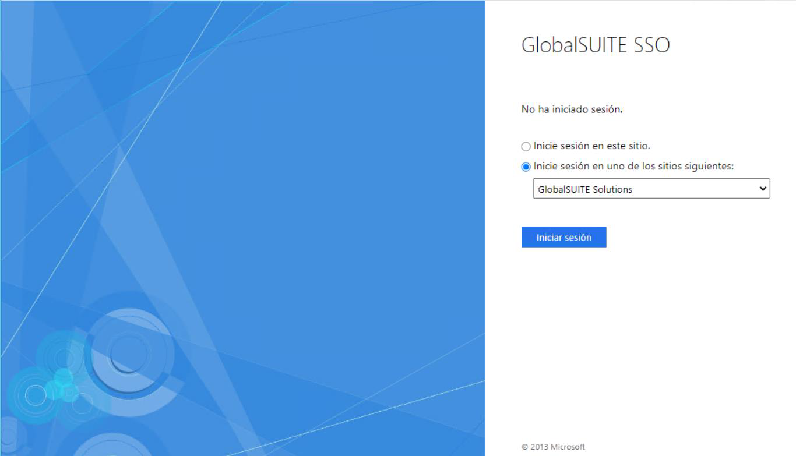

* SP initiated SSO, el proceso de autenticación es iniciado por GlobalSUITE, para usar este método se debe acceder con una url específica. Esta url se forma concatenando la url de GlobalSUITE con el texto: *?entityID=[Identificador de Confianza]*, donde el identificador de confianza es el código generado en la conexión y que puede encontrase en el campo con el mismo nombre, ver apartado 1 de este documento.

Un ejemplo de url es:

https://demochannel.globalsuitesolutions.com/admin/?entityId=5ee724ad10a35

La autenticación con ADFS tiene las siguientes particularidades:

* Si el usuario está accediendo por primera vez a la herramienta, a través de ADFS, se creará un usuario automáticamente con el nombre de usuario que se provee en la petición SAML.
* Si el nombre de usuario ya existe en GlobalSUITE y no es el mismo que se ha creado en la primera conexión se lanzaría un mensaje de error.

### Azure AD

En caso de querer integrar la empresa con el servidor de Azure AD corporativo, se podrá configurar en este apartado. Esto permitirá a los usuarios acceder mediante Single Sign-On (SSO), directamente en caso de estar autenticado en el dominio.

##### **NOTA:** Esta funcionalidad se ofrece como un servicio adicional. Si quiere más información, póngase en contacto con su proveedor.

En primer lugar, para poder configurar la integración, esta tiene que estar habilitada (check **Habilitado**).

A continuación se dispone de los siguientes campos:

* Application ID → Es un campo que se genera de forma automática en el panel de configuración de Azure AD y es único para identificar la aplicación que se va a integrar.
* Object ID → Este parámetro es opcional, pero permite utilizar los roles definidos en el gestor de identidades de Azure en GlobalSuite.
* Directory (tenant) ID → Este es el Azure Active Directory’s Global unique identifier (GUID).
* Login Url → Campo automático Cuando se desea configurar una conexión usando el método SP initiated SSO, se debe introducir la url del servicio del IdP donde se realiza la autenticación vía ADFS.
* Logout Url → Dirección a la que se redirige cuando un usuario con autenticación con Azure AD cierra la su sesión. Si no se define, al cerrar sesión volverá a la pantalla de login por defecto.
* Rol inicial por defecto para usuarios → Aquí se puede indicar qué rol por defecto tomarán los nuevos usuarios que accedan por ADFS. Pueden ser:

  * Administrador
  * Administrador Global
  * Consulting
  * Gestor Consulting

Los roles de usuario pueden ser obtenidos directamente del servidor de AzureAD, en caso de no recibir datos sobre el rol o que los datos que se reciban sean erróneos se utilizará el rol configurado en este campo.

* La autenticación se hará mediante Single Sign-On, para lo cual el usuario únicamente tendrá que acceder a la URL específica en la configuración.
* Si el usuario ya está autenticado en su equipo, el acceso será directo al sistema.
* Si no está autenticado en el navegador, o se tiene varias cuentas activas, se solicitará elegir qué cuenta utilizar o introducir las credenciales válidas.

* En caso de tener configurado el uso de MFA (Multi Factor Autentication) en Azure AD se solicitará el código de verificación a través de Microsoft Authenticator, correo electrónico o SMS. Esto es compatible con el mecanismo de 2FA que está incluido en GlobalSuite® Whistleblower Channel y que se podrá habilitar.

* Cuando un usuario autorizado accede por primera vez, se registrará en el Canal asignándole el rol por defecto definido en la configuración.

* Si el nombre de usuario ya existe en GlobalSuite Whistleblower Channel y no es el mismo que se ha creado en la primera conexión se lanzaría un mensaje de error.

# **Dashboard**

Esta opción permite a los administradores personalizar las gráficas que aparecen en el apartado de [Inicio - Vista General de la Empresa](inicio-vista-general-de-la-empresa.md)

En este apartado podremos reordenar las gráficas para que aparezcan en el orden que deseemos, a través de las flechas de la parte derecha.

En caso de que no queramos visualizar alguna gráfica, podremos ocultarla de la vista principal.

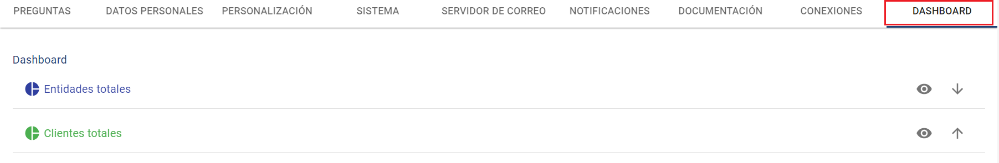

Por defecto, estas gráficas son:

* Entidades totales (nº de canales de denuncia)
* Clientes totales (nº de empresas inferiores)
