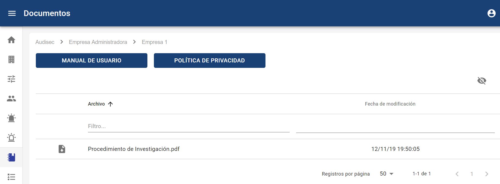

# Documentos

##### **NOTA:** Esta opción está disponible para los usuarios Administrador Global, Administrador y Consulting.

En esta sección se muestran los enlaces del Manual de Usuario y la Política de privacidad, si se pulsa encima de los botones se abren en una ventana nueva para poderlo ver.

Además, en caso de que se hayan subido documentos de apoyo en el apartado de [Configuraciones](configuraciones.md) (en el idioma del usuario), aparecen en la tabla inferior para poder descargarlos a través del icono de la parte izquierda de la tabla.

**NOTA:** También es posible acceder al Manual de usuario desde el pie de pagina de la plataforma, opción "Manual de usuario"
