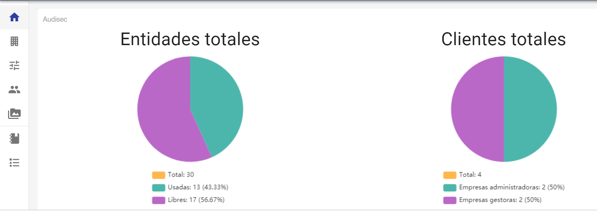

# Inicio - Vista General de la Empresa

##### **NOTA:** Esta opción está disponible para los usuarios Administrador Global, Administrador y Consulting. En el caso de los usuario Consulting, sólo verán la gráfica de la izquierda.

El resumen de empresa permite tener una referencia de la cantidad de licencias de las que dispone la empresa, y de todas ellas cuántas están siendo usadas. Esta opción nos permite tener una contabilidad de las mismas para que se puedan chequear las necesidades de ampliar estas licencias por parte de la empresa.

Este Dashboard inicial es posible ajustarlo en el apartado de [Configuraciones](configuraciones.md)

Se pueden apreciar en el gráfico de la izquierda:

* **Total** de empresas o entidades que se tienen contratadas.
* Entidades **Usadas** en ese momento, con su porcentaje respecto al total.
* Entidades **Libres** para ser usadas, también con su porcentaje sobre el total contratado.

Se pueden apreciar en el gráfico de la derecha:

* Total de clientes que se gestionan, son las empresas hijas directamente creadas.
* Empresas administradoras en ese momento, con su porcentaje respecto al total.
* Empresas gestoras que se tienen y su porcentaje respecto al total.

