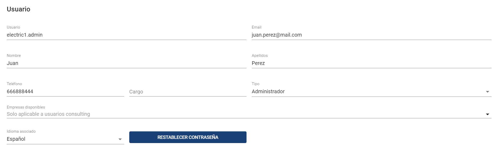
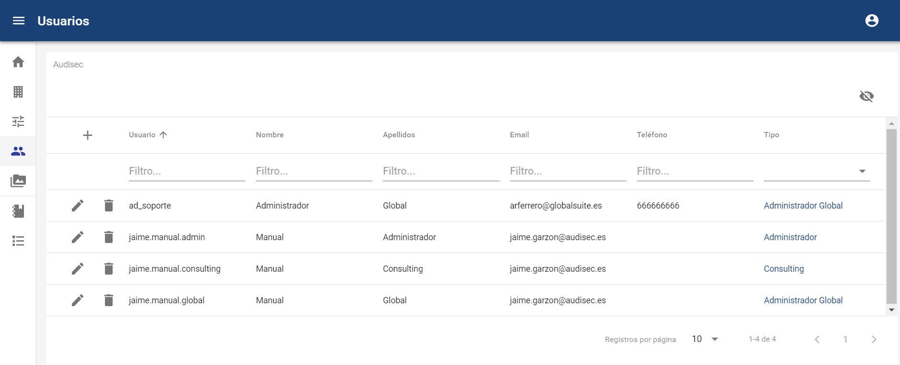
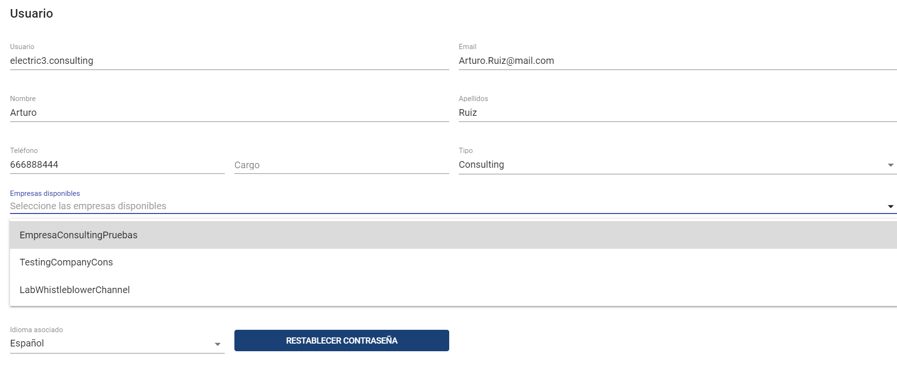
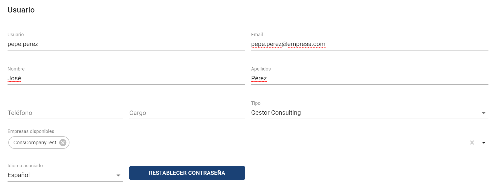

# Usuarios

##### **NOTA:** Esta opción está disponible para los usuarios Administrador Global y Administrador.

En este tipo de empresa es posible crear tres tipos de usuarios:

### **Administrador Global**

Es el rol de usuario con todos los permisos para tener posibilidad de administrar y parametrizar el entorno, además tendrá acceso a la visualización y gestión de comunicaciones. Podrá asignar denuncias a los gestores.

### **Administrador**

Es el rol de usuario con todos los permisos para tener posibilidad de administrar y parametrizar el entorno. A diferencia del anterior rol, no tendrá acceso a la visualización de las comunicaciones, ni a la asignación de estas a los gestores.

### Consulting

Usuario que tendrá la posibilidad de acceder a uno o varios canales de comunicación, dentro de estos, tendrá acceso a la visualización y gestión de comunicaciones. Podrá asignar comunicaciones a los gestores. Este usuario solo podrá realizar todas las acciones anteriores, en empresas Consulting (Canales de Comunicación) a las que un Administrador Global o Administrador le haya dado acceso.

Como ejemplo de creación de un usuario Consulting, se deben poner los siguientes datos para darle acceso a uno o varios canales..

### Gestor Consulting

Usuario que tendrá la posibilidad de acceder a uno o varios canales de comunicación en los que se le haya incluido, y dentro de estos, únicamente tendrá acceso a la visualización y gestión de las comunicaciones que se le asignen directamente (ver [Comunicaciones](../empresa-consulting/comunicaciones.md)). Este usuario solo se le podrán asignar comunicaciones en empresas Consulting (Canales de Comunicación) a las que un Administrador Global o Administrador le haya dado acceso.

##### Restablecer Contraseña

Es posible restablecer la contraseña a un usuario, a través del botón correspondiente disponible en su ficha. Al pulsarlo, se generará una nueva contraseña temporal que se le enviará por correo (el usuario deberá cambiarla en el primer acceso.

Esto únicamente es posible para los usuarios que acceden a través de autenticación local (con usuario y contraseña propios de la aplicación).

Las contraseñas introducidas deben cumplir la siguiente política de contraseñas seguras para usuarios locales:

* Caducidad: las contraseñas tendrán una caducidad máxima de 180 días (6 meses).
* Complejidad: Tener al menos 13 caracteres y contener minúsculas, mayúsculas, números y símbolos ($, &amp;, @, ., #).
* Histórico de últimas contraseñas: Cuando se solicite cambio de contraseña la nueva deberá ser distinta a la actual y no debe coincidir con las cinco últimas contraseñas utilizadas.
* Bloqueo de usuarios: Ante un número de intentos fallidos consecutivos en el proceso de autenticarse, el usuario quedará bloqueado temporalmente.

En caso de que el usuario tenga autenticación por otro mecanismo (como ADFS), no podrá restaurarse la contraseña.

##### Notificaciones

Aparte de las notificaciones que reciben los usuarios Gestores cuando se les asigna una comunicación, todos los tipos de usuario recibirán las notificaciones que tengan configuradas en cada entorno (ver apartado [Configuraciones](../empresa-consulting/configuraciones-consulting.md)).

En cualquier caso, cada usuario podrá desactivar de forma centralizada las notificaciones que recibe, en el apartado Mi Perfil, además de poder cambiar su contraseña:

**Conflicto de Intereses**

Además, cuando el Conflicto de Intereses está habilitado en el apartado de [Configuraciones > Preguntas](https://help.globalsuitesolutions.com/canal-comunicaciones/configuraciones-consulting#ConfiguracionesConsulting-Preguntas), es posible configurar qué usuarios de los que tienen acceso a las denuncias (los roles Administrador Global, Gestor o Consulting a nivel organizativo superior en caso de tener múltiples canales) van a estar incluidos en el conflicto de intereses y serán visibles para el denunciante.

Para ello, accediendo al formulario de estos usuarios (salvo los de rol Administrador, que en ningún caso tienen acceso a las denuncias) se podrá habilitar o deshabilitar el que sea susceptible de tener un conflicto de intereses.

Esto es así para que en los casos que también existan usuarios independientes o de terceros que no estarían involucrados, estos no aparezcan para el denunciante.
