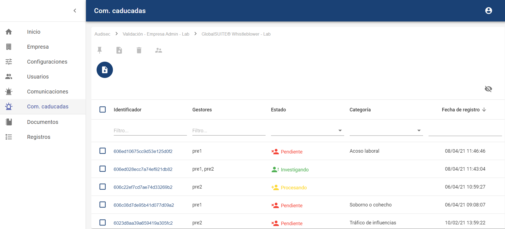
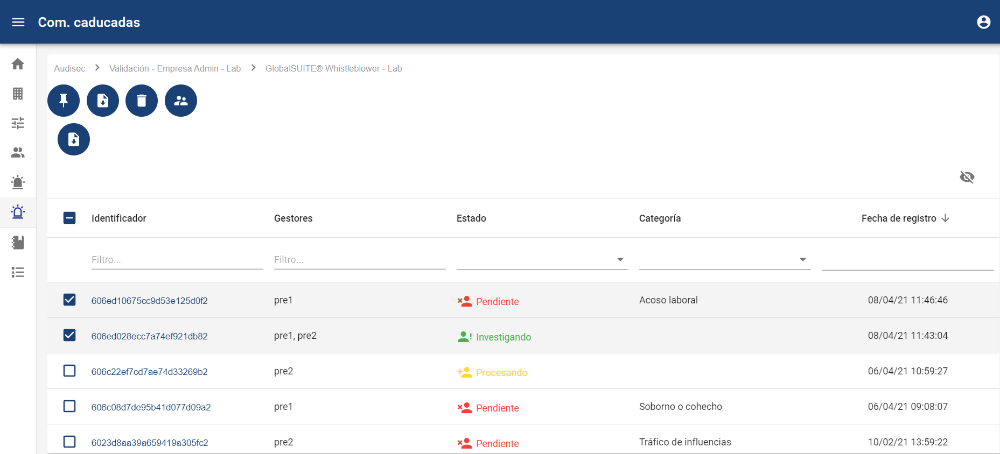
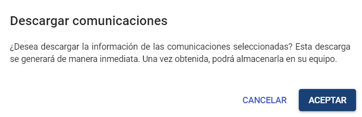
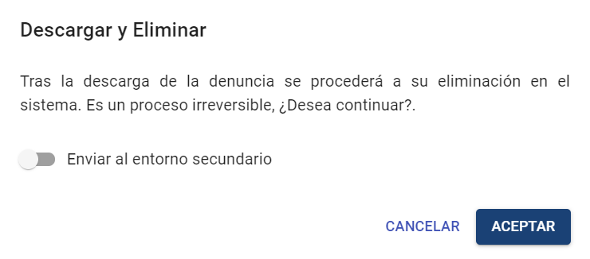

# Comunicaciones Caducadas

### Listado de Comunicaciones Caducadas

Esta opción permite visualizar todo el listado de comunicaciones que están caducadas, es decir, que fueron registradas antes del plazo (en días) configurado en el apartado Configuraciones > Sistema.

En esta primera vista podremos ver el ID de la comunicación, Gestores asignados a la comunicación, Estado en el que se encuentra y Fecha de creación.

Los campos de esta sección son los siguientes:

* Identificador, es un código alfanumérico aleatorio, generado por el sistema.
* Gestores, son las personas que están asignadas a la comunicación y que pueden acceder a la gestión de la misma.
* Estado actual, son los diferentes estados de la comunicación. Pueden ser los siguientes:

  * Pendiente
  * Procesado
  * Investigando
  * Resuelta → Estado en el que la comunicación queda bloqueada salvo el desplegable de estado, el cual se podrá modificar para reabrir la comunicación.  
    NOTA: Estos estados son los que se proponen por defecto, pero son modificables en el apartado [Configuraciones Consulting](configuraciones-consulting.md)
* Categoría, muestra la categoría (o categorías, si se permite asignación múltiple), que tiene cada comunicación asignada.
* Fecha de registro, día en el cual se creó la comunicación.
* Preguntas del formulario de una comunicación. Se podrán añadir preguntas configuradas en el apartado [Configuraciones Consulting](configuraciones-consulting.md) (Preguntas) que podrán ser consultadas, filtradas o descargadas en esta vista.

Es posible descargar el listado de comunicaciones caducadas a través del botón 

que aparece en la parte superior, en formato CSV, para su almacenamiento o tratamiento posterior. Este informe tiene en cuenta los filtros y selección de columnas que se hayan aplicado sobre la vista.

En esta vista, se pueden seleccionar múltiples comunicaciones de entre las que están caducadas.

Para estas comunicaciones seleccionadas es posible marcarlas para que no aparezcan en esta vista, pulsando el botón "Mantener Comunicaciones".  Una vez pulsado, desaparecerán de la vista de comunicaciones caducadas, aunque seguirán apareciendo en la vista de Comunicaciones general.

Igualmente, es posible descargar esas comunicaciones seleccionadas, pulsando el botón "Descargar Comunicaciones".

Así como eliminar definitivamente las comunicaciones seleccionadas mediante el botón "Descargar y Eliminar Comunicaciones".

En caso de que esté habilitado el Entorno Secundario (ver [Configuraciones](configuraciones-consulting.md)), en la petición de confirmación se podrá marcar que antes de eliminar la comunicación la envíe al entorno secundario habilitado.

Por último, podremos acceder al detalle de la comunicación pulsando en el link que aparece en la columna "Identificador", y poder gestionarlas de forma particular.
