# Comunicaciones

##### **NOTA:** Esta opción está disponible para los usuarios Administrador Global, Consulting y Gestor.

## Listado de Comunicaciones

Esta opción permite visualizar todo el listado de comunicaciones del canal. En esta primera vista podremos ver el ID de la comunicación, Gestores asignados a la comunicación, Estado en el que se encuentra y Fecha de creación.

Los campos de esta sección son los siguientes:

* Identificador, es un código alfanumérico aleatorio, generado por el sistema.
* Gestores, son las personas que están asignadas a la comunicación y que pueden acceder a la gestión de la misma.
* Estado actual, son los diferentes estados de la comunicación. Pueden ser los siguientes:

  * Pendiente
  * Procesado
  * Investigando
  * Resuelta → Estado en el que la comunicación queda bloqueada salvo el desplegable de estado, el cual se podrá modificar para **reabrir** la comunicación.
  * Abiertas → Es un filtro, que se aplica por defecto al entrar en esta vista, y que muestra todas las comunicaciones que no se encuentran en estado Resuelta (están pendientes o en proceso).

**NOTA:** Estos estados son los que se proponen por defecto, pero son modificables en el apartado [Configuraciones Consulting](configuraciones-consulting.md)

* Asunto: muestra un resumen o código que facilite la gestión de la comunicación en caso de que se haya habilitado la opción en Configuración > [Sistema.](https://help.globalsuite.es/display/CD/.Configuraciones+Consulting+vv2.46)  Además se podrán realizar búsquedas sobre el mismo, para simplificar su identificación o localización y se incluirá en la descarga CSV que se puede realizar en esta vista.

**NOTA:**En caso de completar el campo asunto con el mismo valor que ya contenga otra comunicación, el sistema mostrará un aviso informativo, aunque permitirá continuar. 

* Gestores: muestra el gestor o gestores asignados a la comunicación.
* Administradores Excluidos: En caso de que el Conflicto de Intereses está habilitado en el apartado de [Configuraciones > Preguntas](https://help.globalsuitesolutions.com/canal-comunicaciones/configuraciones-consulting#ConfiguracionesConsulting-Preguntas), se mostrarán qué usuarios han sido excluidos de la comunicación y no tienen acceso a la misma.
* Categoría, muestra la categoría (o categorías, si se permite asignación múltiple), que tiene cada comunicación asignada.
* Fecha de creación, día y hora en el cual se creó la comunicación.
* Comunicador: se podrá visualizar el e-mail del comunicador para comunicaciones no anónimas.  Además se podrá filtrar por este campo, y se incluirá en la descarga CSV que se puede realizar en esta vista.
* Preguntas del formulario de una comunicación. Se podrán añadir preguntas configuradas en el apartado [Configuraciones Consulting](configuraciones-consulting.md) (Preguntas) que podrán ser consultadas, filtradas o descargadas en esta vista.

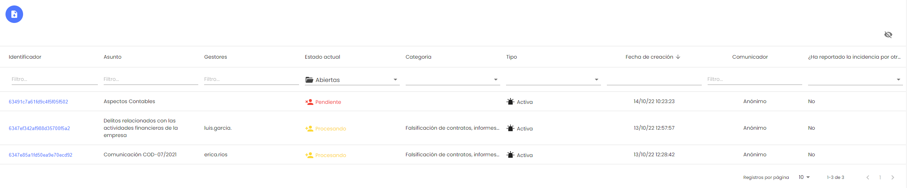

Además de estas columnas que aparecen visibles por defecto, es posible mostrar una columna adicional denominada "Tipo". Esta columna se puede visualizar con el icono   que aparece en la parte superior derecha. Al hacerlo, aparece el desplegable de todas las columnas para mostrar u ocultar las que se quieran:

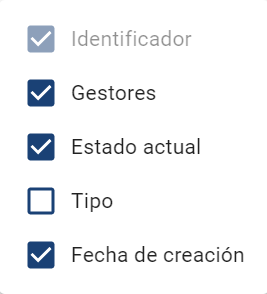

La columna Tipo permite filtrar las comunicaciones por los siguientes parámetros:

* Activa → Son las comunicaciones que se encuentran en proceso de gestión.
* Anonimizada → En estas comunicaciones se ha realizado el proceso de anonimización, para eliminar los datos de carácter personal.
* Archivada → Son las comunicaciones que han superado el plazo máximo definido, y desde el apartado de [Comunicaciones Caducadas](comunicaciones-caducadas.md) se ha marcado para mantenerla en el entorno.
* Anonimizada y Archivada → Estas comunicaciones, que superaban el plazo máximo definido, se han marcado para mantenerlas en el entorno, y además se han anonimizado los datos personales que contuviera.

**NOTA:** Las columnas que se hayan seleccionado u ocultado, se mantendrán durante toda sesión.

Es posible descargar el listado de comunicaciones a través del botón   que aparece en la parte superior, en formato CSV, para su almacenamiento o tratamiento posterior. Este informe tiene en cuenta los filtros y selección de columnas que se hayan aplicado sobre la vista.

## Visualización general de la Comunicación, Estado, ID de la comunicación y comunicador/emisor.

Pulsando el enlace que aparece en el Identificador de la comunicación, nos aparecerá la vista de detalle de la comunicación.

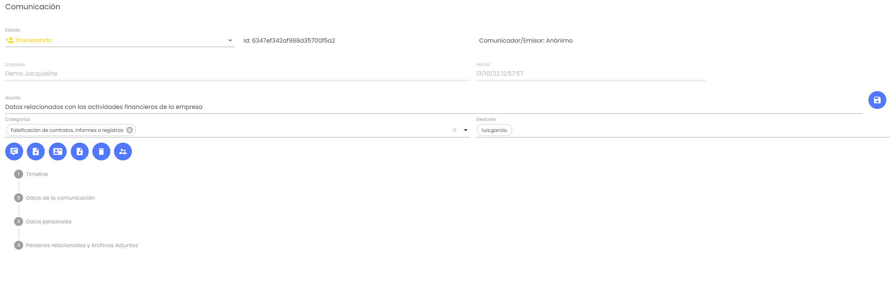

En esta sección se podrá realizar la gestión de la comunicación, para ello podremos ver el formulario general completado por el comunicador, personas responsables del suceso, personas informantes, documentación adjunta.

También se podrá indicar en el campo "Asunto", un resumen o código que facilite la gestión de la comunicación en caso de estar habilitado (en Configuración > [Sistema](https://help.globalsuite.es/display/CD/.Configuraciones+Consulting+vv2.46)) Este campo será visible en el listado principal de Comunicaciones, y se podrán realizar búsquedas sobre el mismo, para simplificar su identificación o localización. Asimismo, en caso de estar habilitado también se incluirá en los informes que se pueden obtener de la herramienta, tanto en formato CSV como el informe PDF detallado de un caso.

También se podrá transicionar la comunicación a otro estado, o asignar y quitar categorías a la comunicación, en caso de estar habilitado.

Adicionalmente dispondremos de cuatro botones para:

* Añadir Comentario → Podremos realizar comentarios sobre la gestión de las comunicaciones, quedarán reflejados en el Timeline. Podremos hacer este comentario visible al Comunicador/Emisor en caso de que desmarquemos que se trata de un "Comentario Privado", en cuyo caso será visible en su Timeline. Si ese check queda marcado, solamente será visible por los gestores de la comunicación, al tratarse de un Comentario Privado.

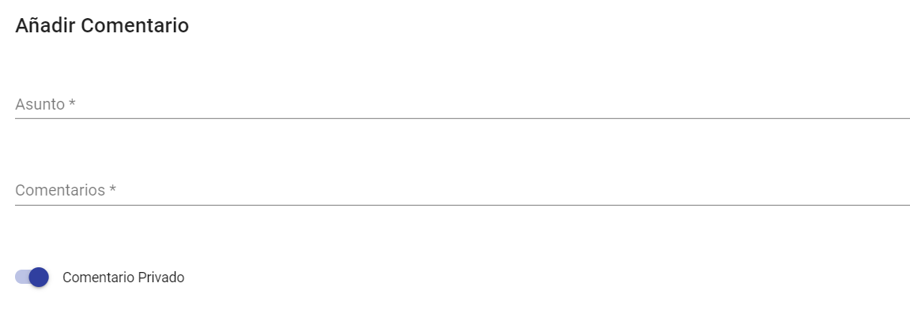

* Adjuntar Documentación → Podremos adjuntar documentación para la gestión de las comunicaciones, quedarán accesibles desde el Timeline. En caso de que queramos que el documento se pueda descargar por parte del Comunicador/Emisor, deberemos desmarcar el check de "Comentario Privado". Si no, solamente estará disponible por parte de los gestores y administradores del entorno.

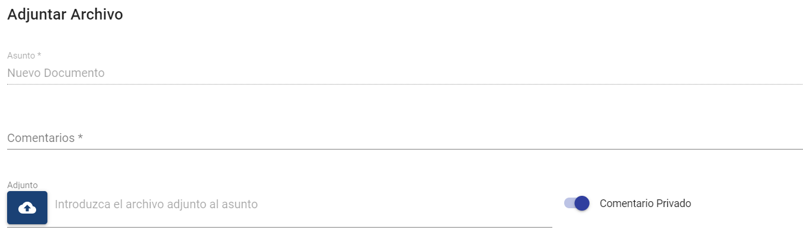

Los archivos que se pueden incluir en la comunicación tienen que ser de uno de los tipos permitidos:

.7z, .ac3, .avi, .bmp, .bpm, .bpmc, .csv, .doc, .docx, .dot, .jpeg, .jpg, .mgr, .mkv, .mov, .mp3, .mp4, .mpp, .mpt, .msg, .odg, .odp, .ods, .odt, .pdf, .png, .pps, .ppsx, .ppt, .pptx, .rar, .rtf, .txt, .vsd, .vst, .wav, .wma, .wmv, .xls, .xlsm, .xlsx, .zip

Si el comentario o el adjunto no se marca como privado, lo verá el Comunicador/Emisor en su Timeline de seguimiento de la comunicación.

El nombre del responsable que lo ha incorporado, aparecerá o no, en función de la [Configuración](configuraciones-consulting.md) (Sistema / Comunicaciones).

* Gestión de Gestores  → Permite asignar o desasignar una comunicación a un gestor para que pase a tratarla. (Sólo podrán hacerlo usuarios Administrador Global y Consulting). También es posible ver los gestores asignados a una comunicación sin necesidad de abrir la ventana de selección.

Dentro de este listado también aparecerán, en caso de haberlos, usuarios con rol Gestor Consulting que pertenezcan a la empresa superior, y estén asignados a este canal. Esos usuarios verán únicamente las comunicaciones que se le hayan asignado con este botón.

La acción de asignar o desasignar un gestor de la comunicación, generará una entrada en el Timeline de la misma, para poder visualizar en qué momento se realizó.

* Descargar Comunicación → Permite descargar toda la información de la comunicación que hay almacenada en la herramienta. Una vez pulsado el botón, nos aparecerá un mensaje de confirmación:

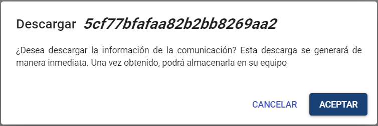

Cuando aceptemos el mensaje, se generará un fichero .zip con toda la información de la comunicación, que comprende:

* * * Informe PDF con toda la información aportada por el comunicador, el Timeline, comentarios y listado de adjuntos.
    * En una carpeta *attachments* se incluirán los adjuntos aportados a la comunicación.
    * En una carpeta *commentsAttachments*se incluirán los adjuntos aportados a la comunicación.

* Eliminar Comunicación → Permite eliminar una comunicación de la herramienta, y de manera automática nos genera la descarga de toda la información de dicha comunicación. Una vez pulsado el botón, nos aparecerá un mensaje de confirmación:

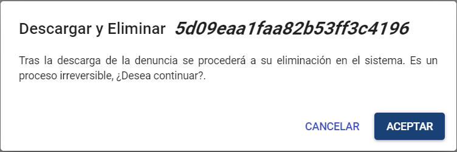

Cuando aceptemos el mensaje, se generará un fichero .zip con toda la información de la comunicación, que comprende:

* * * Informe PDF con toda la información aportada por el comunicador, el Timeline, comentarios y listado de adjuntos.
    * En una carpeta *attachments* se incluirán los adjuntos aportados a la comunicación.

Finalmente, borra definitivamente del sistema toda la información de la comunicación, dejando un registro de log de dicha acción.

En caso de que esté habilitado el Entorno Secundario (ver [Configuraciones](configuraciones-consulting.md)), en la petición de confirmación se podrá marcar que antes de eliminar la comunicación la envíe al entorno secundario habilitado.

## Apartados de la Comunicación

### 1 - Timeline

En esta pestaña podremos ver todo el avance de la denuncia, con un Timeline de todo los sucedido, cambios de estado, comentarios, documentación adjuntada, la asignación de Gestores, así como el detalle de que usuario ha realizado cada avance.

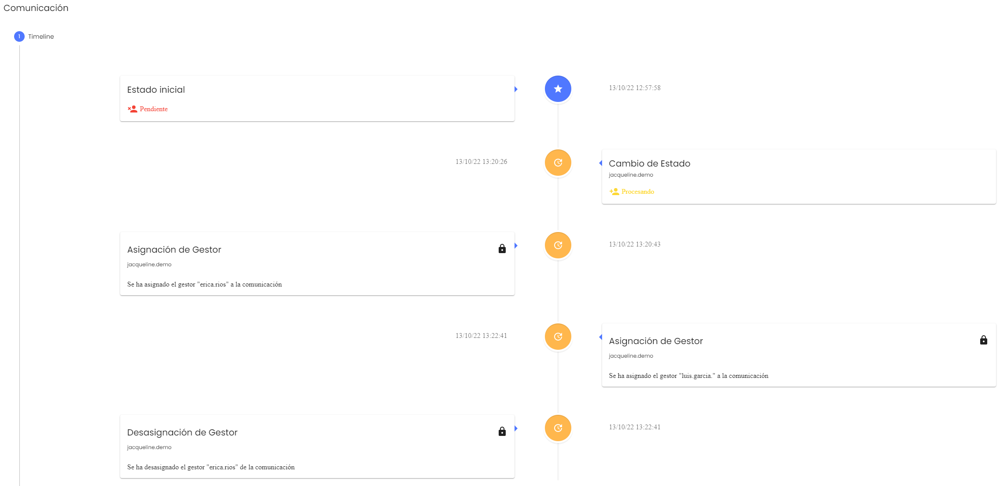

### 2 - Datos de la comunicación

Esta sección hace referencia al formulario completado por la persona que envió la comunicación.

Ejemplo de una comunicación enviada:

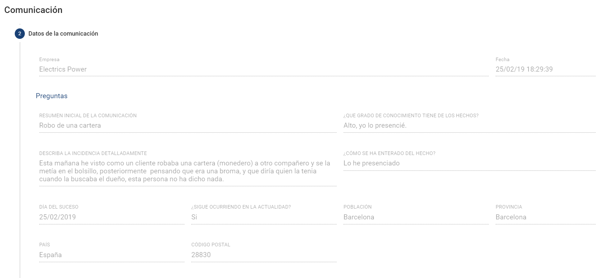

### 3 - Datos del comunicador

En esta sección podemos visualizar en caso de que la comunicación no sea anónima, los datos de la persona que ha enviado la comunicación. En caso de comunicaciones no anónimas, podremos restaurar la password del comunicador si es necesario, además de poder consultar los diferentes campos que puede completar el comunicador que son:

* Nombre y Apellidos
* Cargo en la empresa
* Email (Es el único campo obligatorio)
* Teléfono
* DNI
* Dirección
* Ciudad
* Provincia
* País

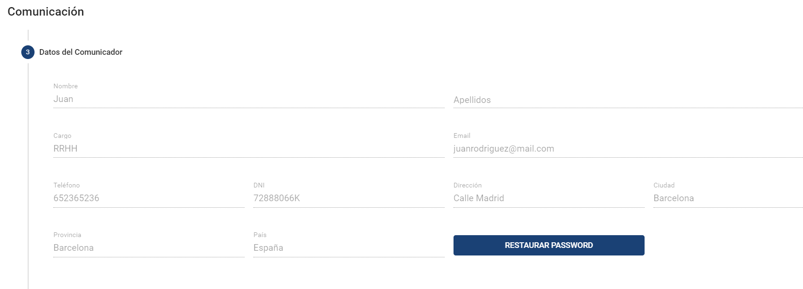

### 4 - Personas relacionadas

En esta pestaña podremos ver los responsables añadidos a la comunicación, los informantes y los ficheros adjuntados a la misma, por parte del comunicador.

* Responsables → Personas que han participado en el suceso que se ha comunicado.
* Informadores → Personas que puede que conozca algo más sobre el suceso.

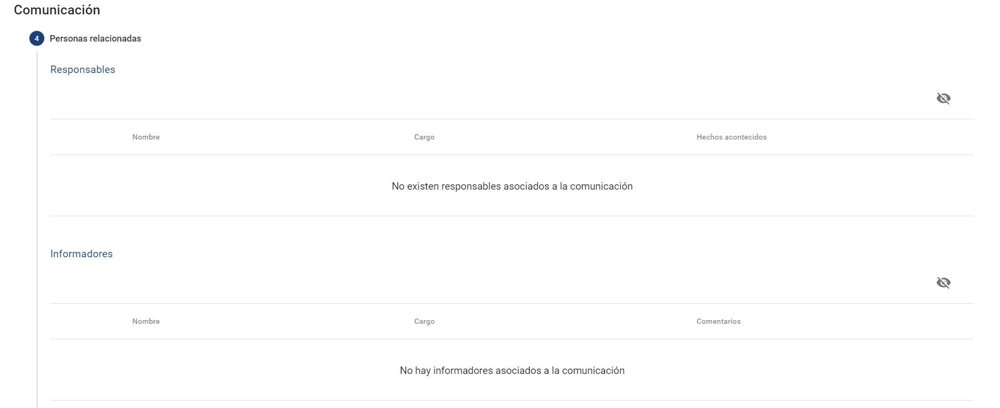

### 5 - Archivos adjuntos

En esta pestaña podremos ver la documentación adjuntada por el comunicador en el momento de enviar la comunicación.

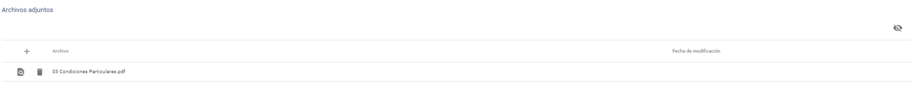

## Anonimización

Una vez finalizada la gestión de la comunicación, o en caso de que haya superado el plazo máximo previsto (la comunicación esté [Caducada](comunicaciones-caducadas.md)), es posible anonimizar los datos de carácter personal de la misma.

Para ello, habrá que pulsar el botón de Anonimización que se encuentra en el menú superior.

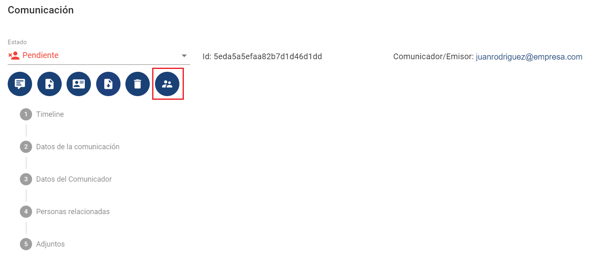

Al pulsarlo, se mostrará un mensaje de confirmación:

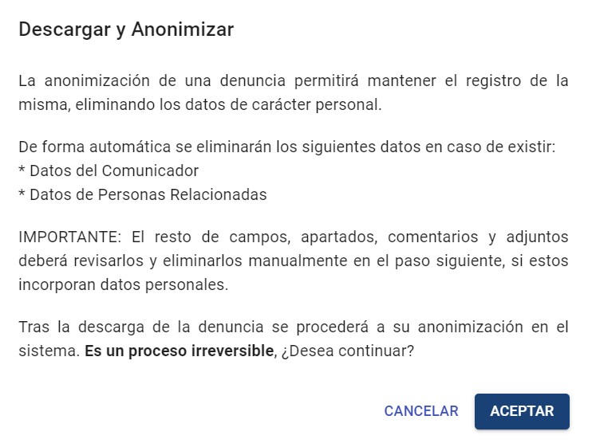

Al aceptar, la comunicación ya elimina automáticamente los datos del comunicador y de las personas relacionadas, en caso de haberlas.

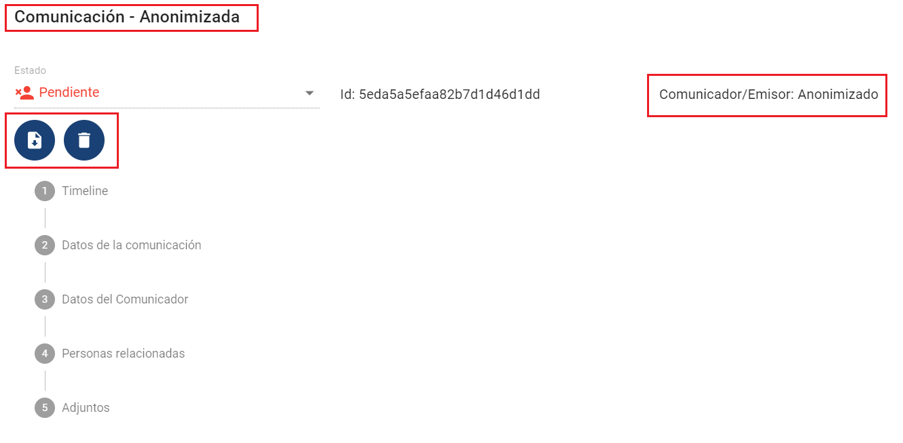

También quedarán habilitados únicamente los botones de Descarga y Borrado de la comunicación.

El resto de campos susceptibles de tener datos de carácter personal deberá ser revisado manualmente. No obstante, se resaltarán los campos que contengan datos de estos tipos:

* Dirección de correo electrónico (email)
* DNI / NIF

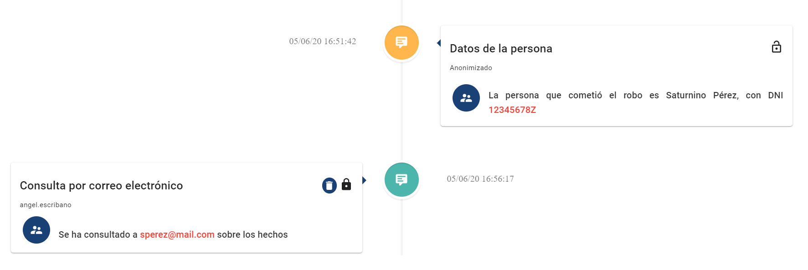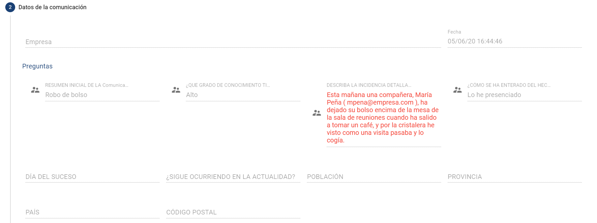

Igualmente, se podrá descargar los adjuntos incorporados para revisar que su contenido no incluye datos de carácter personal.

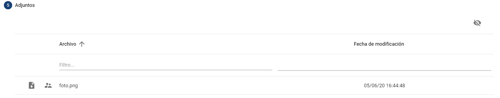

Estos campos, podrán ser anonimizados manualmente, pulsando el botón  , siendo sustituida la información por la etiqueta "Anonimizado".

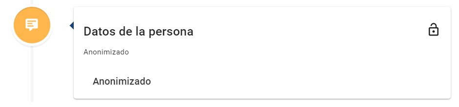

Cuando se anonimice la comunicación, esta podrá seguir gestionándose internamente, añadirse nuevos comentarios o documentos y cambiar de estado. Sin embargo no se podrá comunicarse con el denunciante (al haberse eliminado los datos personales), ni consultarse por el comunicador desde el portal.

Una vez revisada y anonimizada completamente, la comunicación se podrá conservar en el entorno productivo, descargar y eliminar, o enviar al entorno secundario.
