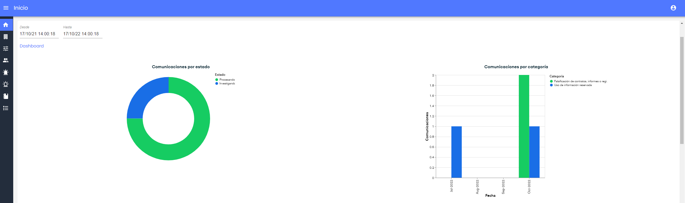
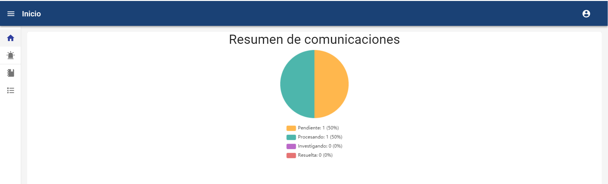

# Inicio - Vista general de Empresa

**NOTA:** Esta opción está disponible para los usuarios Administrador Global, Administrador, Consulting y Gestor. En el caso del usuario Gestor el gráfico es diferente al del resto, y se detalla en la parte inferior de esta pestaña.

* **Vista General**

Esta opción permite ver un resumen del estado de situación del canal. Es posible personalizar qué gráficas de entre las disponibles, se quieren visualizar y en qué orden (ver apartado [Configuraciones Consulting](configuraciones-consulting.md)).

Además, será posible filtrar por un rango de fechas (Desde, Hasta), para ajustar el Dashboard. El rango de fechas que se muestra por defecto es el correspondiente al último año, pudiendo ajustarse el período en el que se quiere consultar la información. En caso de no aplicar ningún filtro, se tendrá en cuenta toda la información y comunicaciones existentes.

El listado de gráficas disponibles es:

* Comunicaciones por estado: Gráfica de sectores para visualizar el estado de las comunicaciones
* Comunicaciones por estado y gestor: Gráfica de barras para identificar cuántas comunicaciones están asignadas a cada gestor, y en qué estado se encuentran.
* Comunicaciones por gestor y estado: Gráfica de barras para identificar la cantidad de comunicaciones por estado, y al gestor al cual están asignadas.
* Comunicaciones por Categoría: Gráfica de barras para consultar cuántas comunicaciones de cada tipo se han creado, por meses.
* Creación de comunicaciones por fecha: Gráfica de histograma, para comprobar la evolución de cuántas comunicaciones se han generado, por meses, en el sistema. Esta información tiene en cuenta, a partir del registro de logs, todas las comunicaciones generadas, aunque las comunicaciones ya no se encuentren en el sistema.
* Preguntas de Selección: Permite consultar de las preguntas de tipo desplegable, cuantas comunicaciones tienen cada opción seleccionada.
* Preguntas de Verificación: Permite consultar en cuantas comunicaciones se ha marcado cada pregunta de este tipo.
* Espacio de Almacenamiento: Muestra el espacio de almacenamiento utilizado y disponible en la herramienta. El espacio utilizado se divide en almacenamiento ocupado por las comunicaciones y adjuntos, espacio ocupado por adjuntos aportados por los gestores y espacio ocupado por documentos internos.

* **Vista Gestores**

En la vista de los Gestores, más acotada, aparece el resumen de los comunicados que él tenga asociados y por tanto pueda ver y gestionar. Así como el detalle del estado y su porcentaje.

