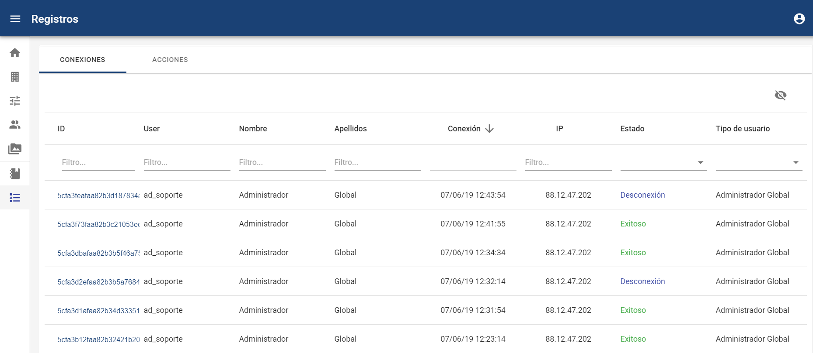
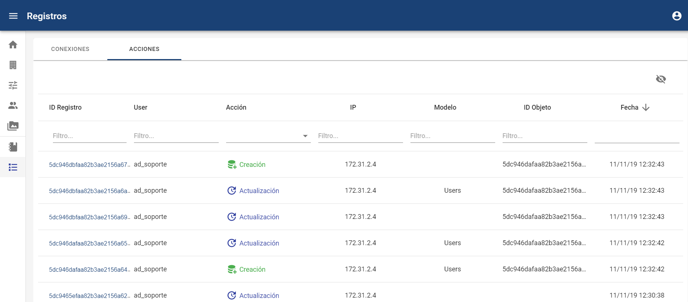

# Registros (Logs)

##### **NOTA:** Esta opción está disponible para los usuarios Administrador Global y Administrador.

* **Conexiones**

En esta pestaña podremos ver todos los intentos de conexión a la herramienta, tanto correctos como incorrectos.

Es posible realizar búsquedas y filtrados por cada uno de los campos, además de poder acceder al detalle del mismo pulsando en el link que aparece en la primera columna.

* **Acciones**

En esta pestaña podremos ver todas las acciones realizadas de lectura, escritura, edición, descarga y borrado de datos en la empresa, con detalles concretos de bbdd, fechas, usuarios y direcciones IPs.

Es posible realizar búsquedas y filtrados por cada uno de los campos, además de poder acceder al detalle del mismo pulsando en el link que aparece en la primera columna.

Mediante el botón de Descarga  se podrá generar un archivo .csv con los registros de Conexiones o Acciones, aplicando los filtros y visibilidad de columnas que se tenga en ese momento, para poder exportar la información.

NOTA: La IP se almacenará en los registros de conexiones y acciones realizadas por los usuarios gestores del canal, y por los comunicadores que no sean anónimos. En caso de ser anónimos, no se almacenará la dirección IP desde la que se realizó la acción.
