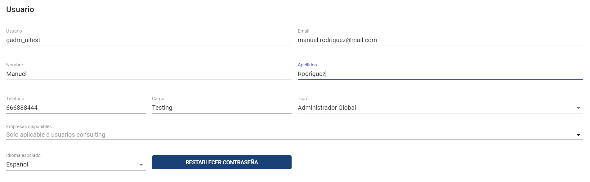
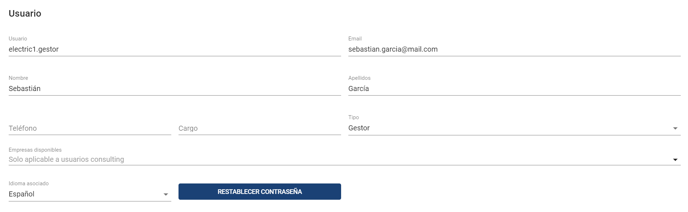
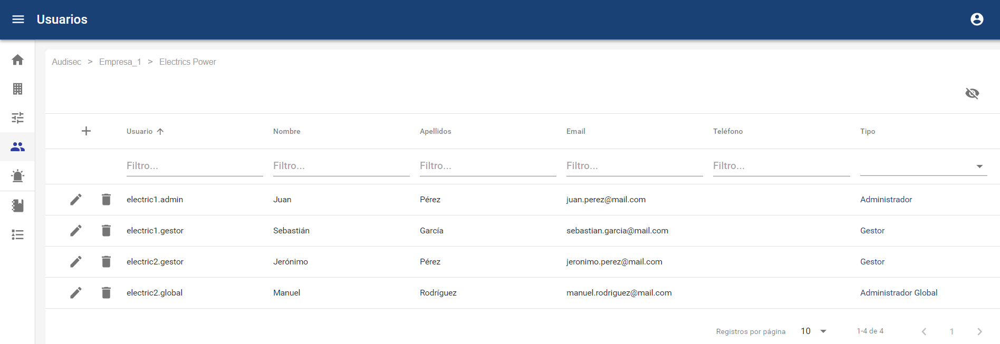
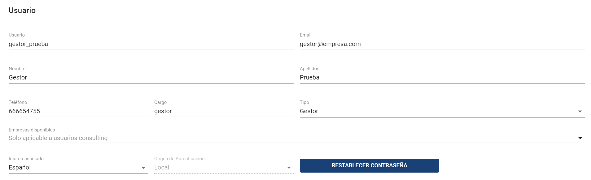
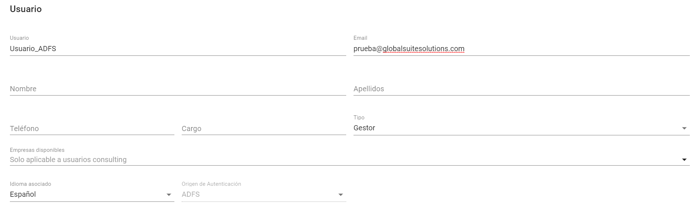
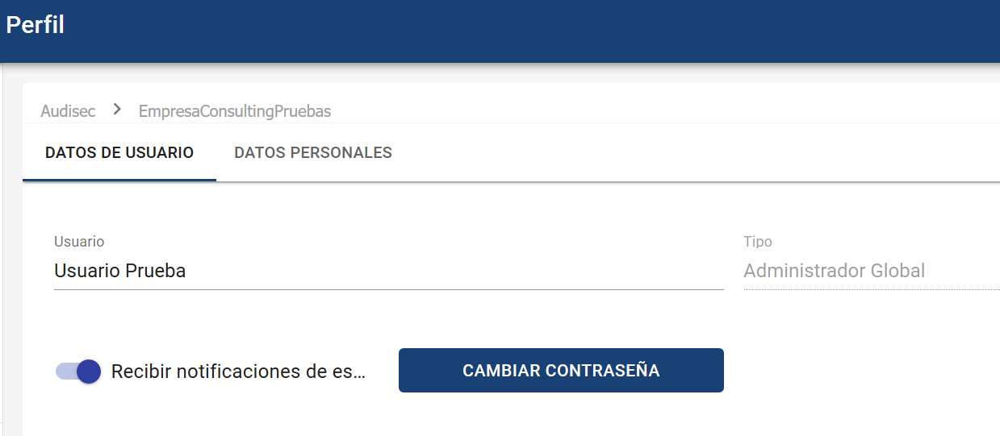
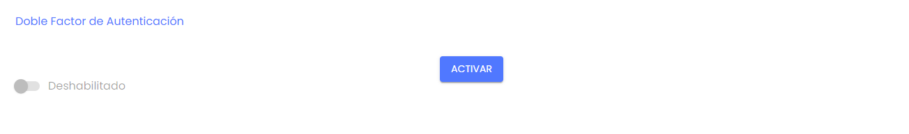
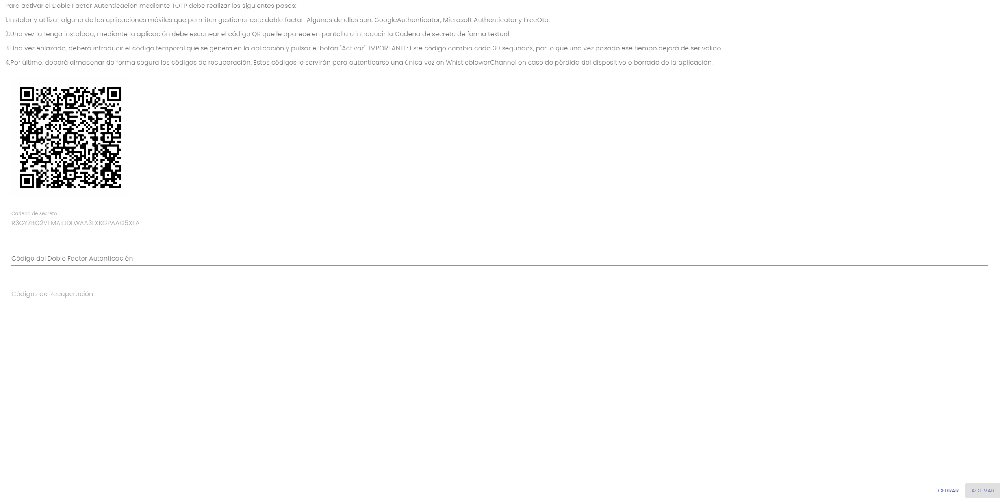
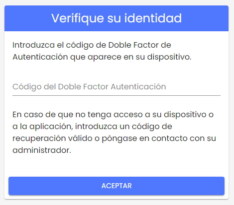
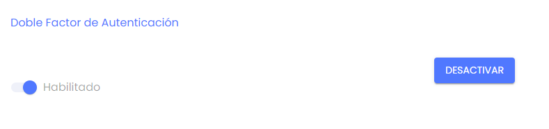

# Usuarios (Consulting)

##### **NOTA:** Esta opción está disponible para los usuarios Administrador Global, Administrador y Consulting. Este último usuario sólo podrá crear usuarios de tipo "Gestor".

En este tipo de empresa es posible crear tres tipos de usuarios:

### Administrador Global

Es el rol de usuario con todos los permisos para tener posibilidad de administrar y parametrizar el entorno, además tendrá acceso a la visualización y gestión de comunicaciones. Podrá asignar denuncias a los gestores.

### Administrador

Es el rol de usuario con todos los permisos para tener posibilidad de administrar y parametrizar el entorno. A diferencia del anterior rol, no tendrá acceso a la visualización de las comunicaciones, ni a la asignación de estas a los gestores.

### Gestor

Es el rol que permite la gestión de comunicaciones. Inicialmente, no tendrá acceso a ninguna comunicación, un Administrador Global o un Consulting tendrá que darle acceso a las comunicaciones que tenga que gestionar.

Notificaciones:

* Recibirá notificaciones cuando se le asignen nuevas comunicaciones.
* Recibirá notificaciones cuando se le desasignen comunicaciones que tenía.

##### Restablecer Contraseña

Es posible restablecer la contraseña a un usuario, a través del botón correspondiente disponible en su ficha. Al pulsarlo, se generará una nueva contraseña temporal que se le enviará por correo (el usuario deberá cambiarla en el primer acceso.

Esto únicamente es posible para los usuarios que acceden a través de autenticación local (con usuario y contraseña propios de la aplicación).

Las contraseñas introducidas deben cumplir la siguiente política de contraseñas seguras para usuarios locales:

* Caducidad: las contraseñas tendrán una caducidad máxima de 180 días (6 meses).
* Complejidad: Tener al menos 13 caracteres y contener minúsculas, mayúsculas, números y símbolos ($, &amp;, @, ., #).
* Histórico de últimas contraseñas: Cuando se solicite cambio de contraseña la nueva deberá ser distinta a la actual y no debe coincidir con las cinco últimas contraseñas utilizadas.
* Bloqueo de usuarios: Ante un número de intentos fallidos consecutivos en el proceso de autenticarse, el usuario quedará bloqueado temporalmente.

En caso de que el usuario tenga autenticación por otro mecanismo (como ADFS), no podrá restaurarse la contraseña.

##### Notificaciones

Aparte de las notificaciones que reciben los usuarios Gestores cuando se les asigna una comunicación, todos los tipos de usuario recibirán las notificaciones que tengan configuradas en cada entorno (ver apartado [Configuraciones](configuraciones-consulting.md)).

En cualquier caso, cada usuario podrá desactivar de forma centralizada las notificaciones que recibe, en el apartado Mi Perfil, además de poder cambiar su contraseña:

**Doble Factor de Autenticación**

Permite Activar la opción Doble Factor de Autenticación cuando en la Configuración esta habilitada la opción, pero no es obligatoria.

* Se deberá pulsar el botón "ACTIVAR" y se deberán realizar los pasos indicados en la pantalla.

* Una vez realizados los pasos indicados, se deberá pulsar el botón "ACTIVAR". Se generarán códigos de recuperación, que sirven para que en caso de perdida del dispositivo o de la aplicación que genera los códigos, se puedan introducir estos códigos a modo de reemplazo. Cada uno de estos códigos son de un solo uso.
* Cuando el usuario ingrese nuevamente al Canal de Denuncias, se le solicitara introducir un código. Para ello deberá ir a la aplicación que lo genera e introducir el código que se ,muestre en la pantalla del dispositivo.

* Si se quiere desactivar el Doble Factor de Autenticación se deberá acceder nuevamente a nuestro Perfil y pulsar el botón "Desactivar"

**NOTA:** Si la Doble Autenticación ha sido configurada como Obligatoria, no se podrá Desactivar.

**Conflicto de Intereses**

Además, cuando el Conflicto de Intereses está habilitado en el apartado de [Configuraciones > Preguntas](https://help.globalsuitesolutions.com/canal-comunicaciones/configuraciones-consulting#ConfiguracionesConsulting-Preguntas), es posible configurar qué usuarios de los que tienen acceso a las denuncias (los roles Administrador Global, Gestor o Consulting a nivel organizativo superior en caso de tener múltiples canales) van a estar incluidos en el conflicto de intereses y serán visibles para el denunciante.

Para ello, accediendo al formulario de estos usuarios (salvo los de rol Administrador, que en ningún caso tienen acceso a las denuncias) se podrá habilitar o deshabilitar el que sea susceptible de tener un conflicto de intereses.

Esto es así para que en los casos que también existan usuarios independientes o de terceros que no estarían involucrados, estos no aparezcan para el denunciante.
