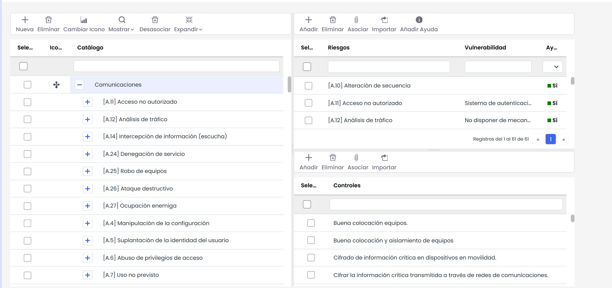
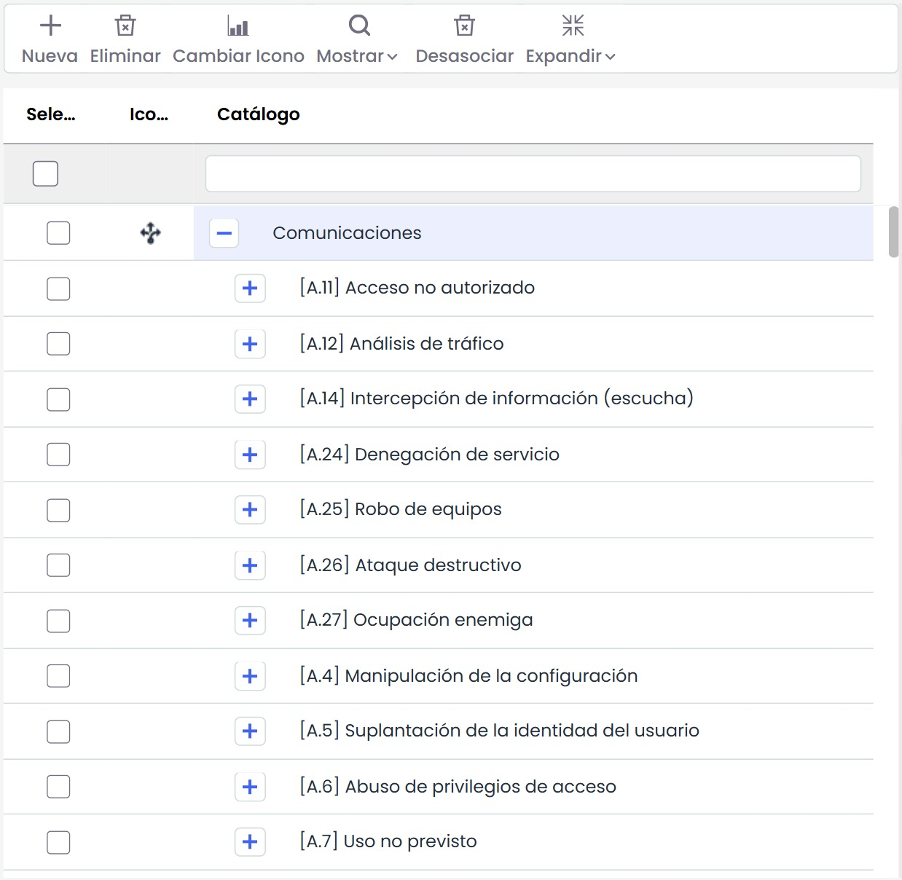
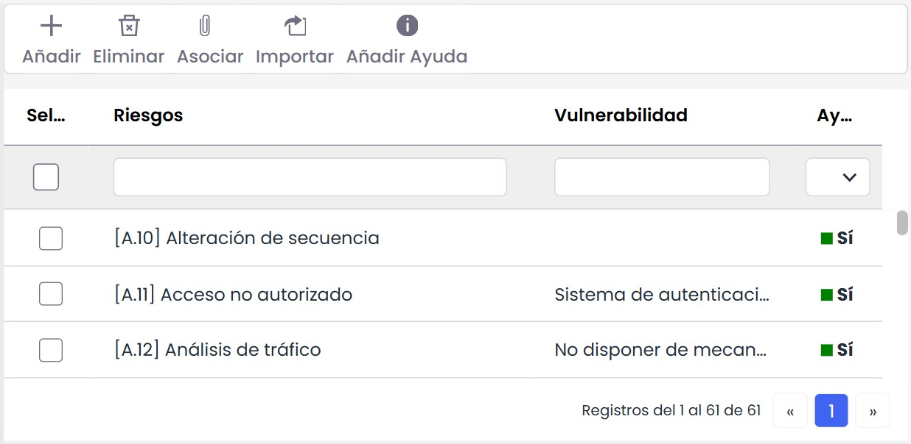
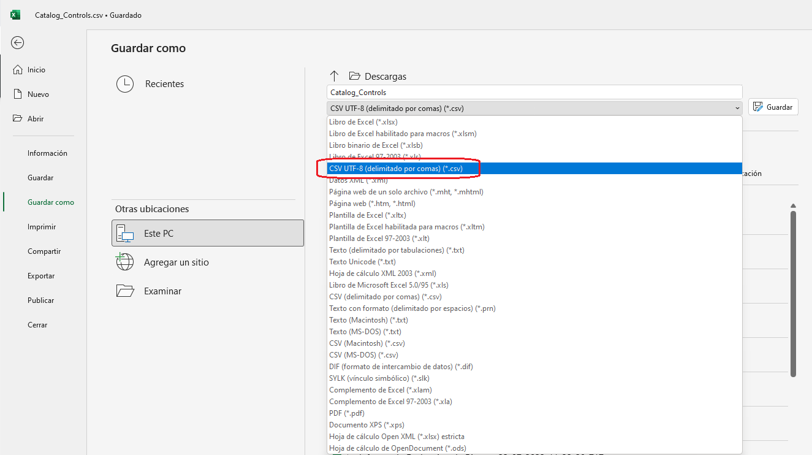
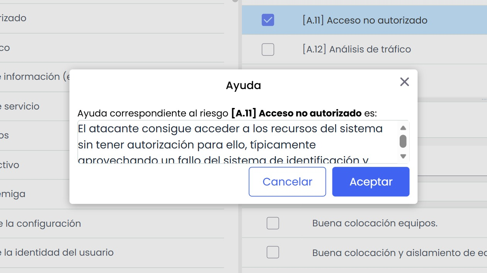
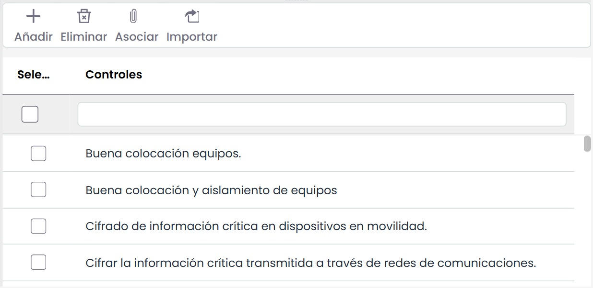
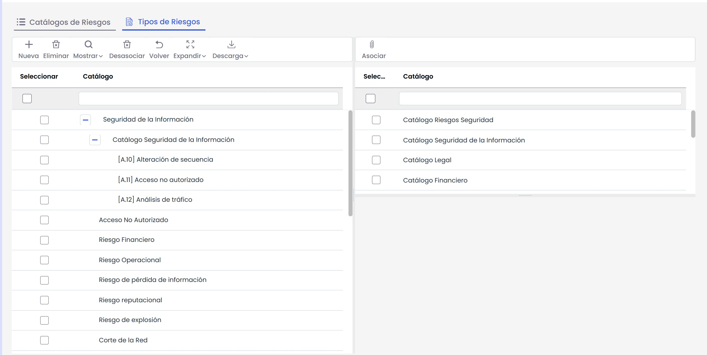
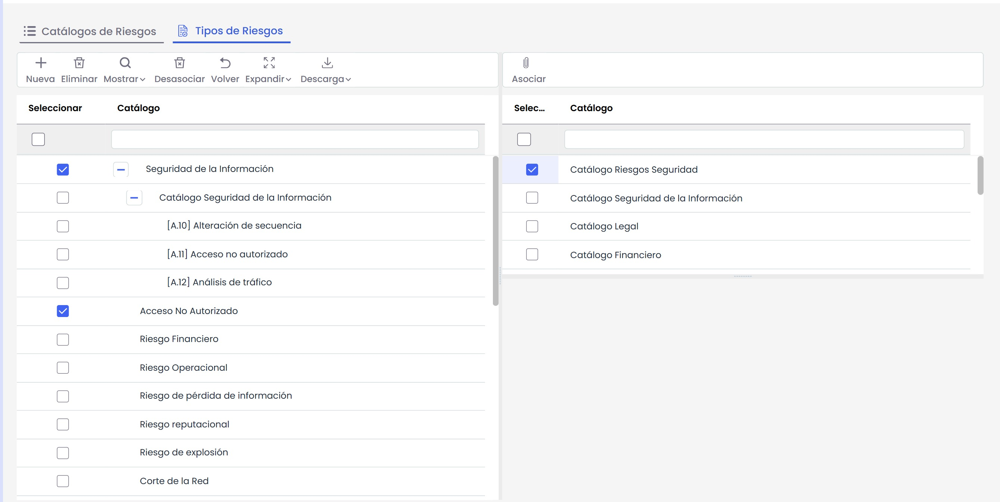
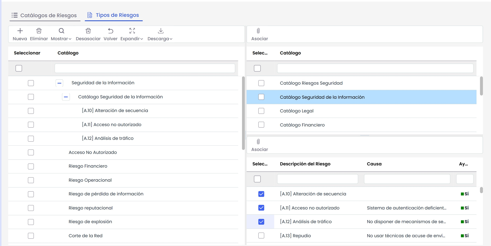

# Catálogos Análisis

### Catálogos de Riesgos

La opción ‘Catálogos Análisis’ ofrece la posibilidad de disponer de catálogos con amenazas de diversa tipología (seguridad, legales, financieros, operacionales, etc.) ya generados en la herramienta o crear un catálogo propio. Estos catálogos serán necesarios para la opción ‘Inventario de Elementos, Análisis de Riesgos y Gestión de Riesgos’.

El listado de catálogos posee las siguientes opciones:

* **Catálogos Análisis:** Permite insertar un nuevo catálogo en el listado.
* **Nuevo:** Permite crear un nuevo catálogo.
* **Eliminar:** Permite eliminar un catálogo existente. Para ello se selecciona la línea de la amenaza y se pulsa el botón ‘Eliminar’.
* **Importar:** GlobalSuite® posibilita importar catálogos ya creados en formato XML.
* **Exportar:** GlobalSuite® posibilita exportar catálogos a formato XML.
* **Cambiar Nombre:** Posibilita cambiar el nombre de un catálogo del listado.

Si se pulsa sobre uno de los catálogos disponibles, se muestra la siguiente pantalla:

El cuadro izquierdo muestra diferentes Categorías a las que asociar amenazas. Las categorías están predefinidas (comunicaciones, hardware, información, etc.), pero se pueden crear nuevas pulsando el botón ‘Nueva’.

El cuadro de las Categorías posee las siguientes opciones:

* **Eliminar:** Permite eliminar una categoría definida.
* **Cambiar Icono:** Permite definir un icono identificativo de la categoría seleccionada.
* **Mostrar:** Esta opción permite filtrar las categorías, algo de mucha utilidad en caso de tener un gran número de categorías.
* **Desasociar:** Permite eliminar la/las amenazas que se hayan asociado con la categoría. Para ello se ha de pulsar el cuadro sitiado a la izquierda de la amenaza y pulsar ‘Desasociar’.
* **Volver:** La herramienta vuelve a la pantalla anterior mostrando el listado de catálogos.
* **Expandir:** Expande el listado de todas las categorías y amenazas que se han asociado.
* **Contraer:** Contrae el listado de las categorías dejando sólo visibles éstas últimas.

El cuadro situado en la parte derecha superior muestra las diferentes Amenazas, que dependiendo del catálogo seleccionado, pueden ser de diversa tipología (seguridad, legal, etc.) como se comentaba anteriormente.

El cuadro de las amenazas posee las siguientes opciones:

* **Añadir:** Permite insertar una nueva amenaza al listado.
* **Eliminar:** Permite eliminar una amenaza existente. Para ello se selecciona la línea de la amenaza y se pulsa el botón ‘Eliminar’.
* **Asociar:** Ésta opción permite asociar una o varias amenazas a una categoría concreta. Para ello se selecciona el cuadro situado a la izquierda de la amenaza, se selecciona el cuadro correspondiente a la categoría y se pulsa el botón ‘Asociar’.
* **Importar:** GlobalSuite® posibilita importar catálogos de amenazas ya creados en formato CSV.  
  Para que el proceso de importación cargue correctamente los caracteres especiales, debe importarse en formato "*CSV UTF-8 (delimitado por comas)*"

  
* **Añadir ayuda:** Permite incorporar un texto más descriptivo a la amenaza seleccionada, a modo de ayuda. Si la amenaza dispone de ayuda esto se mostrara en la columna correspondiente.

Por otro lado el cuadro situado en la parte inferior derecha, muestra un listado con diferentes controles, encargados de mitigar las amenazas definidas.

El cuadro de controles posee las siguientes opciones:

* **Añadir:** Permite insertar un nuevo control al listado.
* **Eliminar:** Permite eliminar un control existente. Para ello se selecciona la línea del control y se pulsa el botón ‘eliminar’.
* **Asociar:** Ésta opción permite asociar uno o varios controles a una amenaza concreta. Para ello se selecciona el cuadro situado a la izquierda del control, se selecciona el cuadro correspondiente a la amenaza y se pulsa el botón ‘Asociar’.
* **Importar:** GlobalSuite® posibilita importar catálogos de controles ya creados en formato CSV.  
  Para que el proceso de importación cargue correctamente los caracteres especiales, debe importarse en formato "*CSV UTF-8 (delimitado por comas)*"

**NOTA:** Las asociaciones que se permiten son: asociar controles con amenazas y asociar amenazas con categorías.

### Tipos de Riesgos

Esta opción permite crear categorías de riesgos, estableciendo los riesgos que están asociados en cada categoría. Esto permite que los riesgos de un análisis de riesgos, procedentes de la propuesta de un catálogo, tengan asociado automáticamente su/s categoría/s automáticamente en función de la configuración establecida en esta funcionalidad.

La tabla situada a la izquierda muestra por defecto las categorías de riesgos (corresponden a las mismas categorías consideradas en la opción "Metodologías de Análisis - Configuración General"). Cada categoría puede tener relacionado uno o varios catálogos de riesgos, situados en la tabla de la parte derecha. Para realizar la asociación entre categorías y catálogos de riesgos se deben seleccionar los items que se quieren vincular y pulsar sobre el botón "Asociar" situado en la tabla de la parte derecha.

Una vez realizada la asociación entre las categorías y los catálogos, se permite seleccionar los riesgos de cada catálogo que están relacionados con la categoría correspondiente. Para ello, se debe seleccionar un catálogo en la tabla de la izquierda, apareciendo en la parte inferior derecha todos los riesgos del catálogo. En este punto, se puede seleccionar los riesgos deseados y al pulsar sobre el botón "Asociar" situado encima de la tabla de riesgos, se asocian los riesgos a cada categoría.

Adicionalmente, la tabla de la izquierda dispone de un conjunto de opciones que permiten gestionar las categorías de riesgos. Concretamente, cada opción permite lo siguiente:

* **Nueva:** Permite insertar una nueva categoría de riesgo.
* **Eliminar:** Permite eliminar una categoría de riesgo. Para ello se debe seleccionar la categoría que se desea eliminar y pulsar sobre el botón 'Eliminar'.

Nota: Los cambios realizados al añadir, modificar o eliminar categorías de riesgos también se reflejan en la tabla de Categorías de Riesgos ubicada en la opción "Metodologías de Análisis - Configuración General".

* **Mostrar:** Permite filtrar las categorías de riesgos, junto a los catálogos y riesgos asociados.
* **Desasociar:** Permite desasociar un catálogo y/o riesgo de una categoría de riesgo. Para ello se debe seleccionar el catálogo o riesgo que se quiere desvincular y pulsar sobre el botón 'Desasociar'.
* **Volver:** Permite volver a la tabla con todos los catálogos de riesgos de la organización.
* **Expandir:** Expande el listado de todas las categorías de riesgos, catálogos y riesgos.
* **Contraer:** Contrae el listado de las categorías de riesgos, catálogos y riesgos, dejando visibles únicamente las categorías.
* **Descargar:** Permite obtener un informe en formato Excel o PDF con la información que se muestra en la tabla.
