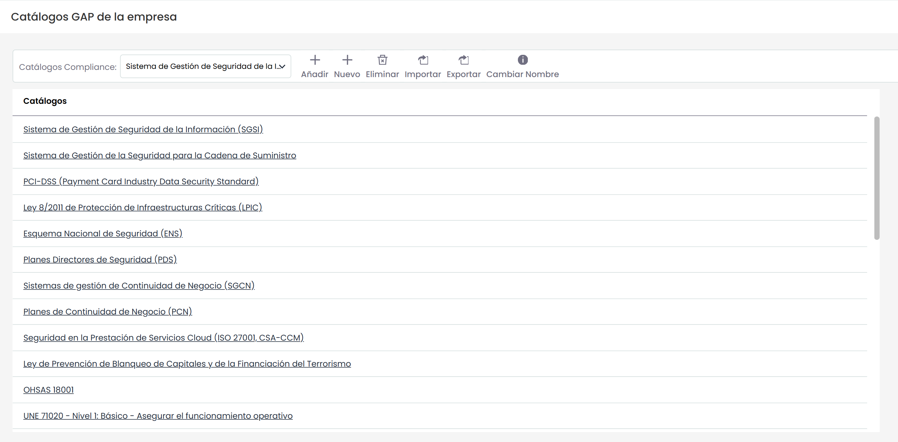
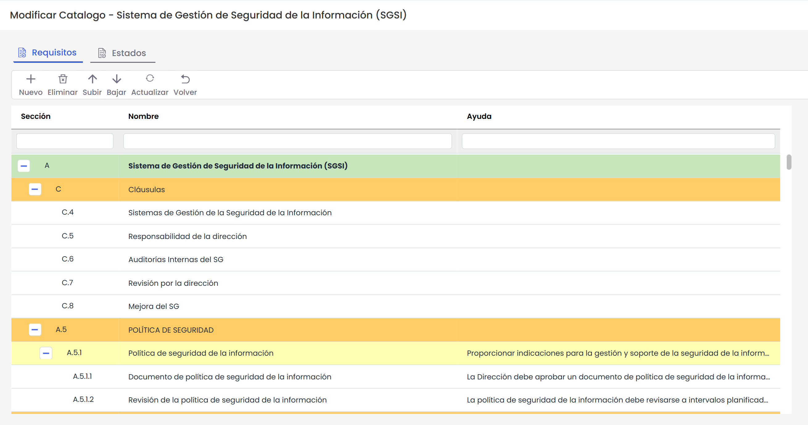
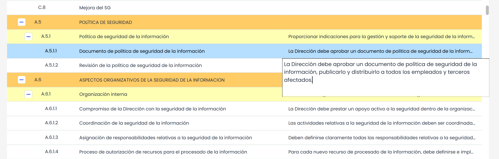
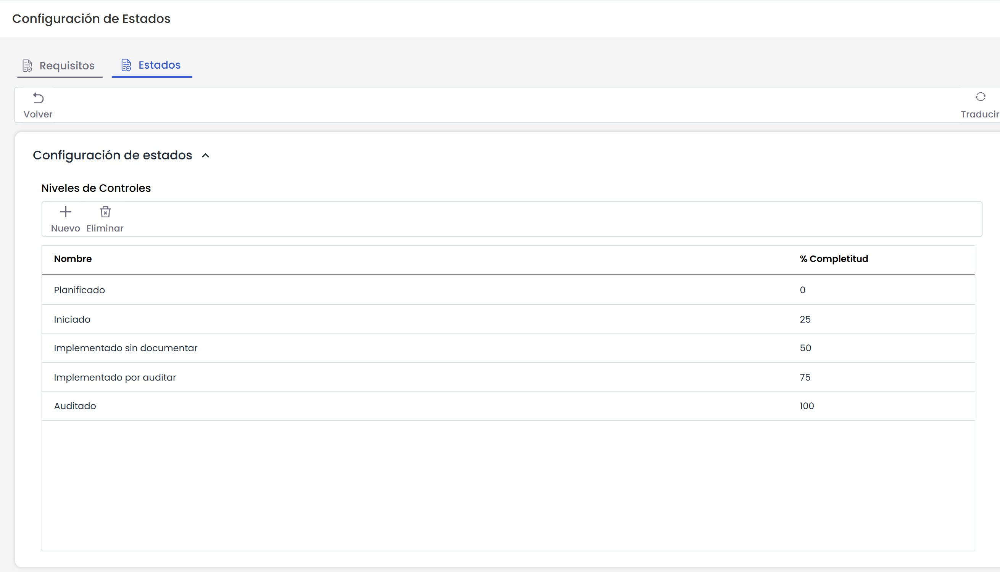

# Catálogos Compliance

La opción ‘Catálogos Compliance’ ofrece la posibilidad de disponer de catálogos de cumplimiento normativo (seguridad, calidad, medioambiente, etc.) ya generados en la herramienta o crear un catálogo propio. Estos catálogos serán necesarios para la opción ‘Gap Analysis’.

El listado de catálogos compliance posee las siguientes opciones:

* **Añadir:** Permite añadir un catálogo a la tabla.
* **Nuevo:** Permite crear un nuevo catálogo.
* **Eliminar:** Permite eliminar un catálogo existente. Para ello se selecciona la línea de la amenaza y se pulsa el botón ‘eliminar’
* **Importar:** GlobalSUITE posibilita importar catálogos ya creados en formato XML.
* **Exportar:** GlobalSUITE posibilita exportar catálogos a formato XML.
* **Cambiar Nombre:** Posibilita cambiar el nombre de un catálogo del listado.

A parte de las opciones anteriormente presentadas, la solución organiza los catálogos a través de dos columnas diferentes:

* **Catálogos:** Determina el catálogo que se ha cargado en Compliance.
* **Automático:** Permite seleccionar un servicio que tenga asociado la empresa. En el caso en la que se haya creado una empresa de ese servicio, se asociará automáticamente ese catalogo a esa empresa.

Para modificar un catálogo compliance hay que pulsar sobre el nombre del catálogo. Al acceder a un catálogo se permite configurar tanto su estructura de requisitos como los estados que serán utilizados para evaluar su cumplimiento. En las siguientes secciones se explican ambas configuraciones.

### Configuración de Requisitos

Al acceder al catálogo se muestra la estructura de requisitos en forma de árbol. La tabla permite las siguientes opciones:

* **Nuevo:** Permite insertar nuevas filas al catálogo. Para ello debemos seleccionar la fila sobre la que queremos generar una fila y pulsar el botón ‘Nuevo’; esta acción permite crear una nueva fila dependiente de la fila seleccionada. Su pueden crear tantas dependencias como se necesiten, no existiendo límite de niveles.
* **Eliminar:** Permite eliminar una fila existente. Para ello se debe seleccionar la línea y se pulsa el botón ‘eliminar’.
* **Subir:** Ofrece la posibilidad de elevar una entrada de la tabla a posiciones superiores. Para ello se debe seleccionar la fila deseada y pulsar sobre el botón.
* **Bajar:** Permite descender una entrada de la tabla a posiciones inferiores. Para ello se debe seleccionar la fila deseada y pulsar sobre el botón.
* **Actualizar**: Permite actualizar las evaluaciones de cumplimiento de este catálogo, que estén activas en la opción de [Compliance](../analisis/compliance/README.md). La información que se actualizará, a partir del código de "Sección" es:

  * Nuevos requisitos
  * Requisitos eliminados
  * Cambios en el nombre o ayuda del requisito
  * Cambio de orden
* **Volver:** La herramienta vuelve a la pantalla posterior mostrando el listado de catálogos.

Todas las entradas del catálogo son modificables por el usuario. Para ello, pulsando dos veces sobre la celda correspondiente se permite su edición.

### Configuración de Estados

Al acceder a la opción "Estados" se permite configurar el conjunto de estados que van a estar disponibles para analizar los requisitos del catálogo compliance que estamos configurando. Estos niveles estarán disponibles por defecto para el catálogo tanto en la opción "GAP Analysis" como en la opción "Compliance", aunque se permitirá modificar de manera individual dentro de cada opción.

A través de los botones "Nuevo" y "Eliminar" se crean y eliminan los estados deseados. La tabla permite editar el nombre de cada nivel tanto en Español como en Inglés, de forma que cada usuario, en función del idioma configurado en su perfil, verá los niveles en un idioma u otro.

Por último, la columna "% Completitud" permite indicar para cada nivel el porcentaje asociado de cumplimiento. Este porcentaje es utilizado por la herramienta para calcular las gráficas de cumplimiento asociadas las opciones de "GAP Analysis" y "Compliance".
