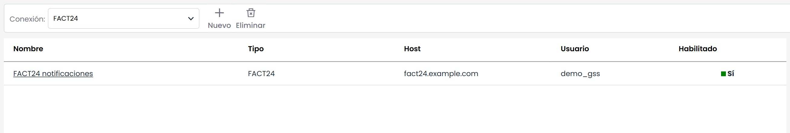

# Conexiones

Esta opción permite configurar conexiones entre GlobalSuite y herramientas externas, gracias a conectores que ya se encuentran implementados en la plataforma. Las conexiones disponibles son las siguientes:

* **OSSIM:** Open Source Security Information Management es una herramienta que permite a los administradores de sistemas gestionar la seguridad de la red, servidores, detección y prevención de intrusos. Esta conexión permite conectarse con las opciones de CMDB, Incidencias y problemas, Mediciones y SOA.

* **OCS:** Esta herramienta permite a los usuarios administrar el inventario de sus activos de TI, recopilando información sobre el hardware y software de equipos que hay en la red. Esta conexión permite conectarse con la opción de CMDB.

* **E-Mail:** Permite la sincronización de una cuenta de correo con la opción de Tickets.

* **Redmine:** Esta herramienta permite la gestión de proyectos a través de un sistema de seguimiento de peticiones. Esta conexión permite conectarse con las opciones de Incidencias y problemas, Tickets, Cambios y entregas, Peticiones del servicio, Reclamaciones, No conformidades y Acciones correctivas/preventivas.

* **Active Directory:** Permite la sincronización de GlobalSuite con el Directorio Activo de una organización, de forma que el acceso a GlobalSuite se realiza a través de las credenciales de acceso del Directorio Activo. Esta conexión permite conectarse con las opciones de Usuarios y Empleados. Más información sobre esta configuración en este apartado de Sincronización > [Active Directory / LDAP](../sincronizacion/active-directory-ldap.md)

* **Aranda:** Esta herramienta permite la gestión y administración de una base de datos de gestión de la configuración. Esta conexión permite, por tanto, conectarse con la opción de CMDB.

* **FACT24:** Esta herramienta, asociada a la continuidad de negocio, permite realizar notificaciones a través de SMS y llamadas telefónicas cuando se producen incidencias que cumplen una serie de criterios. Esta conexión permite conectarse con las opciones de Empleados, Comités de Decisión, Roles, Planes de Gestión de Incidentes, Planes de Recuperación, Gestión de la Crisis y RRHH Críticos.

* **LDAP:** Permite la sincronización de GlobalSuite con el LDAP de una organización, de forma que el acceso a GlobalSuite se realiza a través de este protocolo. Más información sobre esta configuración en este apartado de Sincronización > [Active Directory / LDAP](../sincronizacion/active-directory-ldap.md)

* **SAML:** Permite la autenticación de GlobalSuite mediante el protocolo estándar SAML2 con distintos Gestores de Identidades, de forma que el acceso a GlobalSuite se realiza a través usuarios de confianza e inicio de sesión único. Puede consultar más detalle sobre este tipo de conexiones en el apartado de Sincronización > [SAML](../sincronizacion/saml.md)

Si surgen dudas específicas para la configuración de un tipo de conexión, por favor, contactar con el departamento de soporte de GlobalSuite®.
