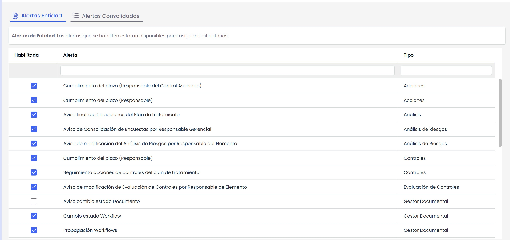

# Configuración Alertas

En este apartado se configuran las distintas alertas que van a estar disponibles para los empleados de la empresa cliente.

Para asociar las alertas al cliente se ha de seleccionar las mismas en la tabla. Las alertas que ofrece GlobalSUITE son las siguientes:

* **Aviso finalización acciones del Plan de Tratamiento:** Envía un correo a la dirección definida cuando una acción del plan de tratamiento de riesgos ha finalizado.
* **Notificaciones Diarias:** Avisa de aquellas tareas pendientes que se han generado en la herramienta de diariamente.

* **Notificaciones Semanales:** Avisa de aquellas tareas pendientes que se han generado en la herramienta de semanalmente.

* **Notificaciones Mensuales:** Avisa de aquellas tareas pendientes que se han generado en la herramienta de mensualmente.

* **Aviso de finalización de contrato 7 días antes:** Avisa de los contratos a los que le falta una semana o menos para terminar. Solo envía la alerta si hay al menos un contrato a punto de finalizar.

* **Aviso de finalización de contrato:** Avisa de los contratos que terminan el día actual. Solo envía la alerta si hay al menos un contrato que finaliza en el día.

* **Envío de noticias nuevas:** Envía una alerta cada vez que se cree una nueva noticia en GlobalSUITE®.

* **Añadir registros a Métricas:** Envía una alerta cada vez que se le deban añadir nuevos registros a una métrica según la periodicidad que tenga definida. Actualmente se envía una alerta por cada métrica definida que deba actualizarse. Este correo también lo recibe el responsable de la métrica.

* **Propagación Documentación:** Envía una alerta cuando se propaga documentación de una entidad a otra. Los empleados de la entidad que tengan esta alerta activada recibirán un correo de aviso.

* **Propagación Workflows:** Esta alerta es enviada cuando un workflow documental ha sido propagado. Los empleados de la entidad que recibe el workflow serán avisados si tienen esta alerta activada.

* **Cambio estado Workflow:** La alerta corresponde a los avisos que se envían en caso de que el estado de un documento cambie, se suba un nuevo documento, o se cambie la versión del mismo. Los empleados que reciben el aviso son aquellos que se encuentren asociados al nuevo estado del documento y se encuentren configurados en esta alerta. La notificación es enviada en el momento que se produce el cambio de estado.

* **Seguimiento Objetivos:** Envía una alerta cuando se realiza la evaluación de un objetivo y se establece un valor a la misma.

* **Seguimiento acciones de controles del plan de tratamiento:** Envía una alerta cuando se modifica el estado de un control incluido en el Plan de Tratamiento de Riesgos.

* **Recordatorio de tareas pendientes:** Se envían alertas diarias con el fin de recordar las tareas pendientes que tiene un usuario.

* **Aviso cambio estado Documento:** Envía una alerta cuando se realiza un cambio de estado en la versión activa de un documento almacenado en el Gestor Documental, se suba un nuevo documento, o se cambia la versión del mismo. Esta alerta es adicional a las notificaciones de los responsables del Workflow de aprobación (alerta "Cambio estado Workflow").

* **Cumplimiento del plazo Controles (Responsable):** Envía una alerta al responsable de un control cuando se cumpla el el plazo establecido en el mismo. Para que reciba la notificación, el responsable deberá estar asociado a esta alerta.

* **Cumplimiento del plazo Acciones (Responsable):** Envía una alerta al empleado responsable de una acción cuando se cumpla el el plazo establecido en la misma. Para que reciba la notificación, el responsable deberá estar asociado a esta alerta.

* **Cumplimiento del plazo Acciones (Responsable del Control asociado):** Envía una alerta al empleado responsable de un control cuando se cumpla el el plazo establecido en alguna de las acciones de dicho control.

* **Aviso de modificación del Análisis de Riesgos por Responsable del Elemento:** Envía una alerta al Responsable del Elemento (definido en la opción Inventario) cuando se produzca cualquier modificación sobre alguno de los riesgos identificados para dicho elemento en el Análisis de Riesgos.

* **Aviso de modificación de Evaluación de Controles por Responsable del Elemento:** Envía una alerta al Responsable del Elemento (definido en la opción Inventario) cuando se produzca cualquier modificación sobre alguno de los controles aplicados a riesgos del elemento.

* **Aviso de Consolidación de Encuestas por Responsable Gerencial:** Envía una alerta al Responsable de los Servicios (definido en la opción Catálogo de Servicios) cuando se consoliden encuestas de Elementos, Riesgos y Controles que afecten a elementos que estén bajo esos servicios.
