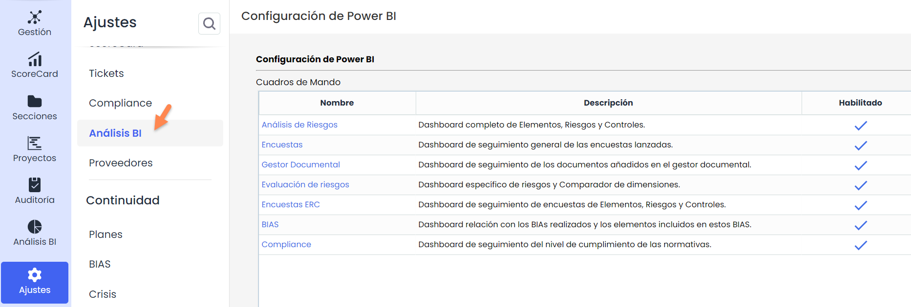

# Configuración Análisis BI

En este apartado se configuran los campos que permiten la gestión y visualización de los cuadros de mando de disponibles con el módulo Business Intelligence en la opción [Análisis BI](https://help.globalsuitesolutions.com/es/globalsuite/v1/analisis-bi).

* **Nombre**: Campo editable tanto desde esta vista como la opción Menú personalizable, accesible desde Ajustes > Configuración> General. Los cambios realizados en cualquiera de estos lugares se sincronizarán automáticamente.
* **Descripción**: Este campo también será editable permitiendo a los usuarios añadir o modificar la descripción del dashboard.
* **Habilitado**: Muestra los dashborads habilitados o deshabilitados en función de la licencia contratada. Este campo es únicamente de consulta, sin posibilidad de edición.
