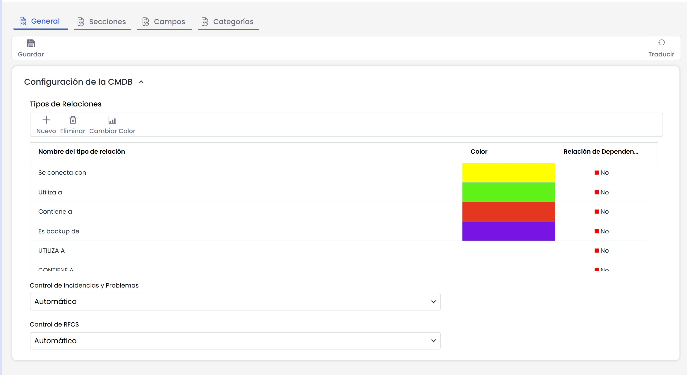
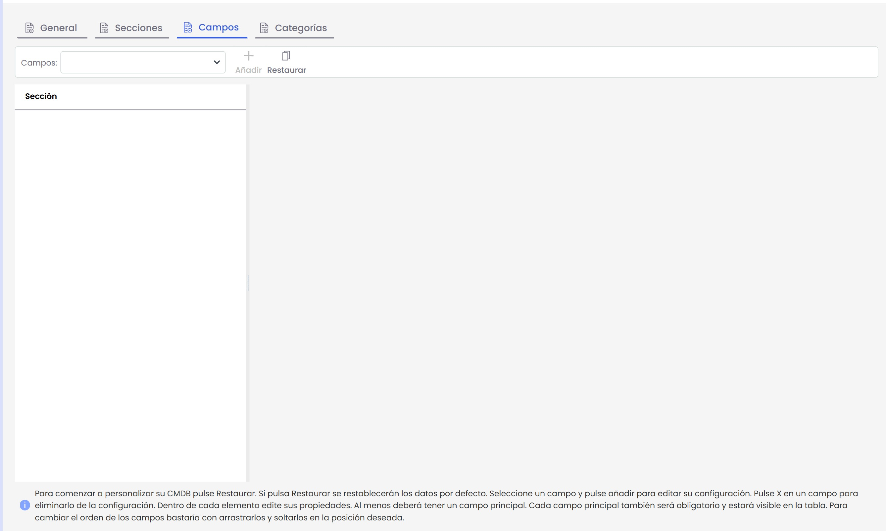
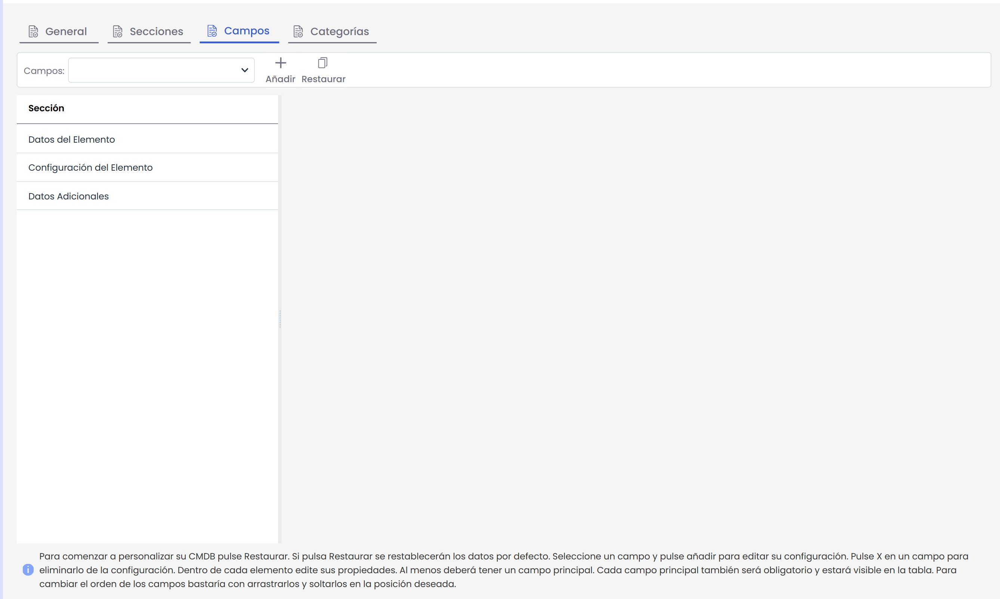
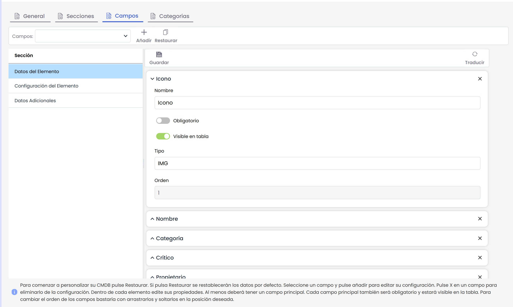
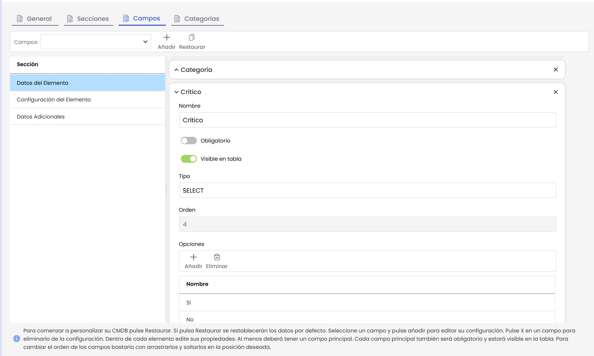
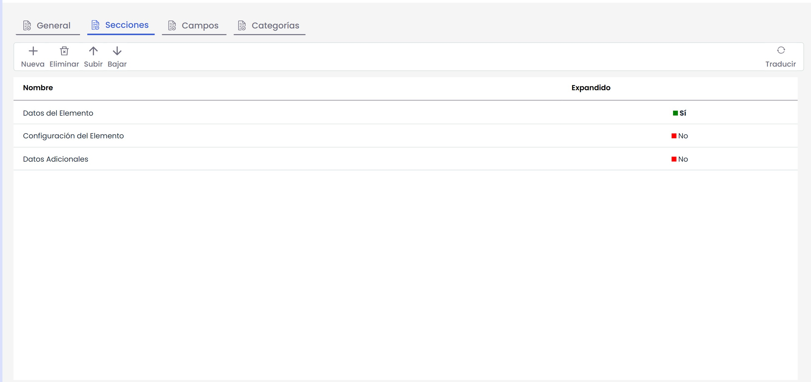
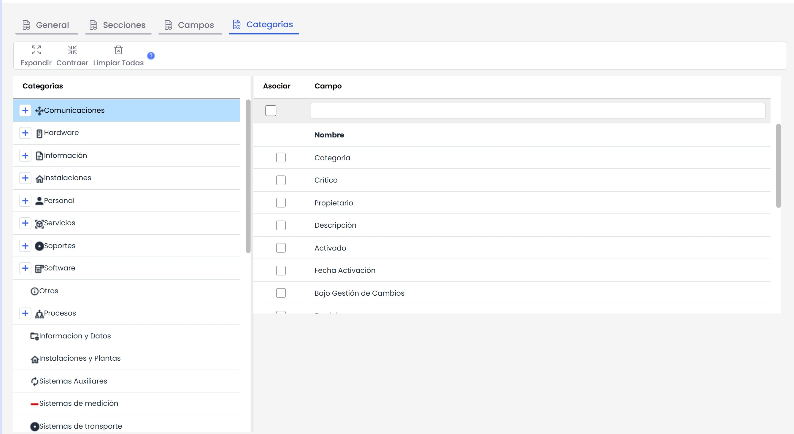

# Configuración CMDB

Esta opción permite personalizar la configuración de la CMDB de nuestro Sistema de Gestión de Servicios de TI.

La personalización de la CMDB se realiza en las dos pestañas que se muestran inicialmente cuando aún no se ha configurado nada de la CMDB. Las dos pestañas son las siguientes:

* **General:** Permite la personalización de los "Tipos de Relaciones" y del control automático o manual para los "Incidentes y Problemas" y las "RFC".
* **Campos:** Permite personalizar todos los campos o atributos a registrar en la CMDB.

A continuación se detalla la funcionalidad de la configuración **"General"** de la CMDB:

* **Tipos de relaciones:** Permite establecer los tipos de relación que pueden tener los CI’s (Configuration Item) creados en el apartado CMDB. Para añadir o eliminar relaciones se han de pulsar los botones ‘Nuevo’ o ‘Eliminar’. Por otro lado, se puede modificar el color de dicha relación seleccionando la fila deseada y pulsando el botón ‘Cambiar color’. Los colores se muestran en ‘Grafo de Relaciones’ de GlobalSuite®.
* **Control de Incidencias y Problemas:** GlobalSuite posibilita que el control de las incidencias y problemas de cada uno de los CI’s sea:

  * **Automático:** (Opción Recomendada) Todos los registros de Incidencias y Problemas que sean registrados en GlobalSuite y cuyos elementos de configuración afectados sean seleccionados en la propia Incidencia o en el Problema, quedarán automáticamente relacionados, de tal manera que al consultar la información de un CI, se podrá visualizar todos los Incidentes y Problemas en los que ha estado involucrado.
  * **Manual:** Cuando el control seleccionado es el "Manual", GlobalSuite habilita un campo de texto en el formulario del CI dónde poder especificar los identificadores (IDs) de los Incidentes y Problemas en los que ha estado involucrado el CI. Esta configuración se utiliza normalmente cuando la organización no utiliza la gestión de Incidentes y Problemas de GlobalSuite, ya que realiza el registro en otro sistema pero necesita tener establecida esta vinculación entre los CIs y los Incidentes y Problemas con los que está relacionado.
* **Control de RFC’s:** GlobalSuite posibilita que el control de RFC’s de cada uno de los CI’s sea:

  * **Automático:** (Opción Recomendada) Todos los registros de RFC´s que sean registrados en GlobalSuite y cuyos elementos de configuración afectados sean seleccionados en la propia RFC, quedarán automáticamente relacionados, de tal manera que al consultar la información de un CI, se podrá visualizar todas las RFC´s en las que ha estado involucrado.
  * **Manual:** Cuando el control seleccionado es el "Manual", GlobalSuite habilita un campo de texto en el formulario del CI dónde poder especificar los identificadores (IDs) de las RFC´s en las que ha estado involucrado el CI. Esta configuración se utiliza normalmente cuando la organización no utiliza la gestión de RFC´s de GlobalSuite, ya que realiza el registro en otro sistema pero necesita tener establecida esta vinculación entre los CIs y las RFC´s con las que está relacionado.

A continuación se detalla la funcionalidad de la configuración **"Campos"** de la CMDB:

Inicialmente esta opción se encuentra vacía, y si se quiere mantener con la configuración por defecto que ofrece la solución, así se tiene que mantener. Si por el contrario, se desea personalizar la información sobre cada elemento de configuración, lo primero que deberá realizar será pulsar en el botón Restaurar.

**IMPORTANTE**: Cada vez que pulse el botón "Restaurar" volverá a la configuración de la CMDB que GlobalSuite proporciona por defecto, por lo que si ya había realizado una personalización previamente, esta será sustituida por la configuración original no pudiendo recuperar la personalización realizada.

La primera vez que se pulsa sobre el botón "Restaurar" la solución carga automáticamente en la tabla izquierda las 3 secciones que componen la información de un CI en la configuración original: "Datos del Elemento", "Configuración del Elemento" y "Datos Adicionales". Además, tras pulsar el botón "Restaurar" también se puede observar que las pestañas de la opción "CMDB" se han ampliado, añadiendo a la pestaña de "General" y "Campos", las pestañas de "Secciones" y "Categorías".

En la pestaña "Campos" se podrá pulsar sobre cualquiera de las secciones para personalizar los campos que van a contener cada una de ellas. Al pulsar sobre la sección, se muestran en la parte derecha de la ventana todo un listado de campos. Pulsando sobre el campo se podrá ver la información sobre el mismo, variando en función del tipo de campo. A continuación se detalla la información que podrá encontrar en los diferentes campos, que dependiendo del tipo de campo, habrá más información o menos.

* **Nombre Español:** Permite establecer la etiqueta en el idioma Español que tendrá este campo en el formulario del CI. Esta etiqueta se mostrará cuando el usuario tenga configurado en su perfil el idioma Español.
* **Nombre Inglés:** Permite establecer la etiqueta en el idioma Inglés que tendrá este campo en el formulario del CI. Esta etiqueta se mostrará cuando el usuario tenga configurado en su perfil el idioma Inglés.
* **Principal:** Atributo solo disponible en los campos de tipo INPUT. Permite establecer cuál será el campo principal de los CI´s que luego se visualizará en el resto de la solución que se relacione con la CMDB. Solo está permitido marcar un campo como Principal.
* **Obligatorio:** Si esta casilla se marca para el campo seleccionado, al registrar la información de un CI, ese campo no podrá quedar vacío por lo que deberá completarse antes de pulsar el botón "Guardar" del formulario del CI.
* **Visible en tabla:** Si esta casilla se marca para el campo seleccionado, este campo podrá visualizarse en la tabla inicial de la CMDB dónde se muestra todo el listado de los CI´s.

* **Tipo:** Da la información del tipo de elemento. Este campo es simplemente informativo. GlobalSuite viene con un conjunto de campos de cada tipo creados por defecto, no pudiendo cambiar el tipo de un campo ya creado.
* **Orden:** Muestra un número que se corresponde al orden en el que se mostrará este campo en el formulario del CI dentro de la sección seleccionado. Este campo es simplemente informativo. Para poder cambiar el orden del campo deberá seleccionar la cabecera del formulario de este campo y arrastrar el campo hasta la posición deseada.

* **Opciones:** Consiste en una tabla para indicar las diferentes opciones que se permitirá seleccionar al usuario en ese campo del formulario del CI. Solo disponible en los campos de tipo SELECT.

Para crear nuevos campos adicionales a cada una de las secciones, se deberá crear la sección sobre la que se desea crear el campo y posteriormente seleccionar el tipo de campo en el desplegable "Campos", para a continuación pulsar el botón "Añadir". Los tipos de campos a incluir son los siguientes:

* **TEXT:** Permite crear un campo de tipo texto cuyo área de visualización será de múltiples líneas de texto.
* **INPUT:** Permite crear un campo de tipo texto cuyo área de visualización será una única línea de texto.
* **DATE:** Permite crear un campo de tipo fecha.
* **SELECT:** Permite crear un campo con múltiples opciones para seleccionar una de ellas.
* **CHECK:** Permite crear un campo con un cuadro para marcar o desmarcar la opción.

La pestaña de **"Secciones"** de la configuración de la CMDB permite crear añadir nuevas secciones al formulario del CI, adicionales a las 3 secciones que vienen por defecto en la configuración de GlobalSuite.

Las opciones disponibles en esta ventana son las siguientes:

* **Nueva:** Permite crear una nueva sección.
* **Eliminar:** Permite eliminar una sección de las existentes. Deberá primero seleccionar la sección y a continuación pulsar el botón "Eliminar".
* **Subir:** Permite aumentar el orden en el que se mostrará la sección en el formulario del CI. Deberá primero seleccionar la sección y a continuación pulsar el botón "Subir" el número de veces que desee, hasta colocar la sección en el orden deseado.
* **Bajar:** Permite reducir el orden en el que se mostrará la sección en el formulario del CI. Deberá primero seleccionar la sección y a continuación pulsar el botón "Bajar" el número de veces que desee, hasta colocar la sección en el orden deseado.

La tabla con la información de las secciones, se compone de 3 columnas cuyo detalle se indica a continuación:

* **Nombre ES:** Permite establecer la etiqueta para la sección en Español.
* **Nombre EN:** Permite establecer la etiqueta para la sección en Inglés.
* **Extendido:** Permite configurar las secciones que se quiere que aparezcan desplegadas por defecto al acceder al formulario de un CI (opción Sí), es decir, mostrando todos sus campos, o bien y las secciones que se quiere que aparezcan contraidas, mostrándose únicamente el nombre de la sección y siendo necesario pulsar sobre el nombre para visualizar los campos incluidos en esa sección (opción No).

La pestaña de **"Categorías"** permite configurar los campos que contendrá cada una de las categorías y/o clases de los Elementos de Configuración de la CMDB.

**NOTA:** Si una categoría tiene todos los campos sin seleccionar, usará los campos de la categoría padre, o en su caso de la empresa. En negrita se muestran los campos obligatorios que además estarán incluidos en todas las categorías.

Para personalizar los campos de una categoría concreta, se debe seleccionar la categoría y después marcar los campos que se requiera. Recuerde, si no hay ningún campo marcada, tomará los campos de la categoría padre o los configurados por defecto, no siendo necesario marcar todos los campos en todas las categorías, si no solo en aquellas categorías que se deseen personalizar.

Si se quiere recuperar la configuración por defecto, se puede pulsar el botón "Limpiar Todas" que eliminará todas las particularidades que se hayan detallado en las categorías.
