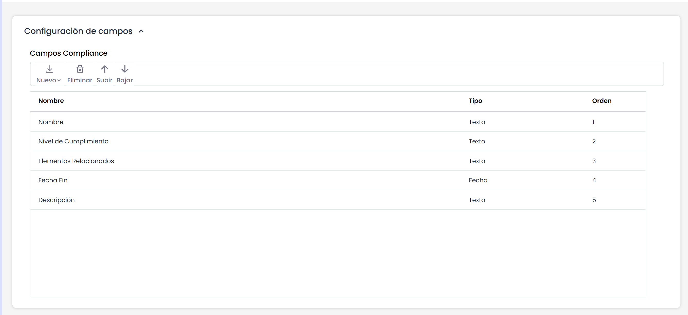

# Configuración Compliance

En este apartado es posible configurar qué campos se pueden mostrar en la tabla principal de la opción de [Compliance](../analisis/compliance/README.md).

Además de cambiar los nombres a los campos fijos que ya existen, y que son:

* Nombre
* Nivel de Cumplimiento
* Elementos Relacionados
* Fecha Fin

Los campos que se pueden añadir son de tipo texto o de tipo fecha, a través del botón "Nuevo".

También es posible cambiar el orden de las columnas mediante los botones "Subir" y "Bajar".
