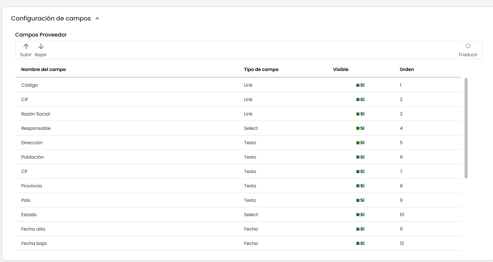
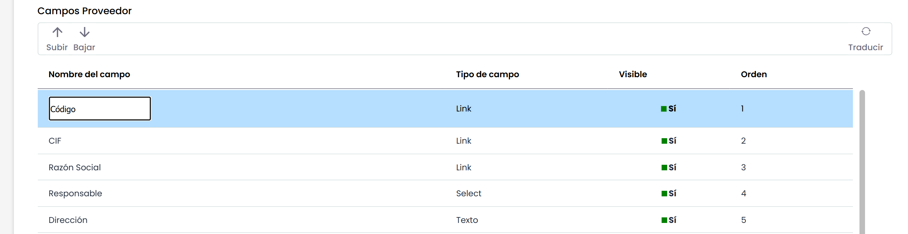
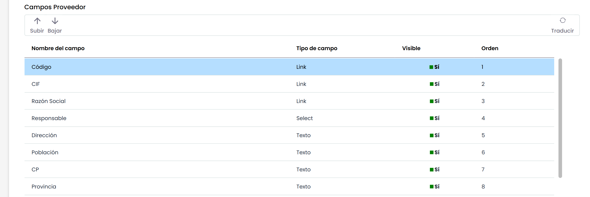
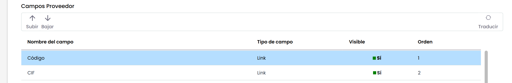
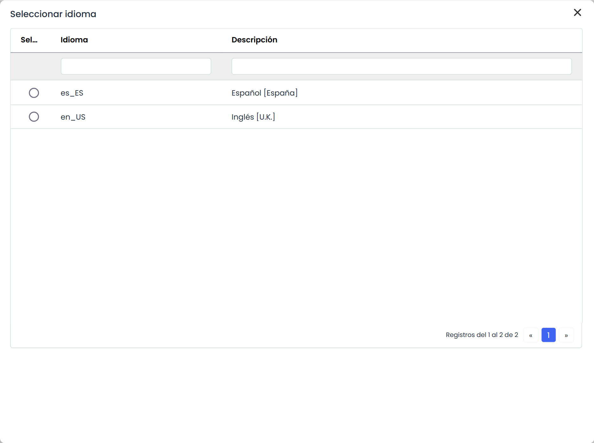
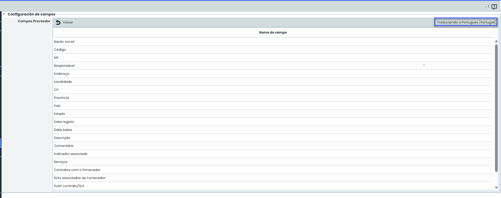
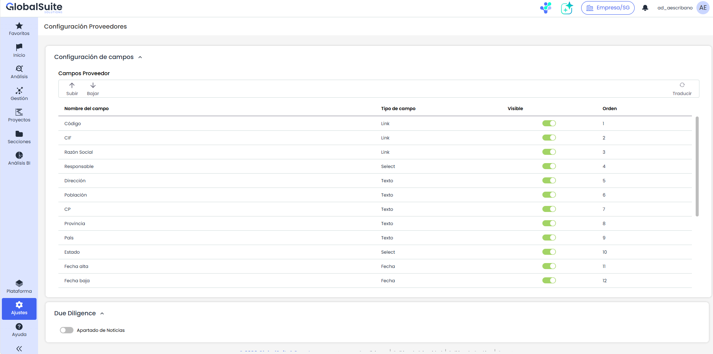

# Configuración de Proveedores

En este apartado se configuran los campos que se muestran para un proveedor, permitiendo configurar el formulario de un proveedor, pudiendo modificar y traducir los nombres de los campos, así como ordenarlos, mostrarlos u ocultarlos.

**Tabla Campos Proveedor:**

* Nombre del campo: Aquí se muestra el nombre con el que se va a mostrar el campo. Al hace doble click se puede modificar el nombre. Existe una validación para que no pueda quedar vacío.

* Tipo de campo: Es un campo informativo, no modificable, para saber que tipo de campo se está modificando.
* Visible: Es un atributo que permite configurar la visibilidad del campo dentro del formulario. Para modificarlo, haga clic sobre la celda correspondiente. Cabe destacar que existe una excepción: el campo "Razón Social" no se puede ocultar.
* Orden: Muestra el orden en que se van a mostrar los campos en el formulario. Se configura utilizando los botones Subir y Bajar que se encuentran en la parte superior de la tabla.

**Traducir**

En el caso de que se haya cambiado el nombre a un campo o se quiera únicamente cambiar la traducción que hay por defecto para el nombre de un campo, se puede ingresar la traducción del mismo.

Para ello Presionar “Traducir”

Se abrirá una ventana en donde se listan todos los idiomas de la empresa en la que estamos trabajando:

Al seleccionar un idioma se abre la ventana en donde podremos ingresar las traducciones:

Aparecen los nombres de los campos en el idioma a traducir. Se podrán cambiar cada uno haciendo doble clic sobre la celda.

**Due Diligence**

Debajo de la configuración de campos se muestra el apartado **Due Diligence**, que permite habilitar el apartado de noticias de proveedores.

* Apartado de Noticias: activa la visualización de las noticias de Due Diligence en la opción de Proveedores. En caso de tener activado un conector del Marketplace para obtener noticias de proveedores, habilite este campo para visualizarlas en la opción.

Al activar esta opción se añade automáticamente a la tabla Campos Proveedor un campo "Noticias" de tipo "Due Diligence", visible y en el último orden disponible. Si se desactiva, el campo se oculta pero el histórico de noticias del proveedor se conserva.

Para conocer el funcionamiento del apartado, consulte [Noticias y Cumplimiento](https://globalsuitesolutions.atlassian.net/wiki/pages/createpage.action?spaceKey=globalsuitees&title=Noticias%20y%20Cumplimiento&linkCreation=true&fromPageId=2065104904).
