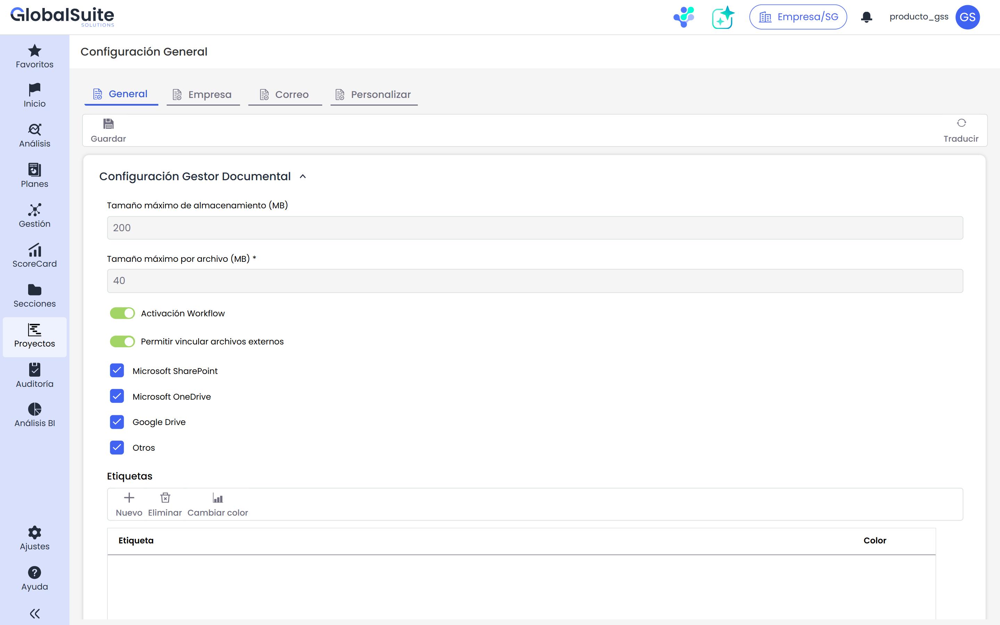

# Configuración General

Las opciones de configuración permiten personalizar y parametrizar la herramienta para ajustar no solo algunos valores predeterminados, sino también para implementar los procedimientos, valores y opciones específicos de cada empresa.

Las opciones de configuración permiten personalizar y parametrizar la herramienta para ajustar no solo algunos valores predeterminados, sino también para implementar los procedimientos, valores y opciones específicos de cada empresa.

El apartado "Configuración General" está organizado en varias pestañas, entre ellas:

* **General**: Muestra las opciones de configuración predeterminadas de la herramienta.
* **Empresa**: Permite configurar los detalles específicos de la empresa, incluyendo:

  * **Configuración SMTP**: Configura los ajustes para el envío de correos electrónicos.
  * **Doble Factor de Autenticación**: Activa y configura la autenticación de doble factor (2FA).
* **Correo**: Permite definir el formato HTML para los correos electrónicos enviados desde la plataforma, adaptando el diseño y el contenido de los mensajes a las necesidades del sistema de gestión.
* **Personalizar**: Permite configurar la imagen corporativa de la empresa: el **logotipo** y los **colores de marca**, que se aplican a toda la interfaz. Consulta [Personalización](personalizacion.md).

Entre las opciones de configuración generales disponibles en estas pestañas se encuentran:

* [Configuración de Normas](configuracion-de-normas.md)
* [Configuración Alcance](configuracion-alcance.md)
* [Configuración de Evidencias](configuracion-de-evidencias.md)
* [Configuración Empresa](configuracion-empresa.md)
* [Propiedades Configuración de Gestión](propiedades-configuracion-de-gestion.md)
* [Configuración Gestor Documental](configuracion-gestor-documental.md)
* [Propiedades Configuración Actas de Reunión](propiedades-configuracion-actas-de-reunion.md)
* [Configuración de Partes Interesadas](configuracion-de-partes-interesadas.md)
* [Configuración de Etiquetas](configuracion-de-etiquetas.md)
* [Configuración de Roles y Responsabilidades](configuracion-de-roles-y-responsabilidades.md)
* [Configuración Estructura Organizativa](configuracion-estructura-organizativa.md)
* [Configuración Correo](configuracion-correo.md)
* [Personalización](personalizacion.md)
