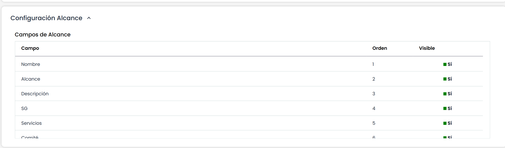

# Configuración Alcance

Este apartado permite la posibilidad de mostrar u ocultar campos del formulario de Inicio > [Alcance](https://help.globalsuite.es/display/GlobalSUITEes/.Alcance+vv5.1) y personalizar los nombres de campos y traducirlos a todos los idiomas disponibles en el entorno.

Los campos de esta tabla son:

* **Campo:**Muestra el nombre identificador del campo. Puede modificarse haciendo doble click sobre el mismo.
* **Orden:**Esta columna indica el orden de cada campo dentro del bloque.
* **Visible:** Indica si la visibilidad del campo esta o no activada. Esta opción permite mostrar u ocultar un campo.


\*\*NOTA:\*\*  El informe generado en la opción se adaptará a esta personalización de campos.

