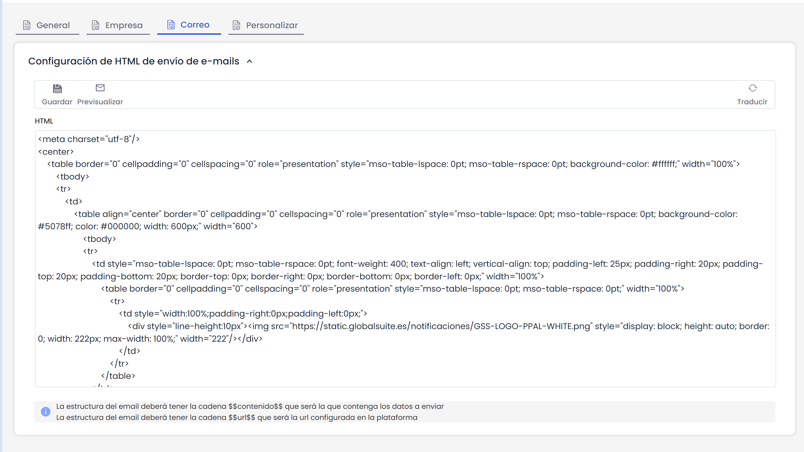

# Configuración Correo

Ofrece la posibilidad al usuario de parametrizar el formato de envío de notificaciones realizadas por la plataforma. Por defecto GlobalSUITE ofrece un formato especifico, que se puede modificar introduciendo la cadena de caracteres $$contenido$$ seguido del texto que desee el usuario que aparezca en las notificaciones.

Al pulsar sobre el botón ‘Previsualizar’ el usuario podrá ver como se mostrarán las notificaciones a los usuarios.

