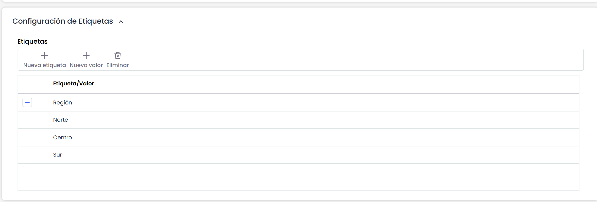

# Configuración de Etiquetas

Esta sección sólo está disponible en aquellas empresas que dispongan de subentidades. Las empresas que tengan una única entidad, la sección no aparece visible.

Esta tabla permite definir un conjunto de etiquetas que podrán asociarse a las subentidades. Una subentidad podrá tener una o varias etiquetas, con los valores correspondientes. La tabla permite las siguientes acciones:

* **Nueva etiqueta:** Este botón permite crear una etiqueta nueva. El nombre de la etiqueta se puede editar haciendo doble click sobre el nombre.
* **Nuevo valor:** Este botón permite crear un valor a una etiqueta. Para ello, se debe seleccionar previamente la etiqueta deseada y pulsar sobre el botón. Los valores de las etiquetas pueden editarse haciendo doble click sobre el nombre.
* **Eliminar:** Permite eliminar una etiqueta o un valor de la tabla, seleccionado la fila deseada y pulsando sobre el botón.

