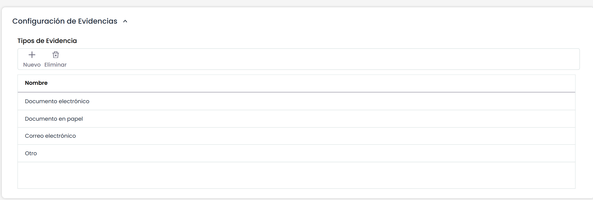

# Configuración de Evidencias

Esta sección sólo está disponible en las empresas que dispongan de la opción "Gestión de Evidencias", en función de los módulos contratados. Las empresas que no tengan dicha opción, la sección no aparece visible.

La tabla permite crear tipos de evidencia, que estarán disponibles para su asociación con las evidencias registradas en la herramienta. La tabla permite las siguientes acciones:

* **Nuevo:** Este botón permite crear una nueva fila en la tabla. El nombre del tipo de evidencia se puede editar haciendo doble click en la columna correspondiente.
* **Eliminar:** Permite eliminar uno o varios tipos en la tabla. Para ello se debe seleccionar la fila o filas deseadas y pulsar sobre el botón ‘Eliminar’.

