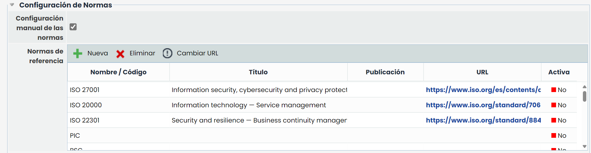

# Configuración de Normas

En este apartado se puede configurar qué normas, estándares o regulaciones se van a gestionar en el sistema.

* **Configuración manual de las normas:** Este campo permite que, cuando esté activado, la configuración de las normas se realiza desde la tabla inferior. En caso de estar desactivado no se podrán configurar.
* **Normas de referencia:** Es el listado de normas que es posible configurar para utilizar en otros apartados de la herramienta, como [Alcance](../../inicio/alcance.md) o [Auditorías](../../planes/auditorias.md).

  * Nueva: Permite introducir un nuevo registro en la tabla
  * Eliminar: Permite eliminar las normas seleccionadas
  * Cambiar URL: Permite modificar el campo URL, el cual debe tener una estructura concreta de dirección web.

Los campos de esta tabla son:

* **Nombre / Código:** Es el campo principal de la normativa.
* **Título:** Permite indicar una descripción o nombre más extenso de la norma
* **Publicación:** Sirve para indicar el período en que se publicó la norma
* **URL:** Permite indicar una dirección o link de la norma
* **Activa:** Sirve para indicar qué normas están activas o no.
