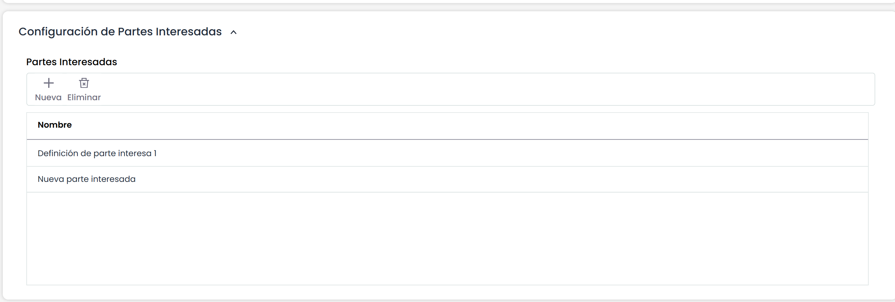

# Configuración de Partes Interesadas

Esta sección permite configurar el listado de partes interesadas, de forma que cada proceso registrado en la opción 'Procesos' del menú 'Inicio' podrá tener asociadas las partes interesadas que le apliquen.

* **Partes Interesadas:** Esta tabla contiene las partes interesadas de la organización, que podrán asociarse a los procesos de negocio definidos en la herramienta. La tabla permite las siguientes acciones:

  * **Nueva:** Permite insertar una parte interesada en la tabla.
  * **Eliminar:** Permite eliminar una o varias partes interesadas en la tabla. Para ello se debe seleccionar la fila o filas deseadas y pulsar sobre el botón ‘Eliminar’.

