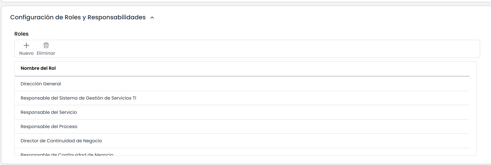

# Configuración de Roles y Responsabilidades

La definición de roles y responsabilidades es parte una fundamental de los sistemas de gestión. Para ello, la plataforma posibilita definir los roles existentes en la organización, que serán los encargados de la gestión del sistema.

Para añadir nuevos roles, se pulsa el botón ‘Nuevo’. Para eliminar un rol se selecciona la línea deseada y pulsamos botón ‘Eliminar’.

