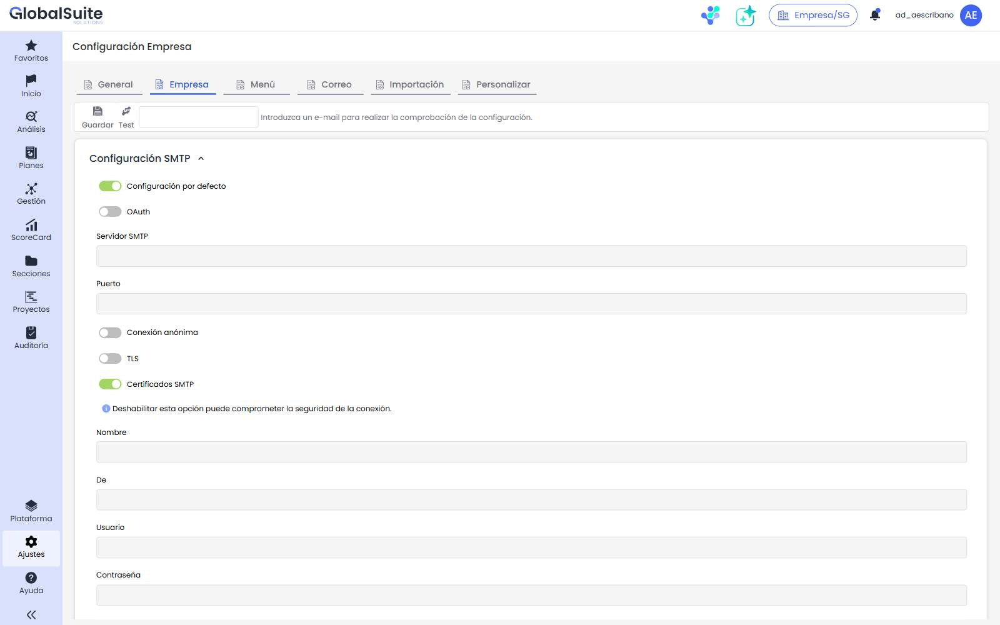

# Configuración Empresa


En esta sección se configuran las opciones específicas de la empresa relacionadas con el \*\*correo\*\* y la \*\*seguridad de acceso\*\*: el servidor SMTP para la gestión de correos, la autenticación de doble factor y la gestión del envío de registros a sistemas externos.



Actualmente, la configuración del \*\*logotipo\*\* ya no se realiza en esta pantalla: se ha trasladado a \*\*Ajustes > Configuración General > Personalizar\*\*. Consulta [Personalización](https://globalsuitesolutions.atlassian.net/wiki/spaces/GlobalSUITEes/pages/2006417409/Personalizaci+n).


## Configuración SMTP

Permite configurar el servidor de correo saliente (SMTP) que GlobalSuite® utiliza para enviar las notificaciones y los correos de la plataforma. La configuración se guarda con **Guardar** y puede comprobarse con **Test**, que envía un correo de prueba a la dirección indicada y muestra el resultado en *Resultado Test*.

* **Configuración por defecto:** utiliza el servidor SMTP predeterminado de GlobalSuite®. Al desactivarla, se habilitan los campos para configurar un servidor propio.
* **OAuth:** habilita la autenticación mediante OAuth 2.0 (recomendada para proveedores como Microsoft 365 o Google que requieren autenticación moderna) en lugar de usuario y contraseña.
* **Servidor SMTP:** dirección (host) del servidor de correo saliente.
* **Puerto:** puerto de conexión del servidor SMTP (por ejemplo, 587 o 465).
* **Conexión anónima:** establece la conexión sin autenticación (sin usuario ni contraseña).
* **TLS:** habilita el cifrado TLS en la conexión con el servidor.
* **Certificados SMTP:** valida el certificado del servidor. Se recomienda mantenerlo activado; deshabilitar esta opción puede comprometer la seguridad de la conexión.
* **Nombre:** nombre que se mostrará como remitente de los correos.
* **De:** dirección de correo que figurará como remitente.
* **Usuario:** usuario de autenticación en el servidor SMTP.
* **Contraseña:** contraseña de autenticación del usuario indicado.


Tras introducir los parámetros, utiliza \*\*Test\*\* con una dirección de correo para verificar que el envío de notificaciones funciona correctamente, y pulsa \*\*Guardar\*\* para aplicar la configuración.


## Doble Factor de autenticación:

Permite la posibilidad de incorporar un segundo factor de autenticación en la herramienta GlobalSuite®:

* De manera adicional al mecanismo de autenticación actual (**Local**, **Active Directory** o **ADFS Single Sign-On**), se puede activar un **segundo factor de autenticación (2FA)** mediante **TOTP** (*Time-Based One-Time Password*) o **Correo Electrónico**.

  El mecanismo **TOTP** permite sincronizar un dispositivo para introducir un código numérico que cambia cada 30 segundos, mientras que la opción de **Correo Electrónico** envía un **código único y temporal** al correo asociado al usuario, el cual deberá introducirse tras iniciar sesión en la herramienta.
* Esta configuración se puede activar si así se requiere, bien de forma **opcional**, o habilitarlo de forma **obligatoria**, en cuyo caso los usuarios tendrán que configurarlo forzosamente en el siguiente acceso.
* Cuenta con mecanismos de seguridad para poder acceder una única vez a la herramienta (Códigos de Recuperación), así como poder desactivarse para un usuario concreto (entrando en su perfil de usuario) en caso de pérdida o borrado del dispositivo asociado.


\*\*NOTA:\*\* El administrador de GlobalSuite® es quien puede decidir si activar o no esta configuración, y en caso de hacerlo, establecer si será opcional u obligatoria.


En el desplegable de la configuración hay tres opciones:

* **Deshabilitado:** El acceso a GlobalSuite® se realizará únicamente con las claves de acceso.
* **Obligatorio:** En el acceso se abrirá automáticamente una ventana emergente solicitando la configuración del doble factor de seguridad para nuestro usuario. Todos los usuarios deberán configurarlo en el mismo instante si tienen la sesión abierta o forzosamente la siguiente vez que inicien sesión en GlobalSuite®, no permitiéndoles continuar si no lo hacen.
* **Opcional:** Cada usuario deberá activarlo individualmente en [Mi Perfil](../../general/area-de-usuario/mi-perfil.md) y deberá seguir los pasos indicados en la ventana emergente. Por defecto, el uso del doble factor de autenticación está habilitado de manera optativa.
