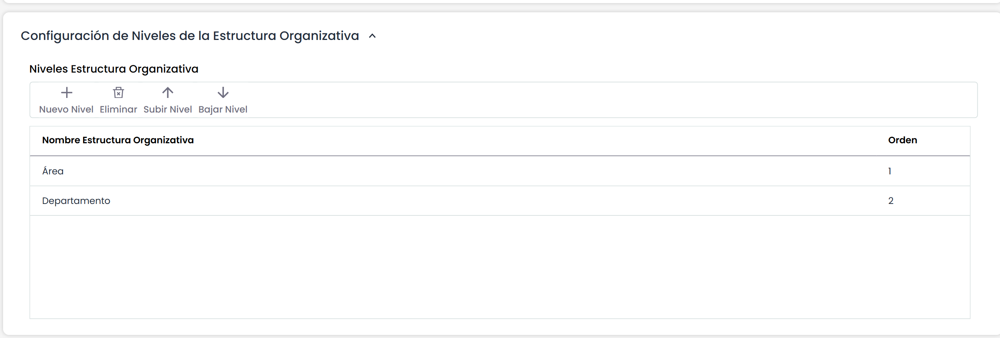

# Configuración Estructura Organizativa


El presente opción ofrece la posibilidad de definir la estructura organizativa de la organización. Para ello se establecen las siguientes opciones:


* **Nuevo Nivel:** Permite insertar una nueva entrada en la tabla para la definición de una unidad estructural. Para poder modificar el nombre se ha de pulsar dos veces sobre la celda e incluir el nombre deseado.
* **Eliminar:**Permite eliminar una entrada de la tabla. Para ello se ha de seleccionar la entrada y pulsar sobre el botón para suprimirel nivel.
* **Subir Nivel:**Ofrece la posibilidad de elevar uno o varios niveles una entrada ya definida
* **Bajar Nivel:**Ofrece la posibilidad de descender uno o varios niveles una entrada ya definida


\*\*NOTA:\*\* La definición de elementos de la estructura organizativa se visualizará en las siguientes opciones:
\* \*\*Inicio/Catálogo de Servicios\*\*
\* \*\*Inicio/Procesos de Negocio\*\*
\* \*\*Gestión/Empleados\*\*


