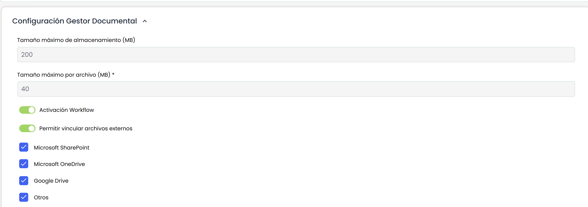
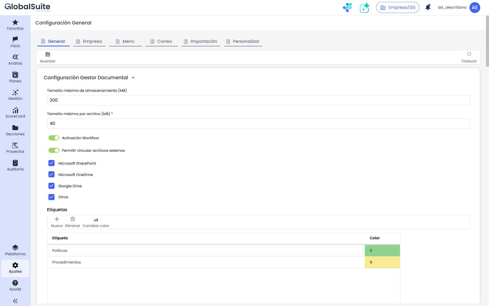

# Configuración Gestor Documental

Este apartado permite configurar aspectos específicos del Gestor Documental:

* **Tamaño máximo de almacenamiento:** Permite establecer el límite de almacenamiento (Megabytes) del gestor documental. Este espacio de almacenamiento va asociado al licenciamiento contratado y sólo puede ser modificado por el departamento de soporte de GlobalSUITE®.
* **Tamaño máximo por archivo:** Permite definir cuál será el tamaño máximo de los archivos adjuntos que se pueden subir a la herramienta. Por defecto este tamaño de archivo es de 40MB, aunque es posible ampliarlo hasta un máximo de 100MB. Sólo puede ser modificado por el departamento de soporte de GlobalSUITE®.
* **Activación Workflow:** Permite activar la funcionalidad de workflows de gestión documental.


\*\*NOTA:\*\* En caso de estar desactivado para la empresa matriz, ninguna de las  subentidades podrá hacer uso del Workflow. En cambio, si está habilitado a nivel de matriz, todas las subentidades lo tendrán activado por defecto. No obstante se podrá desactivar para las subentidades que así lo requieran en el apartado Ajustes> Opciones > [Subentidades](https://help.globalsuite.es/display/GlobalSUITEes/.Subentidades+vv6.23)


* **Visualización inicial Gestor Documental:** Permite configurar la vista del gestor documental al acceder a la opción. Existen tres opciones: Expandida, Contraída y Expandido sólo el primer nivel.

## Vinculación de archivos externos

Permite habilitar que los usuarios **enlacen archivos externos** (mediante su URL) desde repositorios y gestores de contenido corporativos, para utilizarlos en el Gestor Documental **sin duplicarlos**.

* **Permitir vincular archivos externos:** activa o desactiva la posibilidad de vincular archivos externos en el Gestor Documental. Está **activada por defecto**.

Cuando la opción está activada, se muestran los **orígenes permitidos**, que pueden marcarse o desmarcarse de forma independiente:

* **Microsoft SharePoint**
* **Microsoft OneDrive**
* **Google Drive**
* **Otros** (URL libre)

Al vincular un archivo, el sistema valida que su URL corresponda a uno de los orígenes habilitados. Esta configuración se incluye en la **copia de empresa**.


El uso de la opción \*\*Vincular archivo externo\*\* dentro del Gestor Documental se describe en la página [Mis Archivos](https://globalsuitesolutions.atlassian.net/wiki/spaces/GlobalSUITEes/pages/1610383386/Mis+Archivos).

