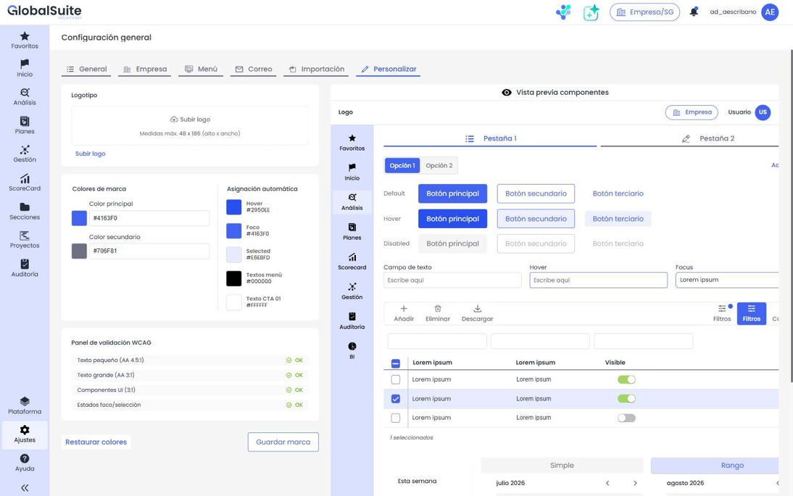
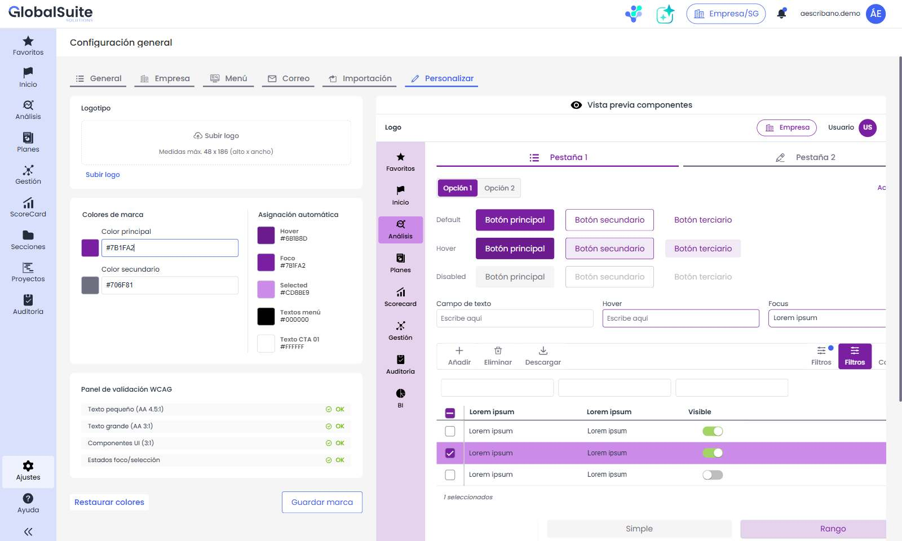

# Personalización


La pestaña \*\*Personalizar\*\* reúne en un solo lugar la configuración de la \*\*imagen corporativa\*\* de la empresa dentro de GlobalSuite®: el \*\*logotipo\*\* y los \*\*colores de marca\*\*. Se accede desde \*\*Ajustes > Configuración General > Personalizar\*\*.


La personalización de la interfaz está unificada en este apartado y se amplía con la **configuración de colores corporativos**, que se aplican de forma coherente a toda la interfaz de la empresa.

## Logotipo

Permite **subir, sustituir o eliminar** el logotipo corporativo que se muestra en la plataforma. El logotipo admite un tamaño máximo de **48 x 186 px (alto x ancho)**.


La configuración del logotipo se ha \*\*trasladado\*\* desde \*Configuración Empresa\* a esta pestaña \*\*Personalizar\*\*.


## Colores de marca

Se definen **dos colores base** que representan la identidad de la empresa. Cada color puede indicarse con el **selector visual** o introduciendo directamente su **valor hexadecimal**:

* **Color principal** — color corporativo dominante (por defecto `#4163F1`).
* **Color secundario** — color de apoyo (por defecto `#706F81`).

Si la empresa no tiene una personalización guardada, se muestran los **colores por defecto** de GlobalSuite®.

## Asignación automática

A partir de los colores base, el sistema **calcula automáticamente** el resto de colores que necesita la interfaz. Estos valores **no son editables** manualmente y se recalculan al cambiar los colores base. Incluyen, entre otros:

* **Hover** — estado al pasar el cursor.
* **Foco** — elemento con el foco activo.
* **Selected** — elemento seleccionado.
* **Textos de menú** y **Texto CTA** — color de texto e iconos sobre superficies coloreadas, elegido automáticamente (blanco o negro) para garantizar el contraste.

## Validación de accesibilidad (WCAG 2.2 AA)

El **Panel de validación WCAG** comprueba en tiempo real que la combinación de colores cumple los umbrales de contraste y legibilidad:

* **Texto pequeño** — contraste mínimo 4.5:1.
* **Texto grande** — contraste mínimo 3:1.
* **Componentes UI** e indicadores gráficos — contraste mínimo 3:1.
* **Estados de foco / selección**.

Cada comprobación se muestra como correcta o no cumplida. Cuando alguna combinación **no cumple**, aparece la acción **Corregir**, que ajusta automáticamente los colores hasta obtener una combinación accesible manteniendo la máxima cercanía posible con la marca.

## Vista previa de componentes

La parte derecha de la pantalla muestra una **vista previa** con componentes representativos de GlobalSuite® (menús, pestañas, botones, campos de texto, filtros, tablas, toggles, selector de fechas, etc.). La vista previa se actualiza **en tiempo real** al modificar cualquier color o el logotipo, **sin necesidad de guardar**, para poder valorar el resultado antes de aplicarlo.

## Guardar y restaurar

* **Guardar marca** — persiste de forma conjunta el logotipo y los colores para la empresa activa y aplica la personalización a la plataforma.
* **Restaurar colores** — devuelve la configuración a los **colores por defecto** de GlobalSuite®.

Las acciones de guardado y restauración se muestran cuando existen cambios sin guardar.

## Aplicación en toda la plataforma

La personalización guardada se aplica de forma **transversal** a toda la interfaz operativa de la empresa: menú superior, menú lateral y submenús, módulos y componentes comunes (modales, tablas, botones, filtros, selectores de fecha, etc.). En el caso de usuarios multitenant, los colores y el logotipo se cargan según la **empresa activa**; si un usuario cambia de empresa, la interfaz se actualiza con la personalización correspondiente.


La personalización de colores \*\*no\*\* modifica la tipografía ni afecta a las pantallas de \*\*login/logout\*\*, a los \*\*informes\*\* ni a las \*\*plantillas de correo\*\*, que se configuran por separado. Para una guía completa de personalización (logo, colores, correos y login) consulta el tutorial \*¿Cómo personalizar GlobalSuite®?\*

