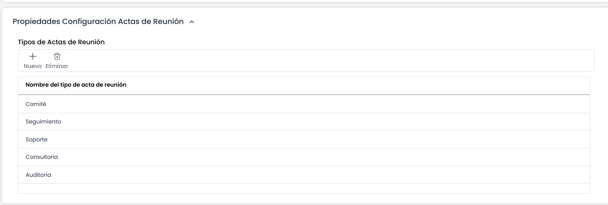

# Propiedades Configuración Actas de Reunión

El apartado de configuración de actas de reunión, permite parametrizar las diferentes tipologías de actas de reunión. GlobalSUITE identifica por defecto comité, seguimiento, soporte y consultoría, pero se pueden añadir nuevas o eliminar pulsando los botones ‘Nuevo’ y ‘Eliminar’.

