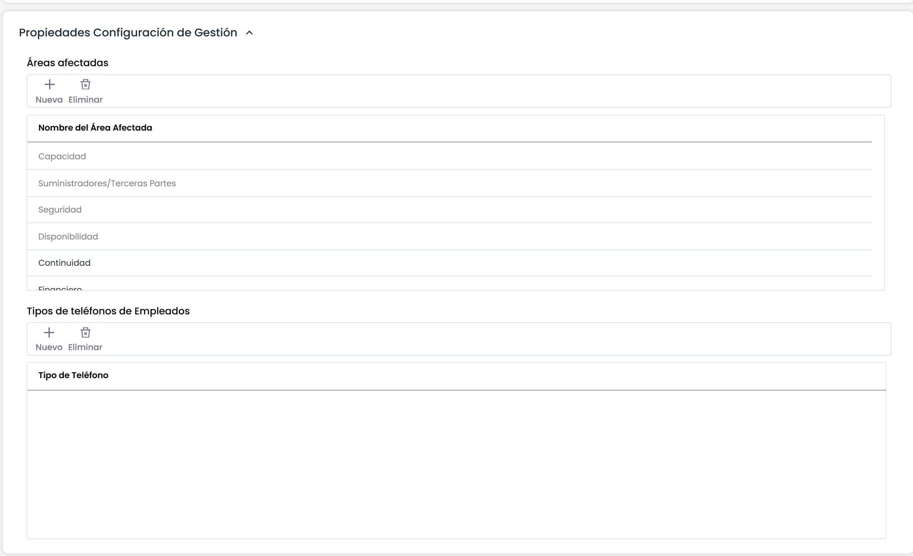

# Propiedades Configuración de Gestión


Este apartado permite la parametrización de listas desplegables ubicadas en las opciones del menú Gestión.


## **Áreas afectadas:**

Permite al usuario incorporar diferentes áreas afectadas que podrán asignarse a los tickets. Utilizando los botones ‘Nueva’ y ’Eliminar’ se permite crear nuevas áreas o eliminar las áreas ya existentes, así como editar su nombre haciendo doble click sobre la fila.

La herramienta propone por defecto las áreas de Capacidad, Suministradores, Seguridad y Disponibilidad, en función de los módulos habilitados. Estas áreas no se pueden modificar ni eliminar ya que están relacionadas con opciones de GlobalSUITE para proveer funcionalidad específica. En concreto:

* **Capacidad:** Las incidencias, no conformidades e indicadores que tienen este área asignada se podrán consultar en los planes de capacidad elaborados en la opción 'Capacidad' del menú 'Planes'.
* **Suministradores/Terceras Partes:** Las incidencias, no conformidades e indicadores que tienen este área asignada se podrán asociar a un proveedor registrado en la opción 'Proveedores' del menú 'Inicio'. Una vez registrado a un proveedor, en el formulario de cada proveedor se podrá consultar todas las incidencias y no conformidades que tiene asignadas durante la evaluación, así como visualizar la gráfica del indicador que tenga relacionado.
* **Seguridad:** Todos los tickets se pueden asignar a este área para indicar que se trata de un ticket relacionado con la seguridad.
* **Disponibilidad:** Las incidencias, no conformidades e indicadores que tienen este área asignada se podrán consultar en los planes de disponibilidad elaborados en la opción 'Disponibilidad' del menú 'Planes'.

## **Tipos de teléfonos de Empleados:**

Permite crear diferentes tipos de teléfonos para identificar el teléfono de cada empleado (fijo, personal, móvil, trabajo, etc.). Los tipos configurados en esta tabla aparecen en el formulario de Empleados, dónde para cada empleado se permite crear más de un teléfono. Utilizando los botones 'Nuevo' y 'Eliminar' se permite crear nuevos tipos o eliminar los tipos ya existentes, así como editar su nombre haciendo doble click sobre la fila.
